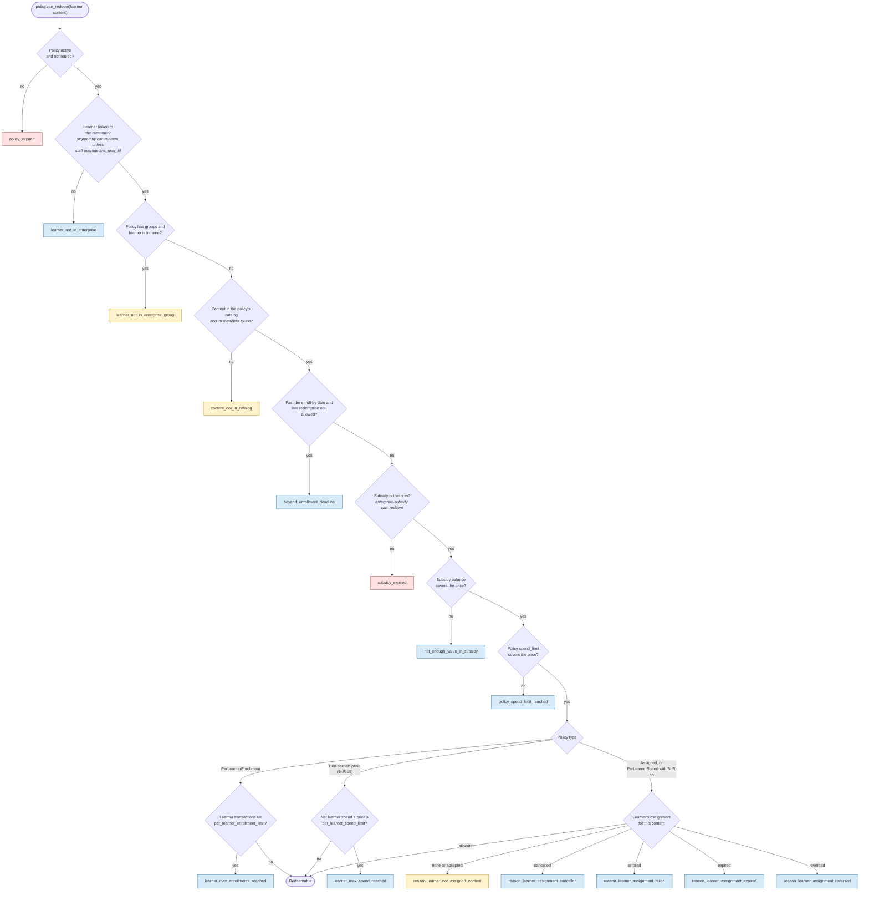
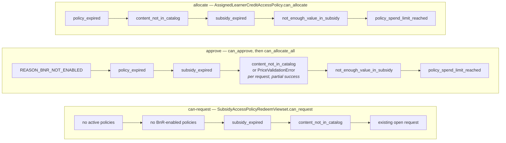
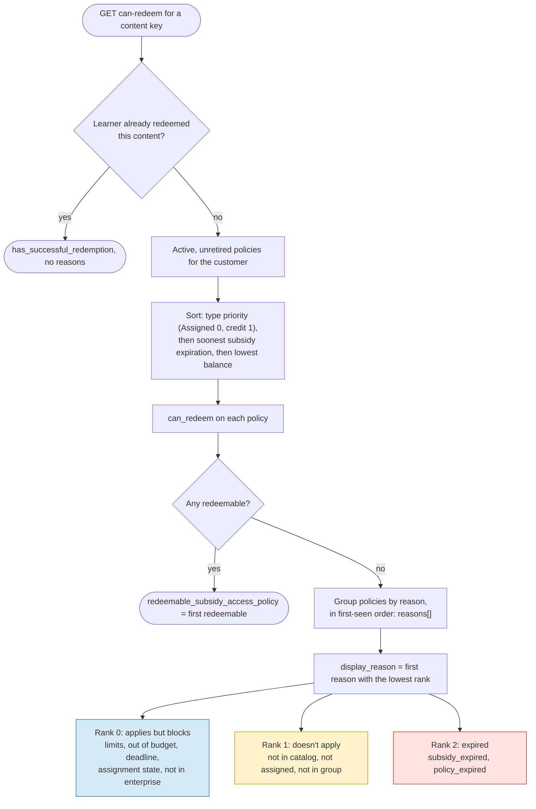
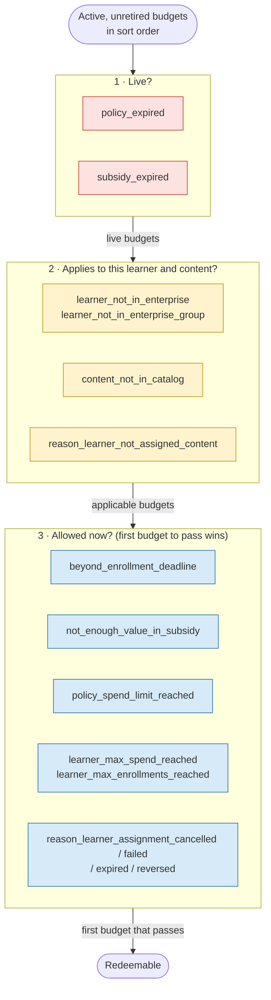

# 0038 Non-redeemable reasons by budget type, and the one a learner sees

## Status

**Proposed** (October 2026)

Sections 1–4 record how budgets are evaluated today and the `display_reason` ranking added in
[edx/enterprise-access#326](https://github.com/edx/enterprise-access/pull/326). Section 5 proposes
evaluating budgets in three stages. It keeps that messaging rule, makes it follow from the
evaluation order instead of a separate ranking, and drops remote calls that can't change the
outcome. Section 5 isn't implemented yet.

## Context

A learner credit budget is a `SubsidyAccessPolicy` record. Every eligibility check on a budget
either passes or returns a short reason slug, and those slugs drive the message a learner or admin
sees. The slugs are defined in `subsidy_access_policy/constants.py`, raised in
`subsidy_access_policy/models.py` and turned into learner-facing text in
`api/v1/views/subsidy_access_policy.py` (`_get_user_message_for_reason`). Nothing documented
which budget type raises which reason, in what order, or which reason wins when a customer has
several budgets.

That gap surfaced in [ENT-12416](https://2u-internal.atlassian.net/browse/ENT-12416). A learner over their per-learner spend limit was told
*"You can't enroll right now because your funds expired."* The customer had a live,
spend-capped budget alongside older budgets that were still active and unretired but funded by
expired subsidies. `can-redeem` evaluates every active, unretired budget, sorts expired subsidies
first (soonest expiration), and used to display the first reason it found, so the expired budget's
reason masked the one that actually blocked the learner.

The same evaluation also costs more than it needs to. Every budget runs the full chain of checks,
and the chain reaches an uncached remote call to enterprise-subsidy (`subsidy_client.can_redeem`
in `SubsidyAccessPolicy.can_redeem`) before it learns whether the subsidy is active, so expired
budgets pay for that call too. The endpoint also keeps evaluating budgets after one is
redeemable, although it only uses the first. On the last 30 days of production redemptions, an
evaluation made 4.02 of these calls per course run on average, and 22% of them went to expired
budgets (see [Performance](#performance)).

### Budget types

`PolicyTypes` (`subsidy_access_policy/constants.py`) lists every concrete budget type. All
three are proxy models of `SubsidyAccessPolicy`.

| Policy type | Priority | Limits it enforces | Type-specific reasons |
|---|---|---|---|
| `AssignedLearnerCreditAccessPolicy` | 0 | `spend_limit`; content must be assigned by an admin | `reason_learner_not_assigned_content`, `reason_learner_assignment_cancelled`, `reason_learner_assignment_failed`, `reason_learner_assignment_expired`, `reason_learner_assignment_reversed` |
| `PerLearnerSpendCreditAccessPolicy` | 1 | `spend_limit`; optional `per_learner_spend_limit` (USD cents, net of committed reversals) | `learner_max_spend_reached`. When Browse & Request (BnR) is enabled, `can_redeem` instead runs as an assigned budget and raises the assignment reasons above. |
| `PerLearnerEnrollmentCreditAccessPolicy` | 1 | `spend_limit`; optional `per_learner_enrollment_limit` (count of transactions) | `learner_max_enrollments_reached` |

Priority comes from `AssignedCreditPolicyMixin` and `CreditPolicyMixin`.
`SUBSCRIPTION_POLICY_TYPE_PRIORITY` (2) is defined but no policy type uses it.

## Decision

We record the full reason catalogue and evaluation order here, as the reference for anyone adding
a budget type or a reason. We choose `display_reason` by ranking reasons instead of taking the
first one. And we propose evaluating budgets in three stages, so the evaluation order itself
produces that ranking and skips work that can't change the outcome.

### 1. How one budget decides today

`SubsidyAccessPolicy.can_redeem` runs the shared checks in a fixed order, and each subclass adds
its own check only after they all pass. The first failing check is the budget's reason. Checks are
ordered from the learner's state, to the content, to the budget's money, as the method's docstring
describes.



Colours match the `display_reason` ranks in section 3: red is expiry, yellow is a budget that
doesn't apply, blue is a budget that applies but blocks the learner.

### 2. Reason catalogue

*Raised by* lists the budget types that can produce the reason. *Where* lists the operations that
raise it: `can-redeem` and `redeem` (learner enrolling, `can_redeem`), `allocate` (admin
assigning, `AssignedLearnerCreditAccessPolicy.can_allocate`), `approve` (admin approving BnR
requests, `can_approve` and `can_allocate_all`) and `can-request` (learner opening a BnR
request).

| Reason slug | Category | Raised when | Raised by | Where | Display rank |
|---|---|---|---|---|---|
| `policy_expired` | Expiry | The policy is inactive or retired (`is_redemption_enabled` is false). | All types | redeem, allocate, approve. `can-redeem` only evaluates active, unretired policies, so it never shows this one. | 2 |
| `subsidy_expired` | Expiry | The subsidy is outside its active window, either expired or not started yet. | All types | can-redeem, redeem, allocate, approve, can-request | 2 |
| `learner_not_in_enterprise` | Learner membership | The learner has no enterprise user record for the customer. | All types | redeem; can-redeem only with a staff `lms_user_id` override | 0 |
| `learner_not_in_enterprise_group` | Not applicable | The policy is restricted to groups and the learner is in none of them. | All types | redeem; can-redeem only with a staff `lms_user_id` override | 1 |
| `content_not_in_catalog` | Not applicable | The policy's catalog doesn't contain the content, or the subsidy has no metadata for it. | All types | can-redeem, redeem, allocate, approve (per request), can-request | 1 |
| `beyond_enrollment_deadline` | Deadline | Now is past the content's enroll-by date and late redemption isn't allowed. | All types | can-redeem, redeem | 0 |
| `not_enough_value_in_subsidy` | Out of budget | The subsidy's remaining balance can't cover the price (for allocation and approval: the already-allocated amount plus the new price). | All types | can-redeem, redeem, allocate, approve | 0 |
| `policy_spend_limit_reached` | Out of budget | The policy's `spend_limit` can't cover the price (for allocation and approval: spent plus allocated plus the new price). | All types | can-redeem, redeem, allocate, approve | 0 |
| `learner_max_spend_reached` | Limit reached | The learner's spend, net of committed reversals, plus the price exceeds `per_learner_spend_limit`. | `PerLearnerSpendCreditAccessPolicy` (BnR off) | can-redeem, redeem | 0 |
| `learner_max_enrollments_reached` | Limit reached | The learner's transaction count is at or above `per_learner_enrollment_limit`. | `PerLearnerEnrollmentCreditAccessPolicy` | can-redeem, redeem | 0 |
| `reason_learner_not_assigned_content` | Not assigned | The learner has no allocated assignment for the content. An `accepted` assignment also maps here; redemption checks already return earlier in that case. | `AssignedLearnerCreditAccessPolicy`; `PerLearnerSpendCreditAccessPolicy` with BnR on | can-redeem, redeem | 1 |
| `reason_learner_assignment_cancelled` | Not assigned | The learner's assignment was cancelled. | Same as above | can-redeem, redeem | 0 |
| `reason_learner_assignment_failed` | Not assigned | The learner's assignment errored. | Same as above | can-redeem, redeem | 0 |
| `reason_learner_assignment_expired` | Not assigned | The learner's assignment expired. | Same as above | can-redeem, redeem | 0 |
| `reason_learner_assignment_reversed` | Not assigned | The learner's assignment was reversed. | Same as above | can-redeem, redeem | 0 |
| `REASON_BNR_NOT_ENABLED` | Not applicable | An admin approves a request on a policy without an active BnR config. The constant holds the message ("This policy does not support BNR."), not a slug. | All types | approve | n/a |

Admin and BnR flows raise a subset of these, in their own order:



The `can-request` checks run across all of the customer's BnR budgets at once rather than per
budget, and three of them return plain text rather than a slug.

### 3. Which reason the learner sees

`can-redeem` evaluates every budget for the content and groups budgets by reason. When none is
redeemable it returns all the reasons, plus a single `display_reason` that the learner portal
shows as-is.



The ranking lives in `_display_reason_rank` (`api/v1/views/subsidy_access_policy.py`):

* **Rank 0, applies but blocks.** The budget would fund this learner and content but something is
  in the way: a per-learner limit, the budget or subsidy is out of money, the enroll-by date has
  passed, or the learner's assignment is in a terminal state. This is what the learner can act on.
* **Rank 1, doesn't apply.** The budget was never going to fund this learner and content. Assigned
  budgets sort first, so without this rank an assigned budget with nothing assigned would mask a
  browse-and-enroll budget's limit.
* **Rank 2, expired.** The budget is no longer usable at all. It's shown only when every budget
  is expired.

`min()` returns the first reason with the lowest rank, so the sort order above still decides
between reasons of the same rank. The `reasons` list and the response shape are unchanged, and
`redeem` and `allocate`, which only ever pass a single reason, are unaffected. Section 5 proposes
producing this ranking from the evaluation order instead.

### 4. Learner-facing messages

`_get_user_message_for_reason` maps slugs to `MissingSubsidyAccessReasonUserMessages`. The
"no admins" variants are used when the customer has no admin contact.

| Reason slug | Message |
|---|---|
| `subsidy_expired` | `ORGANIZATION_EXPIRED_FUNDS`: "...because your funds expired." |
| `policy_expired`, `not_enough_value_in_subsidy`, `policy_spend_limit_reached` | `ORGANIZATION_NO_FUNDS`: "...because your organization doesn't have enough funds." |
| `learner_max_spend_reached`, `learner_max_enrollments_reached` | `LEARNER_LIMITS_REACHED`: "...because of limits set by your organization." |
| `content_not_in_catalog` | `CONTENT_NOT_IN_CATALOG` |
| `beyond_enrollment_deadline` | `BEYOND_ENROLLMENT_DEADLINE` |
| `learner_not_in_enterprise` | `LEARNER_NOT_IN_ENTERPRISE` |
| `reason_learner_not_assigned_content`, `reason_learner_assignment_failed` | `LEARNER_NOT_ASSIGNED_CONTENT` |
| `reason_learner_assignment_cancelled` | `LEARNER_ASSIGNMENT_CANCELED` |
| `learner_not_in_enterprise_group`, `reason_learner_assignment_expired`, `reason_learner_assignment_reversed` | **None.** The learner portal has no fallback for these slugs either. |

### 5. Proposed: evaluate budgets in three stages

Sections 1 and 3 describe two orderings that don't agree: the order a budget runs its checks, and
the rank used to choose between budgets. The ranking compensates after the fact. If the check
order *is* the priority order, the ranking needs no table of its own, and work that can't change
the outcome can be skipped.

Every check belongs to one of three stages, run in this order:

1. **Live?** Is the budget usable at all?
2. **Applies?** Does it cover this learner and this content?
3. **Allowed now?** Can it pay for this enrollment right now?

A budget stops at its first failing check. Budgets move through the stages together, in sort
order, and stage 3 stops at the first budget that passes. When none passes, the learner sees
**the first reason from the furthest stage any budget reached.**



Within each stage, checks run top to bottom. This one diagram and one rule replace the section 1
flowchart and the section 3 ranking. Each stage holds exactly one rank from section 3: stage 1 is
rank 2, stage 2 is rank 1, stage 3 is rank 0. The one difference is `learner_not_in_enterprise`,
which is in stage 2 here and rank 0 in section 3. It fails for every budget of the customer alike,
so the reason shown doesn't change. Whenever each budget fails only one check, `display_reason`
is the same as section 3's.

**Design rules**

* **Stage 1 reads the subsidy record, not the remote call.** `subsidy_record()` is
  request-cached, and the sort already loads it for any customer with two or more budgets. A
  budget is skipped only when `is_active` is `False`. If the lookup failed (`{}`), the state is
  unknown and the budget goes on to stage 3, whose remote call stays authoritative. If that call
  reports the subsidy inactive, the reason is `subsidy_expired`, which still ranks as stage 1.
  Otherwise a blip in enterprise-subsidy would tell learners their funds expired.
* **Within a stage, checks keep today's order**, so a budget's own reason changes only where a
  check moves to an earlier stage (see [Consequences](#consequences)).
* **Stop at the first redeemable budget.** The endpoint only uses `redeemable_policies[0]`, so
  budgets after it don't need evaluating.
* **One ordered check table.** Each check declares its stage and which budget types it applies
  to. That replaces the `super().can_redeem()` chains, the Browse & Request `copy_context_to`
  path in `can_redeem`, and the two hand-kept reason sets behind section 3. Tests enforce that
  every `REASON_*` slug belongs to exactly one stage, that stages never go backwards in the table,
  and that every reason has a learner message.
* **Optional: one remote call per subsidy.** The remote call takes `(subsidy, learner, content)`
  and doesn't depend on the budget, so budgets that share a subsidy can share its answer within a
  request. It must stay request-scoped: balances change between requests, and `redeem` keeps its
  own authoritative call under the policy lock.
* **One audit log line per evaluation**, listing each budget's furthest stage and reason, and the
  reason shown. Explaining a message like the one in ENT-12416 then takes a log search, not
  replica queries.

A sketch of the shape:

```python
class Stage(IntEnum):
    LIVE = 1     # is the budget usable at all?
    APPLIES = 2  # does it cover this learner and this content?
    ALLOWED = 3  # can it pay for this enrollment right now?

# Ordered. Stages never go backwards (a test enforces it); within a stage, today's order is kept.
CHECKS = (
    Check(Stage.LIVE, policy_disabled),                # policy_expired
    Check(Stage.LIVE, subsidy_known_inactive),         # subsidy_expired, from the cached record
    Check(Stage.APPLIES, learner_excluded),            # learner_not_in_enterprise / _group
    Check(Stage.APPLIES, content_not_in_catalog),
    Check(Stage.APPLIES, no_assignment, applies_to=uses_assignments),
    Check(Stage.ALLOWED, past_enroll_by),
    Check(Stage.ALLOWED, subsidy_cannot_pay),          # the one remote call
    Check(Stage.ALLOWED, policy_spend_exceeded),
    Check(Stage.ALLOWED, learner_spend_exceeded, applies_to=spend_capped_without_bnr),
    Check(Stage.ALLOWED, learner_enrollments_exceeded, applies_to=enrollment_capped),
    Check(Stage.ALLOWED, assignment_not_allocated, applies_to=uses_assignments),
)

def evaluate(sorted_policies, request):
    failures, candidates = [], list(sorted_policies)
    for stage in Stage:
        survivors = []
        for policy in candidates:
            reason = first_failure(policy, stage, request)  # this stage's checks, in order
            if reason:
                failures.append((stage_of(reason), policy, reason))
            elif stage is Stage.ALLOWED:
                return policy, failures                     # first budget to pass everything
            else:
                survivors.append(policy)
        candidates = survivors
    return None, failures

def display_failure(failures):
    furthest = max(stage for stage, _, _ in failures)
    return next(f for f in failures if f[0] == furthest)
```

**Rollout**

1. Refactor only: the check table and engine, keeping today's order. Existing tests pass
   unchanged, which shows the refactor changes nothing.
2. Reorder into stages, skip expired budgets in stage 1, stop at the first redeemable budget,
   and replace the section 1 and section 3 diagrams with the one above.
3. Add the per-subsidy cache, the audit log line and the three missing messages (needs copy from
   product).

`allocate` already runs live, applies, allowed, except that it checks the catalog before the
subsidy's expiry. `approve` and `can-request` already check expiry before the catalog. They can
share stages 1 and 2 later; their stage 3 amounts differ.

## Performance

Remote calls dominate the cost of `can-redeem`, and local work is the same in both designs.
Evaluation is sequential, so time spent waiting on enterprise-subsidy grows with the number of
calls.

| Symbol | Meaning |
|---|---|
| K | Content keys in the request. The course page sends every available run (`canRedeem(courseRunKeys)` in the learner portal). |
| P | Active, unretired budgets the customer has, which is the set `can-redeem` evaluates. |
| P_c | Budgets whose catalog contains the content and whose enroll-by date hasn't passed. These reach the remote call today, expired or not. |
| P_live | Budgets whose subsidy is active now. |
| P_app | Live budgets that pass stage 2. |
| r | Position, among the P_app budgets in sort order, of the first one that passes stage 3 (r = P_app when none does). |
| S, S_app | Distinct subsidies among all P budgets, and among the P_app budgets. |
| ℓ | One round trip to enterprise-subsidy's `can_redeem`. |

| Cost per `can-redeem` request | Today | Three stages | Stages + per-subsidy cache |
|---|---|---|---|
| Uncached remote `can_redeem` calls | Θ(K·P_c), at most O(K·P) | O(K·min(r, P_app)) | O(K·min(r, S_app)) |
| ...when the first applicable budget is redeemable | Θ(K·P_c) | Θ(K) | Θ(K) |
| ...when every budget has expired | Θ(K·P_c) | 0 | 0 |
| ...when the learner is blocked by every budget | Θ(K·P_c) | Θ(K·P_app) | Θ(K·S_app) |
| Catalog lookups (TieredCache, remote on a miss) | Θ(K·P) | Θ(K·P_live) | Θ(K·P_live) |
| Policy spend aggregates (request-cached per budget) | O(P_live) | O(P_app) | O(P_app) |
| Subsidy-record lookups (request-cached per subsidy) | Θ(S) when P ≥ 2, none when P = 1 | Θ(S) | Θ(S) |
| Local work (sort and checks) | O(P log P + K·P) | O(P log P + K·P) | O(P log P + K·P) |
| Choosing `display_reason` | O(P) | O(P) | O(P) |

The dominant term improves by a factor of P_c / min(r, P_app): budgets that contain the content,
divided by the live, applicable budgets checked before one passes. Time waiting on
enterprise-subsidy falls in the same proportion, from Θ(K·P_c·ℓ) to O(K·min(r, P_app)·ℓ).

### Measured on production data

To check these bounds against real traffic, we replayed the last 30 days of production
redemptions through both designs using the read replicas:

* **Workload:** 3,246 committed redemptions from `enterprise_subsidy`, each treated as one
  evaluation of one content key at the redeeming customer.
* **Budgets:** each customer's current active, unretired budgets from `enterprise_access`, with
  subsidy liveness from `enterprise_subsidy`.
* **Catalog membership:** from `enterprise_catalog`, following `get_matching_content`: a
  catalog contains a run if it holds the run itself, the run's course, or (for a course key) one
  of its runs.

| Remote `can_redeem` calls per content key | Today | Three stages | Stages + per-subsidy cache |
|---|---|---|---|
| Learner can enroll: mean / p95 / max | 4.02 / 10 / 22 | 1.49 / 2 / 7 | 1.26 / 2 / 7 |
| Learner can enroll: total over the sample | 12,703 | 4,717 (−63%) | 3,985 (−69%) |
| Learner blocked by every budget: total over the sample | 12,703 | 9,956 (−22%) | 4,236 (−67%) |

* Stopping at the first redeemable budget alone, without stage 1, gives 7,363 (−42%). Skipping
  expired budgets supplies the rest.
* 2,747 of today's 12,703 calls (22%) go to expired budgets, which can only answer "inactive".
* The stages make fewer calls in 48% of evaluations. In the rest both make the same number,
  usually one: the median evaluation has a single budget that contains the course.
* Across all customers: 998 evaluated budgets at 527 customers, 594 of them (60%) on expired
  subsidies. 273 customers have only expired budgets, so their evaluations make no remote calls
  under the stages. The largest customer has 22 budgets, 7 of them live.
* Spot check against ENT-12416: for every course that customer's learners redeemed, today makes
  4 calls, 3 of them to expired budgets. The stages make 1.
* On the enroll path, waiting on enterprise-subsidy drops from about 4.02ℓ to 1.49ℓ per content
  key, times K per request. ℓ wasn't measured here; Datadog APM spans for the `can_redeem` client
  call can confirm it after rollout.
* Customers with a single budget (286 of 527) are the exception. The sort skips the subsidy
  record for them today, so stage 1 adds one request-cached lookup per request: Θ(1), not Θ(K).
  For a live budget that's one extra call per request. For an expired one, it replaces K remote
  calls with that one lookup. Caching the subsidy's active window across requests would remove
  it.

Limitations of the measurement:

* Redemptions stand in for `can-redeem` traffic, so the workload leans toward learners who could
  enroll and toward popular courses. Course page views that don't end in an enrollment aren't in
  the replicas.
* Assigned budgets count as reaching stage 3 even when the learner may have no assignment there,
  so the measured savings are a lower bound.
* Enroll-by deadlines and restricted runs are ignored, and membership is computed from the
  replica tables rather than through the enterprise-catalog API.
* Current budget and subsidy state is applied to the last 30 days. 89 of the 3,246 redemptions
  (2.7%) were left out because the budget that redeemed is no longer active.
* Counts are per content key. Multiply by K for a whole request.

## Consequences

### Benefits

* **Messaging.** A learner blocked by a live budget sees that budget's reason, such as
  `learner_max_spend_reached`, instead of an expired or inapplicable budget's reason. Section 3
  delivers this now; section 5 keeps the outcome and makes it follow from the evaluation order.
* **Performance.** On the last 30 days of production redemptions, section 5 cuts uncached remote
  calls to enterprise-subsidy by 63% (69% with the per-subsidy cache) for learners who can enroll,
  and by 22% (67%) for learners blocked by every budget. Customers whose budgets have all expired
  make none. The best case improves from Θ(K·P_c) to Θ(K).
* **Maintainability.** One ordered check table is the logic, the priority and the documentation,
  and the catalogue in section 2 can be generated from it. Budget types declare which checks
  apply to them instead of overriding `can_redeem`.
* **Auditability.** One rule explains every reason shown, and one log line per evaluation records
  it.
* **Consistency.** `approve` and `can-request` already check expiry before the catalog. The
  stages bring `can_redeem`, and later `allocate`, in line with them.

### Trade-offs and risks

* **A budget's own reason changes when it fails more than one check:**
  * An expired budget reports `subsidy_expired`, never `content_not_in_catalog` or
    `beyond_enrollment_deadline`. Today those checks run first.
  * An assigned budget with no assignment reports `reason_learner_not_assigned_content` instead
    of a deadline or funds reason.
  * `redeem`, which evaluates one budget, returns its reason in the same new order.

  The `reasons` list keeps its shape and order, and the budget a learner redeems with doesn't
  change.
* **Unknown subsidy state.** Treating a failed subsidy lookup as expired would show "your funds
  expired" during an enterprise-subsidy outage, so stage 1 skips a budget only on an explicit
  `is_active` of `False`.
* **Single-budget customers** pay one extra request-cached subsidy lookup per request (see
  [Performance](#performance)).
* **Assignment lookups move earlier.** Assigned budgets look up the learner's assignment in
  stage 2, before the remote call. A few more cheap, request-cached database queries run for
  budgets that today fail a funds check first.
* **Fewer per-budget log lines.** Budgets after the first redeemable one aren't evaluated, so
  their `[can_redeem]` log lines disappear. The audit log line replaces them.
* **Caching scope.** The per-subsidy cache must stay request-scoped and must never feed `redeem`'s
  authoritative check.
* **Two orderings during the refactor.** Rollout step 1 keeps today's order inside the new table.
  Steps 1 and 2 should land close together so the table and this ADR don't drift.
* **Choosing a stage is a product decision.** A new reason needs a stage, and that choice
  decides when learners see it.

### Known gaps, not addressed by this ADR

* Three slugs have no learner-facing message (section 4). With the ranking, an expired or
  reversed assignment can now be chosen over an expired budget's message, so these are worth
  filling in.
* `policy_expired` reads "doesn't have enough funds", not "expired".
* Active, unretired budgets funded by expired subsidies are still evaluated on every
  `can-redeem` call; section 5 skips them before any remote call. Retiring them is an operational clean-up
  that also fixes the message for a customer immediately.
* `per_learner_spend_limit` isn't checked on the BnR path: with BnR on, `can_redeem` runs as
  an assigned budget and `can_allocate_all` checks only the subsidy balance and
  `spend_limit`.
* For a learner's own request, `can-redeem` passes `skip_customer_user_check=True`
  (`evaluate_policies`), so `learner_not_in_enterprise` and
  `learner_not_in_enterprise_group` only come from `redeem` or a staff `lms_user_id`
  override. `can-redeem` doesn't reflect a budget's group restriction for the learner.
* `learner_max_enrollments_reached` counts every transaction for the learner, including
  reversed ones, so a refunded enrollment still uses up the enrollment limit.

## Alternatives Considered

### For choosing the reason shown (section 3)

* **Skip only expiration reasons.** Smaller, and it fixes a customer whose only other budget is
  browse-and-enroll. It doesn't fix a customer with a live assigned budget: assigned budgets sort
  first, so "this course is not assigned to you" would still mask the per-learner limit.
* **Stop evaluating budgets on expired subsidies.** Removes the masking at the source, but then a
  customer whose budgets have *all* expired would get no reason at all, instead of the correct
  "your funds expired". Section 5 gets the performance benefit of this without losing that
  message.
* **Re-sort policies by liveness before evaluating.** Changes which budget redeems when several
  are redeemable, which is a larger behavioural change than choosing a message.

### For evaluating budgets (section 5)

* **Keep only the ranking (section 3).** No further code change. But the check order and the
  ranking stay separate, and every expired budget still costs a remote call.
* **Move the expiry check to the top of `can_redeem`, without a check table.** A small diff that
  captures most of the expired-budget saving. But the assignment check stays after the funds
  checks (it lives in the subclass, after `super()`), the two orderings remain, and there's still
  no single place to audit.
* **Run the remote calls in parallel.** Cuts wall-clock time to about one round trip per stage,
  but not the number of calls or the load on enterprise-subsidy, and it adds concurrency inside a
  Django request. Complementary to section 5.
* **A batch `can_redeem` endpoint in enterprise-subsidy.** One round trip for every budget and
  run, but it's a cross-service API change. Also complementary.
* **Use the cached subsidy record's balance instead of the remote call.** Removes uncached calls
  from `can-redeem` entirely. But the displayed result could then disagree with `redeem`'s
  authoritative check, and we haven't verified that the two use the same price source.
* **A rules-engine library.** More machinery than an ordered tuple of checks needs.

## References

* ADR 0004 — add access policy functionality
* ADR 0021 — transaction aggregates (per-learner spend, net of committed reversals)
* [ENT-12416](https://2u-internal.atlassian.net/browse/ENT-12416) — the learner support request that prompted this
* `subsidy_access_policy/constants.py` — `PolicyTypes`, the `REASON_*` slugs and
  `MissingSubsidyAccessReasonUserMessages`
* `subsidy_access_policy/models.py` — `SubsidyAccessPolicy.can_redeem` and the per-type
  overrides, `can_allocate`, `can_allocate_all`, `can_approve`
* `api/v1/views/subsidy_access_policy.py` — `evaluate_policies`,
  `_get_reasons_for_no_redeemable_policies`, `_display_reason_rank`, `can_request`
* `subsidy_access_policy/utils.py` — `sort_subsidy_access_policies_for_redemption`
* `subsidy_access_policy/subsidy_api.py` — `get_redemptions_by_content_and_policy_for_learner`
  (one transactions call per subsidy)
* [edx/enterprise-access#326](https://github.com/edx/enterprise-access/pull/326) — the
  `display_reason` ranking in section 3
* enterprise-catalog `EnterpriseCatalog.get_matching_content` — the catalog membership rule used
  in the measurement
* frontend-app-learner-portal-enterprise `src/components/app/data/queries/queries.ts` — the course
  page sends every available run to `can-redeem`
