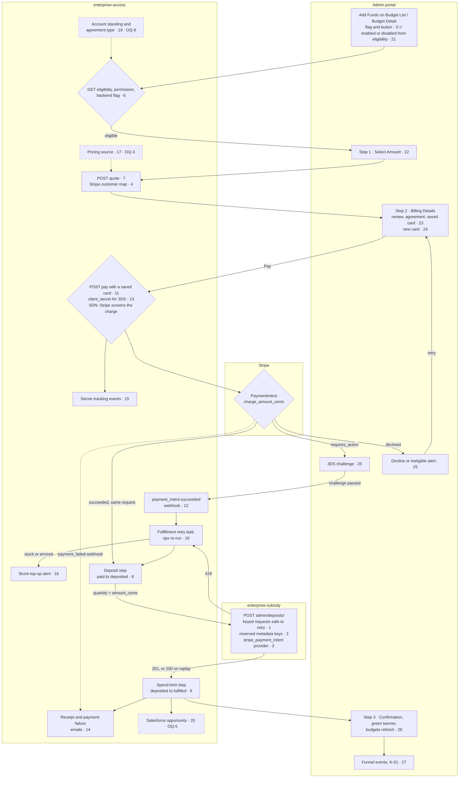
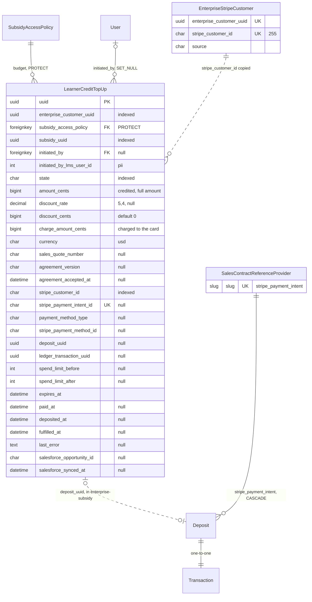
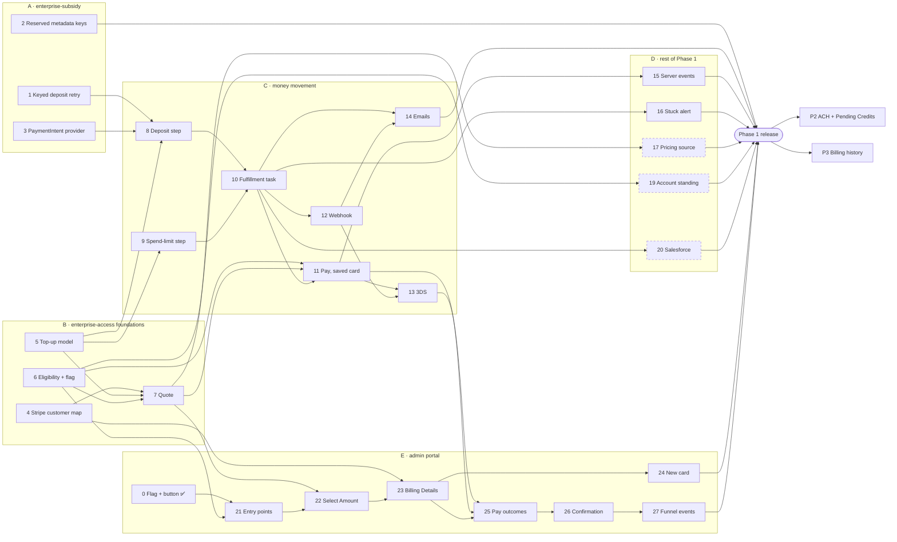

# Implementation Plan: Learner Credit Self-Service Top Up

<!-- Ported from Confluence "Implementation Plan Template - Agentic SDLC" and reconciled to Inner Loop v7. -->

> **Document Classification**
> **Type:** Plan Document (pre-build intent) + Living Execution Tracker.
> Created during Sprint Alignment with pre-build intent; updated during build with status; becomes historical after release; retro appended at sprint end.

| Field | Value |
| --- | --- |
| PRD Link | PRD (V2): Learner Credit Top Up — `https://2u-internal.atlassian.net/wiki/spaces/SOL/pages/4004348117/PRD+V2+Learner+Credit+Top+Up` |
| Tech Spec Link | `docs/plans/tech-spec.md` — reconciled 2026-10-21 against the spec's working copy (Last Updated 2026-10-21; commit `43cb3778` holds everything except the chunk 4 and chunk 5 decisions listed last, which are not yet committed). That covers everything since the previous baseline: the sequence diagrams and the sections filled on 2026-10-16, OQ-1, OQ-4 and OQ-6 closed, OQ-5 partly answered, OQ-11 to OQ-13 opened, the PM's 14-day expiry threshold (R-09), KD-6 (OQ-12 closed), and on 2026-10-21 KD-7 (OQ-11, option (a)), OQ-9 closed from code and config, OQ-10 closed (Segment events), OQ-13 closed as out of scope, and the Eng Lead's decisions on the Stripe timeout (chunk 4) and `discount_cents` (chunk 5). On 2026-10-22 it was reconciled again for TR-8 (400 `subsidy_not_available` vs 503, chunks 6 and 7), for TR-8's grounding in enterprise-subsidy (a missing subsidy answers 403), and for the quote's 400 `quote_not_available` (replacing 422 `pricing_unavailable`); none of these is committed yet. If the spec changes after that, this plan is stale: reconcile it before adding to it. |
| Engineering Lead | rthota-sonata@2u.com |
| Sprint | TBD |
| Status | Planning |
| Created | 2026-09-30 |
| Last Updated | 2026-10-22 |

**Scope** (Eng Lead, 2026-09-30): Phase 1 (card top-ups + Salesforce) is chunked in full. Phases 2
and 3 are placeholder chunks, to be chunked once their gates clear (see the spec's Phased Delivery).
Work blocked on an open question gets its interface built now and its implementation in a separate
chunk that waits on that question.

## Chunk Summary

Chunks are numbered in build order and grouped: **A** enterprise-subsidy (deploys first) · **B**
enterprise-access foundations · **C** money movement · **D** rest of Phase 1 · **E** admin portal.
🔒 = the build waits on an open question. An OQ marked *(launch)* doesn't block the build, only the
release.

| # | Chunk | Status | Owner | Reviewer | Depends On | Unblocks | Est. Size |
| --- | --- | --- | --- | --- | --- | --- | --- |
| 0 | E · Portal flag + disabled "Add funds" on the Budget List card (#183, `ac9849ae`) | ✅ | tsunkara-sonata | — (merged) | — | 21 | — |
| 1 | A · Keyed deposit requests are safe to retry | 🔲 | Ganesh | rthota-sonata (Eng Lead) | — | 8 | M |
| 2 | A · Reject deposit metadata keys that clash with ledger columns | 🔲 | Vineeth | rthota-sonata (Eng Lead) | — | Release | S |
| 3 | A · Add the `stripe_payment_intent` reference provider | 🔲 | Ramesh | rthota-sonata (Eng Lead) | — | 8 | S |
| 4 | B · Every enterprise maps to one Stripe customer | 🔲 | Ganesh | rthota-sonata (Eng Lead) | — | 7, 23 | M |
| 5 | B · `LearnerCreditTopUp` model and state machine | 🔲 | Vineeth | rthota-sonata (Eng Lead) | — | 7, 8, 9 | M |
| 6 | B · Budget eligibility endpoint, permission and backend flag | 🔲 | Ramesh | rthota-sonata (Eng Lead) | — | 7, 11, 19, 21 | M |
| 7 | B · Create and read a top-up quote | 🔲 | Ganesh | rthota-sonata (Eng Lead) | 4, 5, 6 | 11, 17, 22 | L |
| 8 | C · Deposit step (`paid → deposited`) | 🔲 | Vineeth | rthota-sonata (Eng Lead) | 1, 3, 5 | 10 | M |
| 9 | C · Spend-limit step (`deposited → fulfilled`) | 🔲 | Ramesh | rthota-sonata (Eng Lead) | 5 | 10 | M |
| 10 | C · Fulfillment retry task and ops re-run | 🔲 | Ganesh | rthota-sonata (Eng Lead) | 8, 9 | 11, 12, 14, 16, 20 | M |
| 11 | C · Pay for a quote with a saved card | 🔲 | Vineeth | rthota-sonata (Eng Lead) | 6, 7, 10 | 13, 15, 25 | L |
| 12 | C · `payment_intent.succeeded` webhook for top-ups | 🔲 | Ramesh | rthota-sonata (Eng Lead) | 10 | 13, 14 | M |
| 13 | C · 3DS (`requires_action`) completion | 🔲 | Ganesh | rthota-sonata (Eng Lead) | 11, 12 | 25 | M |
| 14 | C · Receipt and payment-failure emails | 🔲 | Vineeth | rthota-sonata (Eng Lead) | 10, 12 | Release | S |
| 15 | D · Server-side tracking events (S-03, S-04) | 🔲 | Ramesh | rthota-sonata (Eng Lead) | 11 | Release | S |
| 16 | D · Stuck-top-up alert | 🔲 | Ganesh | rthota-sonata (Eng Lead) | 10 · threshold proposed in the spec (15 minutes), awaiting Eng Lead | Release | S |
| 17 | D · Pricing source | 🔲 | Vineeth | rthota-sonata (Eng Lead) | 7 · 🔒 OQ-3 | Release | M |
| 18 | D · ~~SDN screening~~ Dropped: Stripe's own screening satisfies R-10 (spec OQ-4, resolved 2026-10-19) | ⛔ | — | — | — | — | — |
| 19 | D · Account standing and agreement type | 🔲 | Ganesh | rthota-sonata (Eng Lead) | 6 · 🔒 OQ-8 | Release | M |
| 20 | D · Salesforce opportunity | 🔲 | Vineeth | rthota-sonata (Eng Lead) | 10 · 🔒 OQ-5 (the route; `is_commission_eligible: false` is confirmed) | Release | Unsized until OQ-5 |
| 21 | E · Add Funds entry points driven by eligibility | 🔲 | Ramesh | rthota-sonata (Eng Lead) | 0, 6 | 22 | M |
| 22 | E · Checkout route, stepper and Select Amount | 🔲 | Ganesh | rthota-sonata (Eng Lead) | 7, 21 | 23 | L |
| 23 | E · Billing Details: review, agreement, saved card | 🔲 | Vineeth | rthota-sonata (Eng Lead) | 4, 22 | 24, 25 | M |
| 24 | E · Pay with a new card (reuse `AddPaymentMethodModal`) | 🔲 | Ramesh | rthota-sonata (Eng Lead) | 23 | Release | S |
| 25 | E · Pay and its outcomes (decline, 3DS, polling) | 🔲 | Ganesh | rthota-sonata (Eng Lead) | 11, 13, 23 | 26 | M |
| 26 | E · Confirmation step, green banner, budgets refresh | 🔲 | Vineeth | rthota-sonata (Eng Lead) | 25 | 27 | M |
| 27 | E · Portal funnel events (K-01) | 🔲 | Ramesh | rthota-sonata (Eng Lead) | 26 | Release | S |
| P2 | Phase 2 placeholder — ACH and Pending Credits | 🔲 | TBD | rthota-sonata (Eng Lead) | Phase 1 live · ADR 0012 conditions | — | Chunk later |
| P3 | Phase 3 placeholder — Billing history | 🔲 | TBD | rthota-sonata (Eng Lead) | Phase 1 live · Billing page shown to customers without an active subscription (OQ-6 resolved) | — | Chunk later |

*Status legend: 🔲 Not Started / 🔨 In Progress / ✅ Done / ⛔ Dropped*

*Est. Size: S / M / L — level of effort, sized to reviewable surface and blast radius, not calendar time.*

## Why These Boundaries

*Proposed in session 1 (2026-09-30) and accepted as proposed: the Eng Lead's answer was "go". The
reasons are the ones given then. A dash means no boundary question came up for that chunk.*

| # | Scope as agreed | Why the boundary is here |
| --- | --- | --- |
| 1 | Retry rules for keyed deposit calls: 200 on replay, 409 on conflict, 429 on a ledger lock, 200 for the loser of a race. Unkeyed calls unchanged. | The whole retry contract enterprise-access relies on, and it all lives in one 97-line file (`deposit.py`). |
| 2 | 400 for deposit metadata keys that clash with ledger columns | A different purpose from chunk 1: bad data, not retries. |
| 3 | The `stripe_payment_intent` provider, in a data migration whose reverse does nothing | Reviewed for safety, not behavior: reversing it would delete every top-up deposit. |
| 4 | New table, backfill, lookup reads the table first, Stripe customer created if missing | It changes a live lookup (saved payment methods), so it ships and settles before any top-up code uses it. |
| 5 | `LearnerCreditTopUp` model, history, allowed state changes | Every later backend chunk writes to it. It has no behavior yet, so it's light to review. |
| 6 | Eligibility endpoint, new permission, backend flag (404 when off), account-standing interface (OQ-8) | The first endpoint, so it carries the permission and the flag. It doesn't need the model, so it can run alongside 4 and 5. |
| 7 | Quote create, detail and list. The pricing interface (OQ-3) returns 400 `quote_not_available` until a real source exists; a settings-based source serves devstack and stage. | Kept at L with the list endpoint inside (see below). |
| 8 | `paid → deposited`: a keyed call to enterprise-subsidy | Isolates failure mode 1, charged but not credited. |
| 9 | `deposited → fulfilled`, with a row lock and a fresh `total_deposits` | Failure mode 2, credited but not spendable, plus a locking pattern new to the repo. Can run alongside 8. |
| 10 | Retries with backoff, `errored_fulfillment` on permanent failure, an ops "re-run" action | — |
| 11 | Create and confirm the PaymentIntent with both idempotency keys, agreement check, 402 on decline, ~~SDN interface (OQ-4)~~, fulfillment in the same request. The SDN interface was dropped 2026-10-19: Stripe screens the charge. | Kept at L with the pre-charge checks inside (see below). |
| 12 | Filter on metadata, store the event, queue fulfillment | It shares the live subscription webhook, so it's kept apart from pay. |
| 13 | `requires_action` with a `client_secret`, completed through the webhook | — |
| 14 | Card receipt on `fulfilled`; failure email from `payment_intent.payment_failed` | — |
| 15 | Server-side tracking events (S-03, S-04) | The spec's Event / Message Contracts now proposes the event names and properties (2026-10-16). |
| 16 | Stuck-top-up alert | The spec now proposes a 15-minute threshold (2026-10-16), awaiting the Eng Lead. |
| 17 | Pricing source | 🔒 OQ-3. |
| 18 | ~~SDN screening~~ | Dropped 2026-10-19: Stripe's own screening is enough (spec OQ-4). |
| 19 | Account standing and agreement type | 🔒 OQ-8. Could merge with 17 if both come from Salesforce. |
| 20 | Salesforce opportunity | 🔒 OQ-5, with no interface-now chunk (see below). |
| 21 | Add Funds on Budget List and Budget Detail, driven by the eligibility endpoint; disabled with the reason shown | Replaces #183's local check, which #183's own TODO says to do. |
| 22 | Checkout route, stepper, and Select Amount with the order summary; Continue creates the quote | Kept at L with the route and stepper inside (see below). |
| 23 | Pre-charge review, legal agreement, choice of saved card | The billing-management API it needs is on in production (spec OQ-6, resolved 2026-10-19). |
| 24 | Pay with a new card | Small, because the Billing page already has Stripe Elements: it reuses `AddPaymentMethodModal` and `StripeProvider`. |
| 25 | Decline alert, 3DS, polling while fulfillment finishes | — |
| 26 | Confirmation step, green banner, refresh of the cached budgets | — |
| 27 | Portal funnel events (K-01) | — |

Chunk types, from the sizing guide's taxonomy: 3 is a migration, 4 a migration plus a refactor, 5
scaffold, 8, 10, 12 and 14 integration glue, and 1, 2, 6, 7, 9, 11 and 13 net-new logic. Portal
chunks carry their own accessibility criteria (NFR-03) rather than sharing a separate
accessibility chunk.

**Boundaries challenged in session 1, all kept as proposed:**

- **Chunks 2 and 3 stay separate.** They have the same reviewer and are each about 30 lines, but
  they serve different purposes.
- **Chunks 8 and 9 split fulfillment along the two failure modes**, rather than forming one
  "fulfillment" chunk. This was the strongest recommendation.
- **Chunk 7 keeps the list endpoint**, although only ops uses it in Phase 1.
- **Chunk 11 keeps the SDN interface and the agreement check**, rather than a separate
  "pre-charge checks" chunk. *(2026-10-19: the SDN interface was dropped, because Stripe screens
  the charge, spec OQ-4.)*
- **Chunk 22 keeps the route and stepper** with the Select Amount step.
- **Chunk 20 gets no interface up front**, unlike the other blocked chunks. If OQ-5's answer is
  Stripe's Salesforce connector (enterprise-access ADR 0026), enterprise-access may need nothing
  beyond PaymentIntent metadata, and an interface built now could end up as dead code.

**Spec additions by chunk (2026-10-19).** Filling the spec's remaining sections on 2026-10-16
added work to existing chunks. No chunk boundary moves, and no new chunk is needed. "Proposed" items
are proposals in the spec that the Eng Lead hasn't confirmed (Open Items 14). Each goes into the
chunk's contract when that contract is drafted.

| # | Added by the spec | Spec section | Status |
| --- | --- | --- | --- |
| 4 | Top-up Stripe calls use the same Stripe setup as the rest of enterprise-access, with no client or timeout of their own. enterprise-access sets none, so stripe-python's defaults apply: an 80-second timeout per attempt and 2 retries on timeouts and connection errors. Customer creation is the first such call; chunks 7 and 11 do the same. This replaces the proposed 10-second client. | Integration Points; TR-7 | Decided 2026-10-21 (Eng Lead) |
| 5 | `expired → paid` is an allowed state change (KD-7) | Key Decisions; OQ-11 | Decided 2026-10-21 (Open Items 12) |
| 6 | Read the subsidy with `subsidy_record(raise_on_error=True)`, so a failed read never counts as eligible (by default it returns `{}`). enterprise-subsidy answering 403 or 404 → 400 `subsidy_not_available`. A soft-deleted or unknown subsidy answers **403** today, with `error_code: "Forbidden"` and `developer_message: "MISSING: subsidy.can_read_subsidies"`. A 404 happens only in a delete-during-read race, so tests should mock the 403. A lost operator role returns the same 403 and body (spec TR-8). In the eligibility response, `subsidy_not_available` is a reason on that budget, with `is_eligible: false`. A connection error, 5xx or other HTTP error → 503 `subsidy_service_unavailable`. `subsidy_record()` doesn't catch connection errors, so this chunk catches them. | Integration Points; API Error Codes; TR-8 | Decided 2026-10-22 (Eng Lead) |
| 7 | The same 400 / 503 split when the quote reads the subsidy; `pay`'s eligibility re-check (chunk 11) gets it from chunk 6's check. The pricing source follows the same rule: a missing or incomplete quote record → 400 `quote_not_available` (was 422 `pricing_unavailable`); only an unreachable source → 503 `pricing_source_unavailable`. | Integration Points; API Error Codes; TR-8; TR-12 | Decided 2026-10-22 (Eng Lead) |
| 8 | A 3-second timeout on the deposit call made from `pay`; on timeout, 429 or 5xx, hand over to the task. The subsidy client passes no timeout (`SCL:.../client.py:408-411`), so this chunk adds it. | Integration Points; Performance Budget | Proposed |
| 10 | First attempt as soon as queued, backoff from 5 seconds (not the shared base task's 60), and its own Celery queue | Performance Budget; Scalability | Proposed |
| 11 | No SDN interface, and no 403 `payment_screening_failed`. Check that the PaymentMethod belongs to the enterprise's Stripe customer before confirming, as billing-management already does. A scoped DRF throttle on `pay`. Target: p50 ≤ 500 ms, not counting Stripe. | Security Design; Performance Budget; OQ-4 | OQ-4 resolved; the rest proposed |
| 12 | The handler moves an `expired` top-up whose PaymentIntent succeeded to `paid` and queues fulfillment, like `created` and `requires_action` (KD-7) | Webhook changes; KD-7 | Decided 2026-10-21 |
| 13 | A test that the `client_secret` is never stored or logged | Security Design | Settled |
| 14 | The failure email is keyed to the Stripe event ID, so a redelivered event sends no second email. Trigger properties are listed in the spec. Campaigns come from Braze, whose owner isn't named (spec Dependencies). | Integration Points; Event / Message Contracts | Proposed |
| 15 | `…learner-credit-top-up.lifecycle.event` on every state change and `…payment.failed` on a decline; nothing about SDN goes to Segment | Event / Message Contracts | Names proposed. OQ-10 resolved 2026-10-21: K-04 and K-05 are counted from these events. |
| 16 | Threshold: 15 minutes in `paid` or `deposited` | Monitoring & Alerting | Proposed (Open Items 2) |
| 19 | Fail closed when the standing source can't be read; one lookup per enterprise per request | Integration Points; Scalability | Proposed |
| 20 | `is_commission_eligible: false` is confirmed. edx-internal has no Salesforce settings for enterprise-access, so an outbound route also adds credentials. | Current State; OQ-5 | Route still open |
| 21–26 | Per-step accessibility: focus moves to each step's heading, live regions for totals and status, visible reasons instead of tooltips, icon and words on banners | Accessibility Impact | Settled |
| 25 | On `top_up_expired`, re-quote for the same amount and show the new totals before Pay (WCAG 2.2.1). A payment Stripe's screening blocks is shown as a generic decline (assumed to arrive as 402; counting blocks is out of scope, OQ-13). | Accessibility Impact; API Error Codes | Proposed |
| 27 | Portal event names under `edx.ui.enterprise.admin_portal.learner_credit_management.top_up.*` | Event / Message Contracts | Proposed |

## Sequencing

*From session 1 (2026-09-30). The Dependency Graph shows the full order.*

- **Deploy order** follows the spec (Data Model, Migrations Required): enterprise-subsidy first
  (group A), then the enterprise-access migrations, then the enterprise-access code behind the
  flag, then the portal.
- **First end-to-end demo:** a top-up by API on stage with a test card. It needs chunks 1 and
  3–11. Chunk 2 is defense in depth, so the demo doesn't need it.
- **The portal starts early.** Chunk 21 can start once chunk 6 lands, building against the API
  contract from there.
- **Chunk 5 unblocks the most work.**
- **Riskiest to get wrong:** chunks 8 and 9 (one failure mode each) and 12 (it shares the live
  subscription webhook).
- **Parallel work:** chunk 6 runs alongside 4 and 5; chunk 9 alongside 8.
- **Blocked chunks** 17 and 19 build against interfaces defined in chunks 7 and 6; chunk 20 has no
  interface. All three gate the release, not the demo. Chunk 18 was dropped (spec OQ-4).

## Top-Up Flow

*The spec's top-up flow (High-Level Architecture), with each step labeled by the chunk that builds
it. The flow itself lives in the spec; this copy only adds the chunk numbers. Dashed boxes are
chunks whose build waits on an open question. Every enterprise-access step reads and writes the
`LearnerCreditTopUp` model and its states (chunk 5).*



**Amounts (OQ-7, resolved 2026-10-12).** The budget gets the full selected amount as credit, not
the discounted amount. `amount_cents` is both the ES deposit quantity (chunk 8) and the
`spend_limit` increase (chunk 9). The card is charged `charge_amount_cents` =
`amount_cents − discount_cents` (chunks 7 and 11). With no discount on record, the two are equal.

**3DS (3-D Secure).** The card networks brand 3DS as Visa Secure, Mastercard Identity Check and
American Express SafeKey, so an admin may see any of these names on their bank's challenge screen.
They all reach this plan the same way, as Stripe's `requires_action` (chunks 13 and 25).

## Open Items

*Carried over from session 1 (2026-09-30). The plan doesn't invent answers to spec gaps: when a
gap's chunk is reached, the Eng Lead decides, the answer goes into the spec as a Key Decision, and
this plan follows.*

| # | Item | Resolves at | Status |
| --- | --- | --- | --- |
| 1 | **Backend feature flag.** NFR-05 wants a per-enterprise flag, but enterprise-access has no per-enterprise flag mechanism; its one flag is a global waffle flag (`EA:enterprise_access/toggles.py:18`). The portal already has a build-time flag from #183, `FEATURE_TOP_UP_LEARNER_CREDIT` (or `hasFeatureFlagEnabled('TOP_UP_LEARNER_CREDIT')`). The name is settled: `FEATURE_TOP_UP_LEARNER_CREDIT` everywhere (Eng Lead, 2026-10-13; spec NFR-05). **Note:** `FEATURE_LEARNER_CREDIT_TOP_UP` (the PRD's name) = `FEATURE_TOP_UP_LEARNER_CREDIT`; both refer to the same flag. **Resolved 2026-10-19 (spec KD-6, OQ-12 closed):** enterprise-access reads it the way it gates SSP, as a Django setting that decides whether `api/v1/urls.py` registers the top-up routes, set per environment in edx-internal. The PRD's NFR-05 doesn't ask for per-enterprise control, and the LMS's `enterprise_features` turned out to be global waffle flags. Cost: no per-enterprise pilot, and turning it off takes a redeploy. | Chunk 6 builds it as decided | Resolved |
| 2 | **Stuck-top-up alert threshold.** The "charged but not credited" alarm (spec Fulfillment rule 4) has no threshold. The spec's Monitoring & Alerting now lists it as P1 but marked the threshold "not set"; on 2026-10-16 it proposed 15 minutes. | Chunk 16, recorded in the spec | Proposed in the spec (15 minutes); awaiting Eng Lead |
| 3 | **Response time for `pay`.** The spec says the conflict between same-request fulfillment and NFR-01's 500 ms target is "settled in the Performance Budget", which now proposes (2026-10-16): p50 ≤ 500 ms not counting Stripe, and p99 ≤ 3.5 s, capped by a 3-second timeout on the deposit call. | Chunk 11, recorded in the spec | Proposed in the spec; awaiting Eng Lead |
| 4 | **Event contracts.** The spec's Event / Message Contracts section was empty; on 2026-10-16 it was filled with proposed event names and properties. OQ-10 is resolved (2026-10-21): K-04 and K-05 are counted from these Segment events, and a ticket to build and fire them is being written (drafted as `tickets.md` Ticket 15). | Chunk 15 | Filled in the spec; names proposed, awaiting Eng Lead |
| 5 | **Spec fix: lock-error detection.** The spec's deposit-endpoint changes say the view detects the wrapped lock error "as the v2 transaction view does". It doesn't: the deposit path wraps the error twice, while the transaction view catches it directly (see chunk 1's notes). | Proposed: fix alongside the KD-6 edit in group B | Open. A 2026-10-12 spec re-baseline fixed it, but that edit was lost. |
| 6 | **Replay before the expiry check** (chunk 1). The "already exists?" lookup runs before the expired-subsidy check, so a paid, already-deposited top-up whose retry arrives after expiry gets 200, not 422, and isn't marked as failed. This goes beyond the spec. | Eng Lead confirmation | Resolved 2026-10-13: confirmed, and added to the spec's deposit endpoint changes |
| 7 | **429 for unkeyed calls too?** (chunk 1) The spec leaves unkeyed calls unchanged, but a lock conflict is always worth retrying. The only unkeyed caller, the Deposit Funds admin tool, treats every error the same (`EA:enterprise_access/apps/subsidy_access_policy/models.py:1188-1192`), so changing it breaks nothing. Recommendation: 429 for all callers. Until decided, chunk 1's scenarios cover keyed calls only. | Eng Lead decision | Awaiting Eng Lead |
| 8 | **Provider slug outside `SubsidyReferenceChoices`** (chunk 3). That list also sets which reference types a subsidy can have, so adding the slug to it would change them. | Eng Lead confirmation | Resolved 2026-10-13: kept as written, and added to the spec's Data Model |
| 9 | **Reviewers.** The Ready-to-Build gate needs a named reviewer for every chunk. Resolved 2026-10-13: the Eng Lead (rthota-sonata) reviews every chunk, including chunks 1–3 as the enterprise-subsidy owner. | Before the Ready-to-Build gate | Resolved |
| 10 | **Tickets.** The earlier `tickets.md` was built straight from the spec, before this plan, and no longer exists. Tickets follow the plan: generate them with the `ticket-generator` skill once the chunk contracts are done. Chunks won't match the old tickets one-to-one. | After groups B–E are drafted | Open |
| 11 | **Monitoring with no chunk yet.** Ops Readiness, Monitoring maps the spec's 13 signals to chunks. Chunk 16 covers the two Fulfillment rule 4 alerts (stuck in `paid` or `deposited`, and `errored_fulfillment`). The other 11 have no chunk, including two P1s (the Stripe-to-top-up reconciliation and the enterprise-subsidy 403), and neither does sending the state-change signals they all read. Decide whether to widen chunk 16 or add a chunk. Since 2026-10-16 the spec proposes thresholds for Stripe errors (5 in 10 minutes) and the Salesforce sync (24 hours), and the SDN guardrail is out of scope for Phase 1 (spec OQ-13, item 15). | Before the group D contracts | Open |
| 12 | **A charge can succeed after its quote expired.** A 3DS challenge finished after `expires_at` charges the card, but the state machine had no `expired → paid` path (spec state diagram). Either cancel the PaymentIntent when a quote expires, or allow `expired → paid`. | Chunk 5 (state machine); spec OQ-11 | Resolved 2026-10-21: allow `expired → paid` (option (a), spec KD-7). Chunk 5's transition table and chunk 12's handler include it. |
| 13 | **Is `discount_cents` nullable?** The spec's field table types it as a plain BigInteger and says the two amounts are equal when there is no discount, but its API contract says `discount_cents` is `null` when there is no discount. Found while drawing the ERD. | Chunk 5 (model), recorded in the spec | Resolved 2026-10-21: not nullable, default `0`. `discount_rate` alone says whether a discount is on record, and the API returns `0`, not `null`. Recorded in the spec's Data Model and API Contracts. |
| 14 | **Spec proposals awaiting confirmation.** The spec's 2026-10-16 fill made proposals that land in chunks 6–8, 10, 11, 14–16, 19, 25 and 27: timeouts, the task's backoff and queue, a throttle, event names, alert thresholds, re-quoting on expiry. They are listed under Why These Boundaries, "Spec additions by chunk". Chunk 4's proposal, a 10-second Stripe client, was decided against on 2026-10-21: top-up calls keep enterprise-access's Stripe defaults. Chunks 6 and 7's failing closed was decided on 2026-10-22: 400 `subsidy_not_available` for a missing subsidy, 503 only when enterprise-subsidy can't be reached. | Eng Lead, before each chunk's contract is drafted | Awaiting Eng Lead |
| 15 | **SDN guardrail count.** Stripe now screens (spec OQ-4), so enterprise-access can't count screening blocks itself. | Before GA metrics reporting | Resolved 2026-10-21: out of scope for Phase 1 (spec OQ-13). The spec's Data Model notes what a future change would need; no chunk builds it. |
| 16 | **How the ops re-run moves state.** The spec's state diagram has `errored_fulfillment → fulfilled`, but Fulfillment rule 3 says the spend-limit step runs only from `deposited`, which is what makes it run once. A re-run that jumps straight to `fulfilled` would skip that guard. Proposed: replace it with `errored_fulfillment → paid` (no deposit yet) and `errored_fulfillment → deposited` (deposit recorded), so a re-run takes the normal path. Found while drafting chunk 5's ticket (`tickets.md`, Ticket 5). | Chunk 5 (state machine) and chunk 10 (ops re-run), recorded in the spec | Awaiting Eng Lead |
| 17 | **Discount rounding.** `amount_cents × discount_rate` isn't always a whole number of cents (for example, 100,001 × 0.1), and the spec doesn't say how `discount_cents` is rounded. Chunk 7's ticket assumes half-up to the cent. | Chunk 7, recorded in the spec (with Finance if needed) | Awaiting Eng Lead |
| 18 | **Refunds have no chunk.** The spec's state machine has an ops refund (`errored_fulfillment → refunded`), and its runbook and rollback plan rely on it, but no chunk builds it. | Before group C contracts: add it to chunk 10 or a new chunk | Awaiting Eng Lead |
| 19 | **Quote expiry has no chunk.** Nothing moves unpaid quotes to `expired`; `pay` only rejects them. The 3DS-completion metric reads `expired`, and KD-7 credits an `expired` top-up whose charge succeeds. Chunk 16's ticket proposes a cleanup command like `cleanup_checkout_intents`, scheduled in edx-internal. | Chunk 16 (proposed) | Awaiting Eng Lead |
| 20 | **Order summary before the quote.** R-02 wants the step 1 order summary to update live, but the discount only arrives with the quote, which is created on Continue. Options: show the amount and balances only until step 2; expose the discount rate before the quote; or re-quote as the amount changes. Chunk 22's ticket assumes the first. | Chunk 22, with the PM; recorded in the spec | Awaiting Eng Lead and PM |
| 21 | **Adding a card changes the default.** `AddPaymentMethodModal` always saves a new card as the customer's default (`AP:src/components/billing/AddPaymentMethodModal.tsx:180-185` at `ac9849ae`). Reused for top-ups, it would change the card a subscription customer is billed with. Chunk 24's ticket proposes a `setAsDefault` prop set to `false` from checkout. | Chunk 24 | Awaiting Eng Lead |
| 22 | **Hidden or disabled Add Funds.** #183 hides Add Funds on expired, retired and scheduled budgets; UX-02 asks for a disabled button with a reason on ineligible budgets. Chunk 21's ticket keeps #183's hiding for those three and disables with a reason otherwise. | Chunk 21, with PM and UX | Awaiting PM and UX |

**Next:** the group B contracts. Decided: chunk 4's Stripe timeout ("Spec additions by chunk", row 4), chunk 5's `expired → paid` (item 12, spec KD-7) and `discount_cents` (item 13), chunk 6's flag (item 1, spec KD-6), and how chunks 6 and 7 fail when the subsidy or quote record isn't available (rows 6 and 7: 400 `subsidy_not_available` or `quote_not_available`; 503 only when the service can't be reached; spec TR-8, TR-12). Still open for group B: how the ops re-run moves state (item 16, chunks 5 and 10) and discount rounding (item 17, chunk 7).

## Chunks

*Chunk contracts are added here as each group is agreed. Group A is drafted; groups B–E are next.*

*Group A citations are against enterprise-subsidy `origin/main@78f9af7` (the spec's baseline) and
openedx-ledger `2.0.0`. `ES` = enterprise-subsidy, `LED` = openedx-ledger, `EA` = enterprise-access,
as in the spec.*

### Chunk 1: Keyed deposit requests are safe to retry

| Field | Value |
| --- | --- |
| Purpose | Make a deposit request that carries an `idempotency_key` safe to retry (KD-5). |
| Exit Criteria | A replay of a keyed deposit returns 200 with the original deposit; the same key with different values returns 409; ledger-lock contention returns 429; the loser of a same-key race returns 200; an unkeyed duplicate still returns 422. Scenarios below. |
| Blast Radius | enterprise-subsidy only: `ES:enterprise_subsidy/apps/api/v2/views/deposit.py`, `ES:.../api/v2/serializers/deposits.py`, `ES:.../api/exceptions.py` (a new error code), and `ES:.../api/v2/tests/test_deposit_views.py`. No model, migration, or openedx-ledger change. **What could break:** a replay that returns 200 for a request that doesn't match exactly would hide a real mismatch, so the comparison must cover quantity, reference ID and provider. The only known caller, EA's Django-admin Deposit Funds tool, sends no key and handles every HTTP error the same way (`EA:enterprise_access/apps/subsidy_access_policy/models.py:1188-1192`). |
| Reviewer | rthota-sonata (Eng Lead) — the enterprise-subsidy owner; the chunk needs enterprise-subsidy and openedx-ledger knowledge |
| Depends On | — |
| Unblocks | 8 |
| Estimated Size | M — about 100 changed lines across two files, but the race handling is subtle. |
| Jira Ticket | Added when tickets are generated from this plan |
| Status | 🔲 Not Started |

#### Exit Criteria (Detailed)

```gherkin
Feature: Keyed deposit requests are safe to retry

  Background:
    Given an active, unexpired subsidy with a ledger
    And a client with operator access to the subsidy's enterprise

  Scenario: The first keyed request creates the deposit
    When the client POSTs a deposit with idempotency_key "K", quantity 100000, reference "R" and the existing provider
    Then the response status is 201
    And exactly one Deposit and one committed Transaction exist in the ledger with idempotency_key "K"

  Scenario: A replay returns the original deposit
    Given a deposit was created with idempotency_key "K", quantity 100000, reference "R" and the existing provider
    When the client POSTs the same request again
    Then the response status is 200
    And the response body is the original deposit, with the same uuid and transaction
    And the ledger balance has increased by 100000 exactly once

  Scenario: A replay still returns 200 after the subsidy expires
    Given a deposit was created with idempotency_key "K"
    And the subsidy has since expired
    When the client POSTs the same request again
    Then the response status is 200 with the original deposit

  Scenario Outline: The same key with different values is a conflict
    Given a deposit was created with idempotency_key "K", quantity 100000, reference "R" and the existing provider
    When the client POSTs idempotency_key "K" with <field> changed
    Then the response status is 409 with code "deposit_idempotency_conflict"
    And no new Deposit or Transaction is created

    Examples:
      | field                             |
      | desired_deposit_quantity          |
      | sales_contract_reference_id       |
      | sales_contract_reference_provider |

  Scenario: Ledger-lock contention is retryable
    Given the ledger lock is held by another request
    When the client POSTs a keyed deposit
    Then the response status is 429 with code "ledger_lock_error"
    And no Deposit is created
    And the same request returns 201 once the lock is released

  Scenario: The loser of a same-key race gets the winner's deposit
    Given two identical requests with idempotency_key "K" both pass the replay check before either commits
    When the second insert fails on the ledger's (ledger, idempotency_key) unique constraint
    Then the second response status is 200 with the first request's deposit
    And exactly one Deposit exists for idempotency_key "K"

  Scenario: Unkeyed duplicates are still rejected
    Given a deposit was created without an idempotency_key
    When the client POSTs the same request again without a key
    Then the response status is 422 with code "deposit_creation_error"
```

#### Files to Change

*Populated during "Plan Before Building" (Step 7 / Agentic Build)*

| File | Change | Why |
| --- | --- | --- |
| | | |

#### Notes / Decisions During Build

*Append as you go:*

- *Planning, 2026-09-30:* The lock error reaches the view wrapped twice.
  `LedgerLockAttemptFailed` (`LED:openedx_ledger/models.py:247`) is wrapped by the ledger's
  `DepositCreationError` (`LED:openedx_ledger/api.py:317-320`), then by the serializer's
  (`ES:.../api/v2/serializers/deposits.py:133-139`). The view must walk the `__cause__` chain. The
  v2 transaction view is the precedent only for the 429 response itself (`Throttled` with
  `ledger_lock_error`, `ES:.../api/v2/views/transaction.py:192-196`); it catches the lock error
  directly because nothing wraps it on that path.
- *Planning, 2026-09-30:* A same-key race resolves through the ledger's `unique_together =
  [('ledger', 'idempotency_key')]` on `Transaction` (`LED:openedx_ledger/models.py:345`). The lock
  is released before `create_deposit`'s outer `atomic()` commits (`LED:openedx_ledger/api.py:298-320`
  with `create_transaction`'s `ledger.lock()`), so the losing insert waits on the winner's row and
  then fails. `ATOMIC_REQUESTS` is off, so re-reading after that failure is safe.
- *Planning, 2026-09-30 (confirmed by the Eng Lead 2026-10-13):* The replay lookup runs before the expired-subsidy check
  (`ES:.../api/v2/views/deposit.py:86-90`). Returning an existing deposit is a read, and returning
  422 for it would push a funded top-up into `errored_fulfillment`.

### Chunk 2: Reject deposit metadata keys that clash with ledger columns

| Field | Value |
| --- | --- |
| Purpose | Reject deposit `metadata` keys that would be written to ledger columns instead of stored as metadata. |
| Exit Criteria | A deposit whose `metadata` contains any ledger parameter name returns 400 naming the key, and nothing is created. Ordinary keys are still stored as metadata. The reserved set tracks the ledger library's signatures. Scenarios below. |
| Blast Radius | enterprise-subsidy only: `ES:.../api/v2/serializers/deposits.py` (`metadata` validation) and its tests. **What could break:** a caller that sends one of these keys today would start getting 400. The only known caller sends `metadata=None` (`EA:enterprise_access/apps/subsidy_access_policy/admin/views.py:143-147`). Direct operator API use is unknown. |
| Reviewer | rthota-sonata (Eng Lead) — same as chunk 1 |
| Depends On | — |
| Unblocks | Release (defense in depth; chunk 8 sends only safe keys regardless) |
| Estimated Size | S |
| Jira Ticket | Added when tickets are generated from this plan |
| Status | 🔲 Not Started |

#### Exit Criteria (Detailed)

```gherkin
Feature: Deposit metadata can't overwrite ledger columns

  Background:
    Given an active, unexpired subsidy with a ledger
    And a client with operator access to the subsidy's enterprise

  Scenario Outline: A reserved metadata key is rejected
    When the client POSTs a deposit whose metadata contains "<key>"
    Then the response status is 400
    And the error names "<key>"
    And no Deposit or Transaction is created

    Examples:
      | key                        |
      | subsidy_access_policy_uuid |
      | lms_user_id                |
      | deposit_uuid               |
      | state                      |
      | quantity                   |

  Scenario: Ordinary metadata is stored as metadata
    When the client POSTs a deposit with metadata {"source": "learner_credit_top_up", "top_up_policy_uuid": "<uuid>"}
    Then the response status is 201
    And the new Transaction's metadata contains both keys
    And the new Transaction's subsidy_access_policy_uuid is null

  Scenario: The reserved set tracks the ledger library
    Given the named parameters of openedx_ledger.api.create_deposit and openedx_ledger.api.create_transaction
    Then every one of them is in the reserved set
```

#### Files to Change

*Populated during "Plan Before Building" (Step 7 / Agentic Build)*

| File | Change | Why |
| --- | --- | --- |
| | | |

#### Notes / Decisions During Build

*Append as you go:*

- *Planning, 2026-09-30:* The reserved names are every named parameter of `create_deposit`
  (`LED:openedx_ledger/api.py:274-282`, which includes `deposit_uuid`) and `create_transaction`
  (`LED:openedx_ledger/api.py:52-65`). Today some of them fail with a `TypeError` that surfaces
  as 422 (`quantity`, `state`), and the rest are silently written to columns
  (`subsidy_access_policy_uuid`, `lms_user_id`, `deposit_uuid`, …). Deriving the set with
  `inspect.signature` keeps it correct across ledger upgrades.

### Chunk 3: Add the `stripe_payment_intent` reference provider

| Field | Value |
| --- | --- |
| Purpose | Register `stripe_payment_intent` as a sales-contract reference provider so top-up deposits can cite their PaymentIntent (KD-5). |
| Exit Criteria | The forward migration creates exactly one provider row and is safe to re-run. The reverse migration deletes nothing. A deposit can cite the provider with a `pi_…` reference. The subsidy's own reference-type choices are unchanged. Scenarios below. |
| Blast Radius | enterprise-subsidy only: a new data migration `ES:enterprise_subsidy/apps/subsidy/migrations/0024_…` (the latest is `0023_mariadb_uuid_conversion`), a slug constant, and a migration test. One row is added to openedx-ledger's `SalesContractReferenceProvider` table. **What could break:** deleting the row, by reversing the migration or by hand, cascades to every top-up deposit (`LED:openedx_ledger/models.py:746-751`). |
| Reviewer | rthota-sonata (Eng Lead) — same as chunk 1 |
| Depends On | — |
| Unblocks | 8 |
| Estimated Size | S — reviewed for safety, not behavior |
| Jira Ticket | Added when tickets are generated from this plan |
| Status | 🔲 Not Started |

#### Exit Criteria (Detailed)

```gherkin
Feature: Top-up deposits can cite a Stripe PaymentIntent

  Scenario: The forward migration adds the provider
    Given the subsidy app is migrated to 0023
    When migration 0024 runs
    Then exactly one SalesContractReferenceProvider with slug "stripe_payment_intent" exists

  Scenario: Re-running the forward step is harmless
    Given the "stripe_payment_intent" provider already exists
    When the forward step runs again
    Then exactly one provider with that slug exists

  Scenario: Reversing the migration deletes nothing
    Given a Deposit that cites the "stripe_payment_intent" provider
    When the subsidy app is migrated back to 0023
    Then the provider row still exists
    And the Deposit still exists

  Scenario: A deposit can cite a PaymentIntent
    Given the migration has run
    When an operator POSTs a deposit with provider "stripe_payment_intent" and reference "pi_3Qexample"
    Then the response status is 201
    And the deposit's sales_contract_reference_provider is "stripe_payment_intent"

  Scenario: The subsidy's reference-type choices are unchanged
    Then "stripe_payment_intent" is not a choice for Subsidy.reference_type
    And makemigrations --check reports no pending changes
```

#### Files to Change

*Populated during "Plan Before Building" (Step 7 / Agentic Build)*

| File | Change | Why |
| --- | --- | --- |
| | | |

#### Notes / Decisions During Build

*Append as you go:*

- *Planning, 2026-09-30 (confirmed by the Eng Lead 2026-10-13):* The slug is defined outside `SubsidyReferenceChoices`. That enum is
  also the choice list for `Subsidy.reference_type` (`ES:enterprise_subsidy/apps/subsidy/models.py:63-70, 176`),
  and a subsidy's reference is its Salesforce line item, never a PaymentIntent. Migration 0022
  copies that enum into the provider table (`ES:.../subsidy/migrations/0022_backfill_initial_deposits.py:34-37`).
  The new migration uses a hard-coded slug with `get_or_create` and `migrations.RunPython.noop` as
  its reverse.
- *Planning, 2026-09-30:* `Deposit.sales_contract_reference_id` is a 255-character field
  (`LED:openedx_ledger/models.py:735-736`), so it fits a `pi_…` ID.
- *Ops note:* The provider row must never be deleted, including from the Django admin. This goes
  into the runbook (Ops Readiness).

## Data Model

*Projected from the spec's Data Model (KD-2 to KD-5), which keeps the per-field notes, the state
machine and the fulfillment rules. This section adds what the spec leaves to the plan: constraints
and indexes in one place, the ERD, and the chunk that builds each piece. Generated for the Eng Lead
to validate; the chunk 4 and 5 contracts finalize it.*

**New Models**

| Model | Fields | Relationships | Constraints | Notes |
| --- | --- | --- | --- | --- |
| `LearnerCreditTopUp` (EA `customer_billing`), chunk 5 | The 30 fields in the spec's field table, plus `created` / `modified` | FK → `SubsidyAccessPolicy` (PROTECT); FK → `User` as `initiated_by` (SET_NULL) | PK `uuid`. Unique: `stripe_payment_intent_id`. Indexed: `enterprise_customer_uuid`, `subsidy_uuid`, `state`, `stripe_customer_id`, and `(subsidy_access_policy, state)`. `state` changes only through the allowed-transitions table. | `TimeStampedModel` (django-extensions) + `HistoricalRecords`. Rows are never deleted (S-01). `initiated_by_lms_user_id` needs a `.. pii:` annotation. `discount_cents` is not nullable and defaults to `0` (Open Items 13). No SDN or decline-outcome field: out of scope (spec OQ-13; the spec's Data Model notes a future option). |
| `EnterpriseStripeCustomer` (EA `customer_billing`), chunk 4 | `enterprise_customer_uuid`, `stripe_customer_id`, `source` (`checkout_intent_backfill` / `created_for_top_up`), plus `created` / `modified` | None; the enterprise is referenced by UUID | Unique: `enterprise_customer_uuid`, `stripe_customer_id` | `TimeStampedModel` + `HistoricalRecords`. `_get_stripe_customer_id_for_enterprise` reads it first and falls back to `CheckoutIntent`. |
| enterprise-subsidy: no new table, chunk 3 | One `SalesContractReferenceProvider` row with slug `stripe_payment_intent` | Every top-up `Deposit` points at it (CASCADE) | Slug of at most 32 characters | Its own constant, outside `SubsidyReferenceChoices`. The row must never be deleted. |

*ERD. Solid lines are foreign keys; dotted lines are values copied across a table or service
boundary with no foreign key. `null` marks nullable columns, as the spec's field table gives them.*



**Migrations**

*From the spec's Migrations Required. Deploy order: chunk 3's migration with the deposit fixes
first, then the enterprise-access migrations, then the enterprise-access code behind the flag,
then the portal.*

| Migration | Description | Risk | Rollback | Chunk |
| --- | --- | --- | --- | --- |
| ES `subsidy` `0024_…`: add the `stripe_payment_intent` provider | `get_or_create` with a hard-coded slug | None; adds one row | The reverse is a no-op and must stay one: deleting the row deletes every top-up `Deposit` | 3 |
| EA `customer_billing`: add `EnterpriseStripeCustomer` and its history table | New tables | None | Reverse only before the first real top-up; after that, keep the tables | 4 |
| EA `customer_billing`: backfill `EnterpriseStripeCustomer` from `CheckoutIntent` | For each enterprise, the latest intent that has a Stripe customer | Low; `CheckoutIntent` is small (`[Assumed]` in the spec), and `get_or_create` makes it safe to re-run | The reverse is a no-op; the lookup falls back to `CheckoutIntent`, so the code can roll back alone | 4 |
| EA `customer_billing`: add `LearnerCreditTopUp` and its history table | New tables | None | Reverse only before the first real top-up; after launch, turn the flag off and keep the tables, which hold payment records | 5 |

## Test Plan

**Unit Tests**

| Area | Scenarios | Chunk | Owner |
| --- | --- | --- | --- |
| | | | |

**Integration Tests**

| Scenario | Systems Involved | Setup Required | Chunk | Owner |
| --- | --- | --- | --- | --- |
| | | | | |

**Edge Case Tests**

| Edge Case | Expected Behavior | Test Type (Unit / Integration / Manual) | Chunk |
| --- | --- | --- | --- |
| | | | |

**Test Data Requirements**

| Data | Source (Factory / Fixture / Seed / Mock) | Setup Method | Teardown |
| --- | --- | --- | --- |
| | | | |

## Ops Readiness

*Projected from the spec's Monitoring & Alerting and Feature Flags, which keep the full conditions
and responses. Severities are the spec's proposals: P1 pages on-call, P2 alerts the team in
business hours, P3 is dashboard only. Signals are `LearnerCreditTopUp` state changes sent as custom
attributes, the way `CheckoutIntent` sends its lifecycle state. No dashboard or on-call rotation is
named yet.*

**Monitoring**

| Metric | Dashboard | Alert Threshold | Severity | Chunk |
| --- | --- | --- | --- | --- |
| Charged but not credited: a top-up stays in `paid` or `deposited` | TBD | Proposed in the spec: 15 minutes (Open Items 2) | P1 | 16 |
| Fulfillment failed: a top-up reaches `errored_fulfillment` | TBD | Any | P1 | 16 |
| Payment taken, top-up not moved: a reconciliation finds a succeeded PaymentIntent whose top-up isn't `paid`, `deposited` or `fulfilled` | TBD | Any | P1 | None yet (Open Items 11) |
| enterprise-subsidy deposit access: a deposit call returns 403 | TBD | Any | P1 | None yet |
| Failed-payment rate (S-04 guardrail) | TBD | More than 5% of payment attempts | P2 | None yet |
| SDN screening failures (S-04 guardrail) | — | Out of scope for Phase 1 (spec OQ-13; Open Items 15) | — | None |
| Stripe API errors: 503 `payment_provider_unavailable` | TBD | Proposed in the spec: 5 or more in 10 minutes | P2 | None yet |
| Stripe webhook delivery: `payment_intent.*` failures | TBD | Not stated | P2 | None yet |
| enterprise-subsidy deposit errors: 5xx, or 429 beyond the retries | TBD | Sustained; not stated | P2 | None yet |
| Pricing source: 503 or 400 `quote_not_available` on quote creation | TBD | Not stated | P2 | None yet |
| 3DS completion: `requires_action` that ends in `expired` | TBD | Dashboard only | P3 | None yet |
| Time to spendable funds: p95 from `paid` to `fulfilled` (NFR-01) | TBD | Dashboard only; target 30 s | P3 | None yet |
| Salesforce opportunity sync: `fulfilled` with no `salesforce_synced_at` | TBD | Proposed in the spec: 24 hours; the check depends on OQ-5 | P3 | None yet |

**Alerts**

| Alert Name | Condition | Who Gets Paged | Response |
| --- | --- | --- | --- |
| Charged but not credited | `paid` or `deposited` past the threshold | On-call (P1) | See the runbook below. |
| Fulfillment failed | `errored_fulfillment` | On-call (P1) | Re-run fulfillment, or refund. |
| Payment taken, top-up not moved | Succeeded PaymentIntent, top-up not moved | On-call (P1) | Fulfill the top-up by hand, then find out why the webhook missed it. |
| enterprise-subsidy deposit access | Deposit call returns 403 | On-call (P1) | The service user lost operator access (OQ-9). Restore the grant, then re-run the affected top-ups. |
| Failed-payment rate | Above 5% | Team, business hours (P2) | Break failures down by `decline_code`, check Stripe's status, and tell the PM (launch guardrail). |
| SDN screening failures | Out of scope for Phase 1 (spec OQ-13) | — | None in Phase 1. Compliance can review Stripe's blocked payments in Stripe. |
| Stripe API errors | Sustained 503s | Team, business hours (P2) | Check Stripe's status page. Admins can retry safely. |
| Stripe webhook delivery | Delivery or signature failures | Team, business hours (P2) | Check the endpoint's `payment_intent.*` subscription and signing secret. |
| enterprise-subsidy deposit errors | Sustained 5xx or 429 | Team, business hours (P2) | Retries back off on their own; persistent failures reach `errored_fulfillment`, which pages. |
| Pricing source | 503 or 400 `quote_not_available` on quote | Team, business hours (P2) | Check the pricing source (OQ-3) and the enterprise's Salesforce record. |

**Runbook**

*If this breaks at 2am, what does on-call do? Drafted from the spec's alert responses for the P1
payment alerts.*

1. **Symptom:** a P1 page. A top-up is stuck in `paid` or `deposited`, has reached
   `errored_fulfillment`, or the reconciliation found a charge whose top-up never moved.
2. **Diagnosis steps:** read the top-up's `state` and `last_error`. Check whether enterprise-subsidy
   already holds a deposit for the key `lc-top-up-<uuid>`. A 403 from the deposit call means the
   operator grant is gone (OQ-9). For a charge whose top-up never moved, check Stripe's webhook
   deliveries for `payment_intent.*`.
3. **Remediation:** run the ops re-run (chunk 10). It is safe to repeat: the deposit key returns the
   same deposit on replay, and the spend-limit step runs only from `deposited`. Refund only if
   fulfillment can't complete (`errored_fulfillment → refunded`). Never delete the
   `stripe_payment_intent` provider row, which would delete every top-up deposit.
4. **Escalation path:** not set yet. Owners named in the spec: rthota-sonata (enterprise-subsidy and
   the OQ-9 grant), Justin Grabowski (Salesforce sync). The Stripe account owner is TBD.

**Rollback Plan**

*Projected from the spec's Rollback Plan (filled 2026-10-16), with the chunk behind each step.*

1. **Turn `FEATURE_TOP_UP_LEARNER_CREDIT` off** (chunks 0, 6, 21). It is a deployed setting on both
   sides (spec KD-6), so this is an edx-internal change and a redeploy, backend first. The portal
   hides every entry point and the top-up endpoints return 404. Nothing is migrated or deleted. As proposed in the
   spec, the webhook handlers and fulfillment ignore the flag, so a top-up that was already paid
   still gets credited.
2. **Settle the top-ups in flight** (chunk 10's ops re-run). Run every top-up in `paid`,
   `deposited` or `errored_fulfillment` to `fulfilled`, or refund it. Quotes in `created` expire on
   their own; one in `requires_action` can still be charged, and the webhook (chunk 12) credits it.
3. **Roll back enterprise-access code only if the flag isn't enough.** It can roll back on its own:
   the Stripe-customer lookup falls back to `CheckoutIntent` (chunk 4). Before removing the webhook
   handlers, wait until no top-up is in `requires_action` or `paid`. Keep the new tables once a
   real top-up exists, because they hold payment records.
4. **Leave the enterprise-subsidy changes in place** (chunks 1–3). Calls without a key are
   unaffected. Never reverse the provider migration (chunk 3): its reverse is a no-op on purpose.

**Feature Flags**

| Flag | Default | Chunk | Rollback Behavior |
| --- | --- | --- | --- |
| `FEATURE_TOP_UP_LEARNER_CREDIT` | OFF | 0 (portal flag, done), 6 (backend Django setting and conditional routes, KD-6), 21 (entry points) | Changed through edx-internal and a redeploy, per environment. Off hides the entry points and returns 404 from the top-up endpoints. The webhook route is gated by `ENABLE_CUSTOMER_BILLING_API`, not this flag; proposed in the spec: the handlers and fulfillment don't check it either, so paid top-ups are still credited. |

## Dependency Graph

*Dashed borders are chunks whose build waits on an open question. Chunk 18 was dropped (spec OQ-4).*



## Retro

*Appended at sprint end (Retro, Step 20). Target: 3–5 actionable items.*

| Field | Value |
| --- | --- |
| Date | |
| Participants | |

### What Went Well

-

### What Didn't Go Well

-

### What Surprised Us

-

### Action Items

| # | Action | Owner | Target | Routed To (CLAUDE.md / Skills / Arch MD / KB) |
| --- | --- | --- | --- | --- |
| 1 | | | | |

## AI Prompts for This Document

*Chunking is a **judgment you make with the AI, not a layout it hands you** — the plan is only
useful if you understand why each chunk is scoped the way it is. Have the AI propose, then
interrogate the boundaries together before you accept them.*

### Step 1 (Sprint Alignment) — co-author the chunking

- `Propose a chunking of tech-spec.md into single-responsibility chunks with Gherkin exit criteria. For each, explain why you drew the boundary there — then let me adjust before you finalize.`
- `Talk me through the dependency order. Which chunk unblocks the most others, and what's the riskiest one to get wrong?`
- `For each chunk, identify blast radius — what services/components are touched?`

### Step 2 (Chunk Review)

- `Pre-screen impl-plan chunks: flag any that span unrelated subsystems, exceed one-sitting reviewable surface, have ambiguous exit criteria, or are missing reviewer/blast-radius fields`

### Step 4 (Technical Readiness)

- `Generate ERD from the data model section of impl-plan.md`
- `Generate test plan from exit criteria — cover unit, integration, and edge cases`

### Step 7 (Agentic Build)

- `Build chunk [N] from impl-plan.md. Follow patterns in CLAUDE.md. Run unit tests after each file change.`

## Changelog

| Date | Change | Why |
| --- | --- | --- |
| 2026-09-30 | Scaffolded from the template. Scope set: Phase 1 in full, Phases 2–3 as placeholders; blocked work split into interface-now and implement-later chunks; reviewers TBD. | Session 1 kickoff: the Eng Lead accepted the proposed defaults. |
| 2026-09-30 | Decomposition agreed: chunks 0–27 plus placeholders P2 and P3, in groups A–E; Chunk Summary and Dependency Graph written. Chunk 0 records portal work already merged (#183). Chunk 20 (Salesforce) has no interface-now chunk, because OQ-5's answer may mean enterprise-access needs no code. | The Eng Lead accepted the proposal as-is ("go"), including keeping chunks 2/3, 8/9 split and 7, 11, 22 at L. |
| 2026-09-30 | Group A contracts drafted (chunks 1–3), grounded against enterprise-subsidy `origin/main@78f9af7` and openedx-ledger `2.0.0`. Three calls made in the drafting, awaiting the Eng Lead's confirmation: the replay check runs before the expired-subsidy check; lock contention answers 429 for keyed calls (unkeyed calls still open); the provider slug lives outside `SubsidyReferenceChoices`. | Session 1. |
| 2026-10-13 | Reconciled with the current spec. OQ-7 is resolved, so chunks 7 and 11 no longer depend on it and the *(assumed)* marker is gone. Added Top-Up Flow: the spec's new flow diagram with each step labeled by its chunk, plus notes on the two amounts (OQ-7) and the 3DS brand names. Tech Spec Link updated. | The spec changed after this plan was written: the OQ-7 answer and 3DS note (2026-10-12) and the flow diagram (2026-10-13). This file had been overwritten on 2026-10-12 with its 2026-09-30 copy, which lost the plan's own 2026-10-12 reconciliation. |
| 2026-10-13 | Rebuilt Why These Boundaries, Sequencing and Open Items from the session 1 transcript (`claude/conversation/impl-plan.rst`). The spec-fix item (lock-error detection) is open again, because the spec re-baseline that fixed it was lost too. | The 2026-10-12 overwrite lost these sections; the Eng Lead asked for them to be rebuilt from the transcript. |
| 2026-10-13 | Open Items, item 1: the flag name is settled as `FEATURE_TOP_UP_LEARNER_CREDIT`, matching #183 and the spec's NFR-05, with a note that the PRD's `FEATURE_LEARNER_CREDIT_TOP_UP` is the same flag; how enterprise-access reads it is still open. Tech Spec Link updated. | Eng Lead decision; the spec's NFR-05 was renamed to match. |
| 2026-10-13 | Chunk owners assigned in sequence by chunk number: Ganesh, Vineeth, Ramesh, repeating (chunks 1–27). Chunk 0 keeps tsunkara-sonata; placeholders P2 and P3 stay TBD until they're chunked. Reviewers are still TBD. | Eng Lead assignment. |
| 2026-10-13 | Reviewer set to the Eng Lead (rthota-sonata) for chunks 1–27 and placeholders P2 and P3, in the Chunk Summary and in chunk 1–3 contracts. Open Items item 9 resolved. | Eng Lead decision. |
| 2026-10-13 | Tech Spec Link updated: the spec gained a Dependencies table (Salesforce, Stripe). No chunk changes: the Salesforce needs are chunks 17, 19 and 20, and the Stripe needs are chunks 4, 11, 12 and 18. | Keeping the plan in step with the spec. |
| 2026-10-13 | Tech Spec Link updated for the spec's new Monitoring & Alerting tables. Open Items 11 (monitoring with no chunk) and 12 (a charge can succeed after its quote expired) added. | The spec's monitoring work exposed both. |
| 2026-10-13 | Ops Readiness, Feature Flags: added `FEATURE_TOP_UP_LEARNER_CREDIT` (default OFF), built by chunks 0, 6 and 21. Tech Spec Link updated for the spec's new Feature Flags row. | Eng Lead request. |
| 2026-10-13 | Open Items item 6 resolved: the replay check runs before the expired-subsidy check. Chunk 1's scenario and note stand; the note is marked confirmed, and the spec now states the order. | Eng Lead decision. |
| 2026-10-13 | Open Items item 8 resolved: the provider slug stays outside `SubsidyReferenceChoices`. Chunk 3 is unchanged; its note is marked confirmed, and the spec's Data Model now states it. | Eng Lead decision ("leave as it is"). |
| 2026-10-14 | Generated the descendant sections from the spec (commit `133021b5`), for the Eng Lead to validate. Data Model: the three model rows with constraints and indexes, an ERD, and the four migrations, each mapped to its chunk (3, 4, 5). Ops Readiness: Monitoring maps the spec's 13 signals to chunks (only two have one, chunk 16), Alerts lists the P1 and P2 alerts, and a runbook and rollback plan are drafted from the spec's responses, flag behavior and migration rollbacks. Open Items 2 and 11 updated; item 13 added (`discount_cents` nullability). Chunk 16 now waits on a threshold that is "not set" rather than an empty section. | The spec's Data Model says its ERD and column detail are finalized in the plan, and the plan's own Data Model and Ops Readiness were still template placeholders. |
| 2026-10-19 | Reconciled with the spec's working copy of 2026-10-19 (Tech Spec Link updated). **Chunk 18 dropped** (⛔ added to the legend): Stripe's own screening satisfies R-10 (spec OQ-4). Chunk 11 loses its SDN interface and no longer unblocks 18; the Top-Up Flow and Dependency Graph lose the SDN node; blocked chunks are now 17, 19 and 20. **OQ-6 resolved:** chunk 23 no longer waits on it, and P3 now waits on showing the Billing page to customers without an active subscription. **OQ-5:** chunk 20 waits on the route only; `is_commission_eligible: false` is confirmed. **Decisions now tracked in the spec:** chunk 5 depends on OQ-11 (`expired → paid`), chunk 6 on OQ-12 (the flag). Added "Spec additions by chunk" under Why These Boundaries, mapping the spec's 2026-10-16 proposals to chunks 4–27 without moving any boundary. Open Items: 2, 3 and 4 now point to the spec's proposals; 11 and 12 updated; 14 (proposals awaiting the Eng Lead) and 15 (SDN guardrail count, spec OQ-13) added. Ops Readiness: proposed thresholds filled in, the SDN rows now refer to Stripe's screening, and the Rollback Plan is projected from the spec's new four-step plan. Group A contracts (chunks 1–3) needed no change. | The spec changed after this plan's last baseline (`133021b5`). |
| 2026-10-19 | Open Items 16 added: the spec's `errored_fulfillment → fulfilled` transition skips the spend-limit step's "only from `deposited`" guard. Chunk 5's Jira draft (`tickets.md`, Ticket 5) uses the proposed fix, together with OQ-11's recommendation and Open Items 13's nullable `discount_cents`. | Found while drafting chunk 5's ticket. |
| 2026-10-19 | Jira drafts written for every remaining Phase 1 chunk (`tickets.md`, Tickets 6–26: chunks 4, 7–17 and 19–27), before their contracts exist; the file now opens with a ticket-to-chunk index. Open Items 17–22 added from gaps found while drafting: discount rounding, refunds with no chunk, quote expiry with no chunk, the order summary before the quote, the add-card default, and hidden vs. disabled Add Funds. | User request: draft tickets from the plan. |
| 2026-10-19 | Expiry threshold for Add Funds changed from 40 to 14 days (spec R-09 and the `budget_expiring_soon` code). This plan names no threshold, so no chunk changes. In `tickets.md`, Tickets 4 (chunk 6), 20 (chunk 21) and 24 (chunk 25) now say 14 days, and Ticket 4's boundary examples are 13 and 14 days. Tech Spec Link updated. | PM decision. The PRD's R-09 and UX-02 now say 14 too (`prd_review.txt`). |
| 2026-10-19 | **Open Items 1 resolved (spec KD-6, OQ-12 closed):** enterprise-access reads `FEATURE_TOP_UP_LEARNER_CREDIT` the way it gates SSP, as a Django setting that decides whether the top-up routes are registered, set per environment in edx-internal. Chunk 6 no longer waits on a decision. Rollback Plan step 1 and the Feature Flags row now say turning it off takes a redeploy. In `tickets.md`, Ticket 4 (chunk 6) now builds the setting and the conditional routes. Its "no deploy" scenario is replaced by one checking the webhook route is unaffected, its proposal list drops the flag, and its reason for not extending `subsidy-access-policies` is corrected. Tickets 7 and 11 (chunks 7 and 11) no longer say the flag is per enterprise. Tech Spec Link updated. Still open for chunk 5: OQ-11 (Open Items 12). | Eng Lead answer to OQ-12. |
| 2026-10-21 | Reconciled with the spec's answers to OQ-9, OQ-10, OQ-11 and OQ-13 (Tech Spec Link updated). **KD-7 (OQ-11, option (a)):** Open Items 12 resolved; chunk 5 no longer waits on a decision; "Spec additions by chunk" row 5 is decided and a row for chunk 12's handler (`expired → paid`) is added; item 19 updated. **OQ-9 closed:** chunk 8 no longer carries OQ-9 *(launch)*; redemptions already pass the same operator check. **OQ-10 closed:** item 4 and the chunk 15 row say K-04 and K-05 are counted from the Segment events. **OQ-13 out of scope:** Open Items 15 resolved; item 11, the chunk 25 row, the Data Model note and both SDN rows in Ops Readiness are updated. "Next" now starts group B with no decision outstanding. | Eng Lead answers recorded in the spec. |
| 2026-10-21 | **Chunk 4, Stripe timeout decided:** top-up Stripe calls use the same Stripe setup as the rest of enterprise-access, stripe-python `15.6.1`'s defaults (an 80-second timeout per attempt, 2 retries on timeouts and connection errors), not the proposed 10-second client. "Spec additions by chunk" row 4 is now decided, and Open Items 14 drops chunk 4. **Chunk 5, `discount_cents` decided:** not nullable, default `0`; Open Items 13 resolved, and the Data Model row and ERD say so. "Next" now lists what is decided and still open for group B. Tech Spec Link updated. | Eng Lead decisions, recorded in the spec (Integration Points, TR-7, Data Model, API Contracts). |
| 2026-10-22 | **Chunks 6 and 7, failing on a subsidy read decided (spec TR-8):** enterprise-subsidy answering 403 or 404 → 400 `subsidy_not_available` (a reason with `is_eligible: false` in the eligibility response); a connection error, 5xx or other HTTP error → 503 `subsidy_service_unavailable`. Reads use `subsidy_record(raise_on_error=True)` (on `main` since `39904e03`), and chunk 6 also catches connection errors, which `subsidy_record()` lets through as 500s. `pay` (chunk 11) gets the split through chunk 6's check. "Spec additions by chunk" rows 6 and 7 are now decided; Open Items 14 and "Next" updated. Tech Spec Link updated. | Eng Lead: a missing subsidy should be a 400 "subsidy not available", and 503 only when the service can't be reached. |
| 2026-10-22 | **Chunk 6, enterprise-subsidy's answer grounded (spec TR-8):** today a soft-deleted or unknown subsidy answers 403 (`error_code: "Forbidden"`, `developer_message: "MISSING: subsidy.can_read_subsidies"`), not 404. A 404 happens only in a delete-during-read race. "Spec additions by chunk" row 6 says so and tells chunk 6's tests to mock the 403. A lost operator role returns the same 403 and body, which is the cost recorded in spec TR-8. No chunk boundary or dependency changes. Tech Spec Link updated. | Eng Lead asked how enterprise-subsidy answers a missing subsidy today, and to record it in the spec and plan. |
| 2026-10-22 | **Chunk 7, quote errors decided:** a missing or incomplete quote record → 400 `quote_not_available`, replacing 422 `pricing_unavailable`; only an unreachable pricing source → 503 `pricing_source_unavailable` (spec TR-12). The transcript's "7 · Quote: Same 503 proposal" (session 4) meant the subsidy read, which already moved to the 400 / 503 split earlier today. "Spec additions by chunk" row 7, chunk 7's scope line (the interim pricing interface returns 400, not 422), "Next", and the Ops Readiness pricing rows updated. Tech Spec Link updated. | Eng Lead: the quote should return 400 "quote not available", not 503; 503 only when the service can't be reached. |
