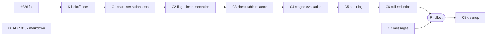

# Implementation Plan: Staged budget evaluation for `can-redeem`

> Built with the `sdlc-inner-loop-guide:impl-plan-builder` skill. The tech spec is
> [ADR 0038](../../decisions/0038-non-redeemable-reasons-and-display-reason.md). Chunks are cut on
> logical seams, not line counts. Predicted sizes are recorded so build-time actuals can be compared
> in [agent-efficacy-log.md](agent-efficacy-log.md).

> **Document Classification**
> **Type:** Plan Document (pre-build intent) + Living Execution Tracker.

| Field | Value |
| --- | --- |
| PRD Link | [ENT-12416](https://2u-internal.atlassian.net/browse/ENT-12416) (support request; no PRD) |
| Tech Spec Link | `docs/decisions/0038-non-redeemable-reasons-and-display-reason.md` (section 5 is the design; Performance has the measured basis) |
| Engineering Lead | Hamzah Ullah |
| Sprint | TBD |
| Status | Planning |
| Created | 2026-10-27 |
| Last Updated | 2026-10-27 |

## Chunk Summary

| # | Chunk | Status | Owner | Reviewer | Depends On | Unblocks | Est. Size |
| --- | --- | --- | --- | --- | --- | --- | --- |
| K | Record the staged-evaluation decision and plan | 🔲 | Hamzah Ullah | TBD | #326 | C1 | S |
| C1 | Pin today's `can_redeem` behaviour with characterization tests | 🔨 | Hamzah Ullah | TBD | K | C2 | M |
| C2 | Instrument `can-redeem` for a flagged rollout | 🔲 | Hamzah Ullah | TBD | C1 | C3 | S |
| C3 | Move `can_redeem` onto an ordered check table | 🔲 | Hamzah Ullah | TBD | C2 | C4 | L |
| C4 | Evaluate budgets in stages behind the flag | 🔲 | Hamzah Ullah | TBD | C3 | C5 | L |
| C5 | Log one audit line per evaluation | 🔲 | Hamzah Ullah | TBD | C4 | C6 | S |
| C6 | Make only the remote `can_redeem` calls that can change the outcome | 🔲 | Hamzah Ullah | TBD | C5 | R | M |
| C7 | Give every reason a learner message | 🔲 | Hamzah Ullah | TBD | product copy | R | S |
| R | Roll the flag out to everyone (ops, no code) | 🔲 | Hamzah Ullah | TBD | C6, C7 | C8 | n/a |
| C8 | Remove the old evaluation and the flag | 🔲 | Hamzah Ullah | TBD | R, plus one release cycle | none | M |

*Status legend: 🔲 Not Started / 🔨 In Progress / ✅ Done. Sizes are sized to reviewable surface
and blast radius, not lines of code.*

**Seam rationale.**
- **C1 lands first** so every later chunk is judged against tests written before anything moved.
- **C2 lands before the behaviour changes** so production collects a baseline call count with the
  flag off.
- **C3 is a large but mechanical refactor.** Unedited tests prove it, so it stays one seam rather
  than being split by line count.
- **C4 is the only net-new decision logic.** It gets the heaviest review. It changes *which
  reason* is chosen, plus the stage-1 skip that the staging itself implies.
- **C5 (observability) and C6 (call reduction) stay out of C4** so that C4 stays reviewable.
  Stopping at the first redeemable budget moved to C6, because it's a call optimization, not a
  messaging decision (pre-screen finding).
- **C7 has nothing to do with the stack**, but R waits for it. Showing the reason from the
  furthest stage makes slugs with no message more likely to be displayed.

**Demoable increments.**
- After C2: production dashboards show today's call counts by cohort.
- After C4: a staff user can see the new evaluation for any learner through `lms_user_id`.
- After C6: the measured −69% applies.

## Chunks

### Chunk K: Record the staged-evaluation decision and plan

| Field | Value |
| --- | --- |
| Purpose | Put ADR 0038 and this plan in the repo as the kickoff for the stack. |
| Exit Criteria | The ADR renders on GitHub with its diagrams, math and tables, and the diff holds only the three docs paths. |
| Blast Radius | `docs/decisions/0038-…md`, `docs/decisions/README.rst`, `docs/plans/staged-policy-evaluation/`. No code. |
| Reviewer | TBD |
| Depends On | #326 (the ADR describes #326's ranking) |
| Unblocks | C1 |
| Estimated Size | S (docs) |
| Status | 🔲 Not Started |

```gherkin
Scenario: The ADR renders on GitHub
  Given docs/decisions/0038-non-redeemable-reasons-and-display-reason.md
  When it is rendered with the GitHub Markdown API
  Then it contains 4 mermaid diagrams, 6 tables and 59 rendered math expressions
  And no raw "$`" sequences remain

Scenario: The kickoff PR holds only docs
  Given the kickoff PR is based on #326's branch
  When its diff is listed
  Then it touches only docs/decisions/0038-…md, docs/decisions/README.rst and docs/plans/staged-policy-evaluation/*
```

### Chunk C1: Pin today's `can_redeem` behaviour with characterization tests

| Field | Value |
| --- | --- |
| Purpose | Capture today's `can_redeem` behaviour and remote-call counts in tests before anything moves. |
| Exit Criteria | New tests pass on #326's code; there are no production code changes. |
| Blast Radius | Tests only: `api/v1/tests/test_subsidy_access_policy_views.py`, `subsidy_access_policy/tests/test_models.py`, `subsidy_access_policy/tests/test_forced_redemption.py`, `subsidy_access_policy/tests/test_tasks.py`, `content_assignments/tests/test_admin.py`. The callers pinned are the `can-redeem` view, the `redeem` view (`views/subsidy_access_policy.py:742`), BnR, the admin action and forced redemption. |
| Reviewer | TBD |
| Depends On | K |
| Unblocks | C2 (and every later chunk relies on these tests) |
| Estimated Size | M (tests only, but they encode behaviour precisely) |
| Status | 🔨 In Progress |

```gherkin
Scenario Outline: can-redeem then redeem works for each budget type
  Given a customer whose only budget is a <type> budget covering the content, with the learner eligible
  When the learner calls can-redeem and then redeem for that content
  Then can-redeem returns redeemable_subsidy_access_policy.uuid equal to that budget's uuid
  And redeem returns 200 with a transaction created against that budget
  Examples: | type | PerLearnerSpend | PerLearnerEnrollment | Assigned (with an allocated assignment) |

Scenario: Browse and Request approval then redemption
  Given a PerLearnerSpend budget with BnR enabled and an approved learner credit request
  When the learner redeems the requested content
  Then assignment_request_can_redeem is called, a transaction is created and the assignment becomes accepted

Scenario: Admin and forced redemption paths keep their contract
  Given an allocated assignment, and a ForcedPolicyRedemption record
  When the content-assignment admin action, force_redeem from admin, and the Celery task run
  Then each gets a 3-tuple (redeemable, reason, existing_transactions) from can_redeem
  And a transaction is created and ForcedPolicyRedemption.redeemed_at is set

Scenario: credits_available is unaffected
  Given a recorded fixture of the credits_available response for the same customer budgets
  When credits_available is requested
  Then the response has the same policy uuids, in the same order, with the same remaining_balance_per_user

Scenario: Baseline remote-call count (flag-off expectation; removed in C8)
  Given P budgets whose catalogs contain the content, E of them on expired subsidies, and K content keys
  And no successful redemption exists for any key, every subsidy is reachable, the learner is in the enterprise, the enroll-by date hasn't passed and metadata exists
  When can-redeem is requested with the subsidy client mocked
  Then the subsidy client's can_redeem is called exactly K × P times, expired budgets included
```

| File | Change | Why |
| --- | --- | --- |
| `enterprise_access/apps/api/v1/tests/test_subsidy_access_policy_views.py` | Add workflow and baseline call-count tests | Pin endpoint behaviour |
| `enterprise_access/apps/subsidy_access_policy/tests/test_models.py` | Add BnR contract test | Pins `models.py:1360` |
| `enterprise_access/apps/subsidy_access_policy/tests/test_forced_redemption.py`, `tests/test_tasks.py` | Add forced-redemption contract tests (admin path and task path) | Pins `models.py:2331` and `tasks.py:37` (through `force_redeem_with_geag_metadata`) |
| `enterprise_access/apps/content_assignments/tests/test_admin.py` | Add admin redemption test if absent | Pins `content_assignments/admin.py:170` |

#### Notes / Decisions During Build

Following "reuse before reinvent", scenarios that existing tests already pin are mapped to those
tests, and only the gaps get new tests.

| Scenario | Pinned by |
| --- | --- |
| can-redeem then redeem, spend and enrollment caps | **New:** `TestSubsidyAccessPolicyRedeemViewset.test_can_redeem_then_redeem_workflow` (2 cases) |
| can-redeem then redeem, Assigned | Existing: `TestAssignedSubsidyAccessPolicyCanRedeemView`, `AssignedLearnerCreditAccessPolicyTests.test_can_redeem` and `.test_redeem` |
| Browse & Request approval then redemption | Existing: `SubsidyAccessPolicyTests.test_per_learner_spend_policy_can_redeem_with_bnr_enabled` and `..._redeem_with_bnr_enabled` (`test_models.py`) |
| Admin action contract | **New:** `TestForceRedeemAssignmentsWithRealCanRedeem.test_real_can_redeem_feeds_redeem`. The existing admin tests mock `can_redeem` |
| Forced redemption, admin and Celery task | **New:** `test_force_redeem_can_redeem_contract` and `test_force_redeem_task_can_redeem_contract`. The existing task tests patch `force_redeem` |
| `credits_available` unaffected | Existing: `test_credits_available_endpoint`, `..._refunded_spend`, `..._with_content_assignments` |
| Baseline remote-call count | **New:** `TestSubsidyAccessPolicyCanRedeemView.test_can_redeem_remote_call_baseline` (5 cases: P, E, K) |
| `existing_transactions` contract | **New:** `SubsidyAccessPolicyTests.test_can_redeem_returns_existing_transactions_contract` (6 cases). The existing tests only ever assert `[]` |

Result: 16 new test cases; `make test` 3092 passed, 37 skipped; quality 10/10.

### Chunk C2: Instrument `can-redeem` for a flagged rollout

| Field | Value |
| --- | --- |
| Purpose | Make the flagged rollout measurable before any behaviour changes. |
| Exit Criteria | The flag exists and is tested; `set_custom_attribute` is called with each monitoring key (mocked); responses are unchanged with the flag on or off. |
| Blast Radius | `enterprise_access/toggles.py`, `enterprise_access/tests/test_toggles.py`, the `can-redeem` view (`views/subsidy_access_policy.py:844`), the `redeem` view (`:742`, cohort attribute only), a counter around the subsidy client's `can_redeem` (`models.py:927`), and new `*_MONITORING_KEY` constants (pattern: `customer_billing/constants.py:187`). A wrong counter would only affect metrics. |
| Reviewer | TBD |
| Depends On | C1 |
| Unblocks | C3, and the production baseline |
| Estimated Size | S |
| Status | 🔲 Not Started |

```gherkin
Scenario: The rollout flag exists and is a per-user WaffleFlag
  Given enterprise_access.toggles
  Then STAGED_POLICY_EVALUATION is a WaffleFlag named "enterprise_access.staged_policy_evaluation"
  And its annotation block has toggle_use_cases: temporary and a toggle_target_removal_date
  And staged_policy_evaluation_enabled() returns False when no request is active

Scenario Outline: can-redeem records the cohort and call count
  Given the flag is <state> for the requesting user
  And K content keys, each covered by N budgets that reach the remote call
  When can-redeem is requested with set_custom_attribute and the subsidy client mocked
  Then set_custom_attribute is called with ("staged_policy_evaluation", <state>)
  And with ("subsidy_can_redeem_calls", K × N), which equals the mock's call_count
  And with ("can_redeem_evaluated_key_count", K), counting only keys that reached evaluate_policies
  And the response body is identical to the C1 expectations
  Examples: | state | True | False |

Scenario: redeem records the cohort
  Given the flag is on for the requesting user
  When redeem is requested
  Then set_custom_attribute is called with ("staged_policy_evaluation", True)
```

| File | Change | Why |
| --- | --- | --- |
| `enterprise_access/toggles.py` | Add `STAGED_POLICY_EVALUATION` WaffleFlag, annotations and helper | Follow `ENABLE_MULTI_LICENSE_ENTITLEMENTS_BFF` |
| `enterprise_access/tests/test_toggles.py` | Add flag on/off and off-request tests | Toggle tests already live here |
| `enterprise_access/apps/api/v1/views/subsidy_access_policy.py` | Set the custom attributes in `can_redeem` and the cohort attribute in `redeem` | Cohort metrics for both endpoints |
| `enterprise_access/apps/subsidy_access_policy/models.py` | Count remote `can_redeem` calls per request (request cache) | Call-count metric |

### Chunk C3: Move `can_redeem` onto an ordered check table

| Field | Value |
| --- | --- |
| Purpose | Replace the `super().can_redeem()` chains with one ordered check table that keeps today's order. |
| Exit Criteria | C1 and all existing tests pass with no edits to them; new rule tests pass. |
| Blast Radius | `SubsidyAccessPolicy.can_redeem` (`models.py:867`), `PerLearnerEnrollmentCreditAccessPolicy.can_redeem` (`:1275`), `PerLearnerSpendCreditAccessPolicy.can_redeem` (`:1531`, BnR branch `:1540`, `copy_context_to` `:1362`), `AssignedLearnerCreditAccessPolicy.can_redeem` (`:1736`), and a new `subsidy_access_policy/eligibility.py`. The remote `can_redeem` call and C2's counter move into `eligibility.py`, and C6 builds on that. `assignment_request_can_redeem` stays as a shim that delegates to the table, so `test_models.py:949-975` runs unedited; C8 removes it. **Payment path:** `redeem` depends on `existing_transactions` from this call. |
| Reviewer | TBD |
| Depends On | C2 |
| Unblocks | C4 |
| Estimated Size | L (mechanical refactor; review is "same order, same contract", proven by unedited tests) |
| Status | 🔲 Not Started |

```gherkin
Scenario: Behaviour is unchanged
  Given the test suite as of C2
  When the refactor is applied
  Then every existing test and every C1 test passes without modification

Scenario: The check table is well-formed
  Given CHECKS in subsidy_access_policy/eligibility.py
  Then every slug can_redeem can return is declared by at least one check
  And each check returns only slugs it declares
  And each check declares the policy types it applies to
  And BnR-enabled PerLearnerSpend budgets get the assignment checks and not the per-learner spend check

Scenario Outline: The can_redeem contract is preserved
  Given a <type> budget that fails at <point>
  When can_redeem is called
  Then it returns a 3-tuple (redeemable, reason, existing_transactions)
  And existing_transactions is <transactions>
  Examples:
    | type | point | transactions |
    | any | a check before the remote call | [] |
    | any | subsidy_expired (remote active is False) | [] |
    | any | after the remote call, or redeemable | the remote payload's all_transactions |
```

| File | Change | Why |
| --- | --- | --- |
| `enterprise_access/apps/subsidy_access_policy/eligibility.py` (new) | Stage, Check, CHECKS in today's order, `first_failure` | Single ordered source of truth |
| `enterprise_access/apps/subsidy_access_policy/models.py` | The four `can_redeem` methods delegate to the table | Remove `super()` chains |
| `enterprise_access/apps/subsidy_access_policy/tests/test_eligibility.py` (new) | Rule tests | Prove the table is well-formed |

### Chunk C4: Evaluate budgets in stages behind the flag

| Field | Value |
| --- | --- |
| Purpose | With the flag on, choose each budget's reason, and the reason shown, by the furthest stage reached (live, then applies, then allowed). |
| Exit Criteria | Differential, call-count, scaling and query-count tests pass; the ENT-12416 scenario shows `learner_max_spend_reached` with the flag on; flag-off behaviour is unchanged. |
| Blast Radius | `eligibility.py` (stage order, read when a request has the flag; requests without one keep today's order), `evaluate_policies` (`views/subsidy_access_policy.py:581`), the `can-redeem` view loop (`:844`), `_display_reason_rank` (`:181`) and `_get_reasons_for_no_redeemable_policies` (`:194`). Single-budget callers (`redeem`, the admin action, forced redemption from admin) follow the requesting user's flag. The Celery forced-redemption task has no request, so it stays on today's order until C8. The redeemable budget must not change. |
| Reviewer | TBD |
| Depends On | C3 |
| Unblocks | C5, R |
| Estimated Size | L (the only net-new decision logic) |
| Status | 🔲 Not Started |

```gherkin
Scenario: Same outcome as today when each budget fails one check
  Given a matrix of budgets (type × live/expired × in/out of catalog × assignment state × limit reached) where each budget fails at most one check
  When can-redeem runs with the flag on and with it off
  Then redeemable_subsidy_access_policy is the same
  And display_reason is the same

Scenario Outline: The documented differences, when one budget fails two checks
  Given a <budget> that fails both <first today> and <first staged>
  When can-redeem runs with the flag off, then on
  Then that budget's reason is <first today> with the flag off and <first staged> with it on
  Examples:
    | budget | first today | first staged |
    | expired budget whose catalog lacks the content | content_not_in_catalog | subsidy_expired |
    | expired budget past the enroll-by date | beyond_enrollment_deadline | subsidy_expired |
    | assigned budget with no assignment and no funds | not_enough_value_in_subsidy | reason_learner_not_assigned_content |
    | assigned budget with no assignment, past the enroll-by date | beyond_enrollment_deadline | reason_learner_not_assigned_content |

Scenario: ENT-12416
  Given an expired assigned budget, a live assigned budget with nothing assigned, two expired spend budgets and a live spend budget at its per-learner limit
  When the learner calls can-redeem with the flag on
  Then display_reason is learner_max_spend_reached

Scenario: Expired budgets make no remote calls
  Given P budgets, E of them on expired subsidies, whose catalogs contain the content, none redeemable, and K content keys
  When can-redeem runs with the flag on
  Then the subsidy client's can_redeem is called exactly K × (P − E) times
  And adding expired budgets adds no calls, for P in {1, 5, 20} and K in {1, 3}

Scenario: Unknown subsidy state is not treated as expired
  Given a budget whose subsidy record lookup failed and returned {}
  When can-redeem runs with the flag on
  Then the subsidy client's can_redeem is called for that budget
  And its reason comes from that call's payload

Scenario: No extra queries
  Given the ENT-12416 budgets
  When can-redeem runs inside CaptureQueriesContext with the flag off, then on
  Then the query count with the flag on is no higher than with it off
```

| File | Change | Why |
| --- | --- | --- |
| `enterprise_access/apps/subsidy_access_policy/eligibility.py` | Staged order and cross-budget evaluation | The design in ADR 0038 section 5 |
| `enterprise_access/apps/api/v1/views/subsidy_access_policy.py` | `evaluate_policies` branches on the flag; display by stage | Endpoint behaviour |
| `enterprise_access/apps/api/v1/tests/test_subsidy_access_policy_views.py` | Differential, call-count, scaling, query-count and ENT-12416 tests | Exit criteria |

### Chunk C5: Log one audit line per evaluation

| Field | Value |
| --- | --- |
| Purpose | Log one structured line per (request, content key) evaluation in both cohorts. |
| Exit Criteria | Tests assert the line's exact fields for a redeemable and a blocked evaluation, with the flag on and off. |
| Blast Radius | The `can-redeem` view (`views/subsidy_access_policy.py:844`), where the reason shown is computed, plus `evaluate_policies`. Logging only. Format: prefix `[can_redeem audit]`, key=value fields. |
| Reviewer | TBD |
| Depends On | C4 |
| Unblocks | C6 |
| Estimated Size | S |
| Status | 🔲 Not Started |

```gherkin
Scenario Outline: One audit line per content key
  Given the <case> budgets and the flag <state>
  When can-redeem runs for K content keys
  Then K lines with the prefix "[can_redeem audit]" are logged
  And each line's fields are exactly: content_key, staged=<state>, budgets (uuid:stage:reason per budget), display_reason, redeemable_policy, subsidy_can_redeem_calls
  Examples:
    | case | state |
    | ENT-12416 (blocked) | on |
    | ENT-12416 (blocked) | off |
    | one redeemable budget | on |
```

### Chunk C6: Make only the remote `can_redeem` calls that can change the outcome

| Field | Value |
| --- | --- |
| Purpose | Cut the remote `can_redeem` calls in a flagged `can-redeem` evaluation to those that can change the result. |
| Exit Criteria | Evaluation stops at the first redeemable budget; budgets sharing a subsidy share one call per content key; `redeem`, the admin action and forced redemption still make their own call. ADR 0038's Consequences gain the `ContentPriceNullException` change (422 becomes 200 when a later budget's price is null), and the reviewer confirms it. |
| Blast Radius | `evaluate_policies` (early stop) and the remote call in `eligibility.py`. The per-subsidy cache is an explicit object that `evaluate_policies` creates and passes to `can_redeem`, defaulting to `None`. `redeem` (`views:742`), the admin action and `force_redeem` never pass one, so they can't read it. Request-scoped only; never TieredCache. |
| Reviewer | TBD |
| Depends On | C5 |
| Unblocks | R |
| Estimated Size | M (subtle: cache scope and early stop together decide the call count) |
| Status | 🔲 Not Started |

```gherkin
Scenario: Stop at the first redeemable budget
  Given three live budgets that apply to the content, the first in sort order redeemable, and K content keys
  When can-redeem runs with the flag on
  Then the subsidy client's can_redeem is called exactly K times
  And redeemable_subsidy_access_policy is the first budget

Scenario: Budgets sharing a subsidy share its answer
  Given two live budgets that apply, on the same subsidy, neither redeemable, and K content keys
  When can-redeem runs with the flag on
  Then the subsidy client's can_redeem is called exactly K times

Scenario: redeem stays authoritative within the same request
  Given a cache entry exists for (subsidy, learner, content) in this request
  When policy.can_redeem is called from the redeem path without a cache argument
  Then the subsidy client's can_redeem is called again
```

### Chunk C7: Give every reason a learner message

| Field | Value |
| --- | --- |
| Purpose | Add learner messages for `learner_not_in_enterprise_group`, `reason_learner_assignment_expired` and `reason_learner_assignment_reversed`. |
| Exit Criteria | Every slug `can_redeem` can return maps to a non-empty message (`REASON_BNR_NOT_ENABLED` is excluded: it's already message text, used only by approve). |
| Blast Radius | `subsidy_access_policy/constants.py` (`MissingSubsidyAccessReasonUserMessages`), `_get_user_message_for_reason` (`views/subsidy_access_policy.py:249`). No learner portal change: it shows the backend's `userMessage`. |
| Reviewer | TBD |
| Depends On | Copy from product (independent of the stack; base `main`) |
| Unblocks | R (staged display makes these slugs more likely to be shown) |
| Estimated Size | S |
| Status | 🔲 Not Started |

```gherkin
Scenario: No reason without a message
  Given every slug that can_redeem can return
  When _get_user_message_for_reason is called for each, with and without admin contacts
  Then each returns a non-empty message
  And the three new messages equal the copy recorded in the C7 ticket
```

### Chunk R: Roll the flag out to everyone (ops, no code)

| Field | Value |
| --- | --- |
| Purpose | Widen the flag in gated steps until every learner uses the staged evaluation. |
| Exit Criteria | Every step's gate holds; the flag is on for everyone for one release cycle. |
| Blast Radius | Production `can-redeem` and `redeem` for flagged users. Rollback is setting the flag to Everyone = No, with no deploy. |
| Reviewer | TBD (rollout owner plus an on-call engineer) |
| Depends On | C6, C7 |
| Unblocks | C8 |
| Estimated Size | n/a (ops) |
| Status | 🔲 Not Started |

**Before R1 (prerequisites).** Check the prod config, which lives outside the repo:
- `OPENEDX_TELEMETRY` includes the Datadog backend, otherwise C2's attributes never reach APM;
- `WAFFLE_OVERRIDE` isn't set;
- the cache backend, which decides how fast a flag change reaches every process. Record that time
  in the runbook.

| Step | Action | Gate to the next step (failing any gate: set the flag to Everyone = No, then diagnose) |
| --- | --- | --- |
| R1 | Turn the flag on for one staff user. Call `can-redeem` with 5+ chosen learners' `lms_user_id`, flag on and off | Same `redeemable_subsidy_access_policy` for every learner; `display_reason` differs only in the 4 C4 example rows |
| R2 | Turn the flag on for the ENT-12416 learner | Their `can-redeem` shows `learner_max_spend_reached`. Their next real enrollment, once under the limit, is their own normal redemption: no test transaction is made on their behalf |
| R3 | Turn the flag on for the enterprise staff group. As a flagged admin, run one forced redemption from Django admin | Over 7 days, flagged cohort: mean `subsidy_can_redeem_calls` ÷ `can_redeem_evaluated_key_count` ≤ 1.6; 5xx and `redeem` failure rates ≤ the unflagged rate + TBD (Eng) |
| R4 | Turn the flag on for pilot groups of learners (waffle groups). Use percentage only if stage shows the `dwf_` cookie keeps users in one cohort | Same as R3, 7 days per widening |
| R5 | Turn the flag on for everyone | Same as R3 for one release cycle |

### Chunk C8: Remove the old evaluation and the flag

| Field | Value |
| --- | --- |
| Purpose | Make the staged evaluation the only evaluation once R5 has held for a release cycle. |
| Exit Criteria | Suite green with only the flag overrides removed from the flag-on tests; the flag-off differential and C1 baseline call-count tests deleted; ADR 0038 status Accepted, with the superseded diagrams marked historical. |
| Blast Radius | The files from C3–C6; `toggles.py` and `test_toggles.py`; C2's `staged_policy_evaluation` attribute (`subsidy_can_redeem_calls` stays); C5's `staged` field; the C1 baseline call-count test; ADR 0038; and deleting the waffle `Flag` row in admin. The Celery forced-redemption task switches to the staged order here for the first time; R3's admin-triggered forced redemption is its proxy. |
| Reviewer | TBD |
| Depends On | R5, plus one release cycle |
| Unblocks | none |
| Estimated Size | M (mostly deletions) |
| Status | 🔲 Not Started |

```gherkin
Scenario: One evaluation remains
  When the flag and the old path are removed
  Then the C4–C6 call-count and ENT-12416 tests pass with only their flag overrides removed
  And enterprise_access.toggles no longer defines STAGED_POLICY_EVALUATION
  And the Celery forced-redemption task test passes on the staged order
```

## Data Model

No new models, fields or migrations. The waffle `Flag` row for
`enterprise_access.staged_policy_evaluation` is created in Django admin at R1 and deleted after
C8. No ERD changes.

## Dependency Graph



## Test Plan

> Generated by the impl-plan-builder skill from the chunk exit criteria and grounded at `96c5b9cc`.
> - "Views tests" = `api/v1/tests/test_subsidy_access_policy_views.py`.
> - "SAP tests" = `subsidy_access_policy/tests/`.
> - *(new)* = a class or file that doesn't exist yet. Owner for every row: Hamzah Ullah.

**Unit Tests**

| Area | Scenarios | Chunk |
| --- | --- | --- |
| Rollout flag (`enterprise_access/tests/test_toggles.py`) | **Type and name:** `WaffleFlag` named `enterprise_access.staged_policy_evaluation`. **Helper:** true or false under `override_waffle_flag`. **No request:** returns False even with Everyone=Yes; the helper checks `crum.get_current_request()` explicitly. **Annotations:** checked from the source text with `inspect.getsource`, since the repo has no toggle-annotation linter. | C2 |
| Remote-call counter (SAP `test_models.py`, *(new)* `SubsidyCanRedeemCallCounterTests`) | Goes up by 1 per `subsidy_client.can_redeem` call. Stays the same when a budget fails before the remote call. Cleared with the request cache. After C3 it moves with the call into `eligibility.py`. | C2 |
| `can_redeem` contract (SAP `test_models.py`, ddt across the policy test classes) | Always a 3-tuple. `existing_transactions` is `[]` for a failure before the remote call and for `subsidy_expired`, and the payload's `all_transactions` otherwise. Written in C1 so C3 runs it unedited. | C1, gate in C3 |
| Check table (SAP *(new)* `test_eligibility.py`) | Every `REASON_*` (except `REASON_BNR_NOT_ENABLED`) is declared by at least one check. Each check returns only slugs it declares. Each check declares its policy types. BnR on spend budgets means assignment checks and no per-learner spend check. | C3 |
| Stage rules (`test_eligibility.py`) | One stage per slug. Stages never go backwards. Order within a stage matches today's. | C4 |
| Staged engine (`test_eligibility.py`, stub policies) | A budget stops at its first failing check. The reason shown is the first one from the furthest stage. Returns `(None, failures)` when nothing passes. With the flag off, `_display_reason_rank` still picks the reason. | C4 |
| Stage-1 liveness (`test_eligibility.py`) | `is_active: False` gives `subsidy_expired` with no remote call. `True`, a missing key or `{}` (an `HTTPError`, `models.py:543-548`) moves on. | C4 |
| Per-subsidy cache object (`test_eligibility.py`) | The key is `(subsidy_uuid, lms_user_id, content_key)`. A hit makes no call. Another key or learner misses. `cache=None` always calls. Nothing is written to `request_cache` or `TieredCache`. | C6 |
| Early stop (`test_eligibility.py`) | Returns at the first budget passing stage 3; later budgets aren't evaluated. | C6 |
| Learner messages (views tests, *(new)* `TestGetUserMessageForReason`) | Every slug except `REASON_BNR_NOT_ENABLED`, with and without admin contacts: a non-empty message. The three new slugs equal the ticket copy. | C7 |
| Cleanup (`test_toggles.py`, views tests) | No `STAGED_POLICY_EVALUATION`, `_display_reason_rank`, `EXPIRED_POLICY_REASONS` or `NOT_APPLICABLE_POLICY_REASONS` remain. | C8 |

**Integration Tests** (in-process through DRF, admin and Celery, with remote services mocked)

| Scenario | Systems Involved | Setup Required | Chunk |
| --- | --- | --- | --- |
| can-redeem then redeem, ddt over spend-cap, enrollment-cap and Assigned (ALLOCATED) budgets | `can-redeem` view (`views:844`), `redeem` (`:742`), the policy models | *(new)* `TestCanRedeemThenRedeemWorkflow(BaseCanRedeemTestMixin, APITestWithMocks)`, reusing the redeem mocks (views tests:1203-1251) | C1 |
| BnR approval then redemption: `assignment_request_can_redeem` called (`wraps=` spy), transaction created, assignment accepted | `redeem`, the spend policy (`models:1531/1540`), `copy_context_to` (`:1335`) | `LearnerCreditRequestConfigurationFactory(active=True)`, `AssignmentConfigurationFactory`, `LearnerContentAssignmentFactory(ALLOCATED)`, `LearnerCreditRequestFactory(APPROVED)` | C1 |
| Admin action with a real `can_redeem` (only the subsidy client mocked) | `content_assignments/admin.py:124/170`, `policy.lock()` | *(new)* class in `content_assignments/tests/test_admin.py` with `MockPolicyDependenciesMixin` (the existing class mocks `can_redeem`, `:56-60`) | C1 |
| `force_redeem` from admin: 3-tuple (spy), `redeemed_at` set | `models:2312/2331` | Extend `test_forced_redemption.py:106` and `:239` | C1 |
| Celery `force_redeem_task` through `force_redeem_with_geag_metadata` | `tasks.py:30-41`, `api.py:156` | *(new)* class in `test_tasks.py` (the existing one patches `force_redeem`, `:23`) | C1 |
| `credits_available` matches a recorded fixture | `views:663` | *(new)* expected response recorded on #326; reuse the setup at views tests:1437-1476 | C1 |
| Baseline `can_redeem.call_count == K × P`, expired included (flag off; deleted in C8) | `can-redeem`, `evaluate_policies`, the sort | Per-subsidy side-effect helper (see Test Data); no prior redemptions | C1 |
| Custom attributes on can-redeem (`staged_policy_evaluation`, calls equal `call_count`, evaluated key count K) and the cohort attribute on redeem; response bodies unchanged | Views, counter, waffle | Patch `views...set_custom_attribute`; `override_waffle_flag` | C2 |
| Differential: each budget fails at most one check, so same redeemable budget and `display_reason`, flag on vs off | View, `eligibility.py`, `views:194` | *(new)* `TestStagedEvaluationDifferential`. Doesn't mock `evaluate_policies` (the #326 test at views tests:2882 does) | C4 |
| Documented differences: the 4-row C4 Examples, flag off then on | Same | One budget per row that fails two checks | C4 |
| ENT-12416 with the flag on, so `learner_max_spend_reached` | View, sort, all stages | ENT-12416 builder (see Test Data) | C4 |
| Expired budgets: `call_count == K × (P − E)`, for P in {1,5,20} and K in {1,3} | View, stage 1 | Per-subsidy helper; flag on; nothing redeemable | C4 |
| Unknown state: `retrieve_subsidy` raises for one subsidy; the remote call decides | `models:525`, sort with null expiration | `retrieve_subsidy.side_effect` keyed by subsidy | C4 |
| Query count, flag on ≤ off, for ENT-12416 | View, DB | `CaptureQueriesContext(connection)` | C4 |
| Audit line: K lines `[can_redeem audit]` with exact fields, in both cohorts; no email or name | View logging (logger `views:90`) | `assertLogs(...views.subsidy_access_policy, 'INFO')` | C5 |
| Early stop: the first of 3 applicable budgets redeems, so `call_count == K` | `evaluate_policies` | Flag on; K in {1,3} | C6 |
| Shared subsidy: 2 budgets on one subsidy, neither redeemable, so `call_count == K` | Cache object | Same `subsidy_uuid=` | C6 |
| `redeem`, the admin action and `force_redeem` make their own remote call and pass no cache | `views:742`, admin, `force_redeem` | `call_count` before and after; extend `test_admin.py:84`'s `assert_called_once_with` | C6 |
| One evaluation remains: C4–C6 tests pass with only `override_waffle_flag` removed; the task test runs the staged order | All | Delete the differential and C1 baseline tests | C8 |
| Stage QA: ENT-12416 reproduced on stage | Stage enterprise-access, enterprise-subsidy, learner portal | Seeded stage customer | C4 gate, R |

**Edge Case Tests**

| Edge Case | Expected Behavior | Type | Chunk |
| --- | --- | --- | --- |
| Subsidy record `{}` | Not expired: the budget sorts last, reaches stage 3 and the remote call decides. A remote `active: False` gives `subsidy_expired`, ranked as stage 1. | Unit + Integration | C4 |
| Single budget (the sort skips the record, `utils.py:62-63`) | Stage 1 loads the record once per request (`retrieve_subsidy.call_count == 1` for K=3). Live: 1 call per key. Expired: 0 calls and 1 lookup. | Integration | C4 |
| Every budget expired | 0 remote calls; `display_reason == subsidy_expired`; `reasons` keeps its shape. | Integration | C4 |
| K > 1 | Each key is evaluated separately. A redeemed key skips evaluation (`views:918`) and isn't counted. The cache never shares across keys. | Integration | C2, C4, C6 |
| BnR spend budget | Runs as assigned. No assignment gives stage-2 `reason_learner_not_assigned_content` with no remote call. The per-learner limit isn't checked (known gap). Shares the cache by `subsidy_uuid`. | Unit + Integration | C3, C4, C6 |
| Restricted run | Stage-2 `content_not_in_catalog`, no remote call. The existing test at views tests:3563 passes with the flag on. | Integration | C4 |
| Late redemption allowed | The deadline check is skipped; redeemable in both cohorts. An expired subsidy gives `subsidy_expired` with the flag on. | Integration | C4 |
| No request (Celery task), with the flag at Everyone=Yes | The old order: an expired, out-of-catalog budget fails with `content_not_in_catalog` (`models:2352`). After C8: `subsidy_expired`. | Unit + Integration | C2, C4, C8 |
| Staff `lms_user_id` override, flag on for staff only | The staff call uses the staged order, and `learner_not_in_enterprise_group` can come from stage 2 (`views:923`). The learner's own call uses today's order. Extends views tests:2968. | Integration | C4 |
| Assigned budget with no assignment and no funds | Flag on: `get_assignment` makes 1 query and there's no remote call. Flag off: 1 remote call and no query. The query count goes **up by 1**; this is asserted, not hidden. | Integration | C4 |
| `ContentPriceNullException` on a budget after the first redeemable one | Flag off: 422 (`views:628-632`). Flag on after C6: 200, because the budget isn't evaluated. A documented behaviour change; see the decisions below. | Integration | C6 |
| Unreachable subsidy | Excluded before evaluation; views tests:2136 passes with the flag on. | Integration | C4 |
| A waffle `Flag` row leaking between tests | `addCleanup(django_cache.clear)`, as `mixins.py` does. | Unit | C2, C4 |
| `BaseCanRedeemTestMixin` never sets `retrieve_subsidy` (views tests:2050-2104) | C4 tests set records per subsidy. Otherwise `is_active` is a `MagicMock` and stage 1 silently reads it as unknown. | Unit (fixture guard) | C4 |
| R1 manual comparison | Same redeemable budget for 5+ learners; reasons differ only in the 4 C4 rows. | Manual | R |

**Test Data Requirements**

| Data | Source | Setup Method | Teardown |
| --- | --- | --- | --- |
| Budgets | Factory | `PerLearnerSpendCapLearnerCreditAccessPolicyFactory`, `PerLearnerEnrollmentCapLearnerCreditAccessPolicyFactory`, `AssignedLearnerCreditAccessPolicyFactory` (SAP `factories.py:23-70`); a shared `subsidy_uuid=` for the cache test | Transaction rollback |
| Assignments (all states) | Factory | `AssignmentConfigurationFactory`, `LearnerContentAssignmentFactory` (`content_assignments/tests/factories.py:17,29`) | Rollback |
| BnR config and request | Factory | `LearnerCreditRequestConfigurationFactory(active=True)`, `LearnerCreditRequestFactory` (`subsidy_request/tests/factories.py:80,91`) | Rollback |
| Forced redemption and actor | Factory | `ForcedPolicyRedemptionFactory` (SAP `factories.py:85`), `UserFactory(lms_user_id=…)` | Rollback, plus `request_cache(...).clear()` |
| Groups | Factory + Fixture | `PolicyGroupAssociationFactory`, `TEST_ENTERPRISE_GROUP_UUID`, `TEST_USER_RECORD` (`test_utils/__init__.py:38-65`) | Rollback |
| Subsidy client | Mock | A class-level patch of `SubsidyAccessPolicy.subsidy_client`, shared across budgets so `call_count` totals them. **To create:** a helper that sets `retrieve_subsidy` and `can_redeem` side effects keyed by `subsidy_uuid`, with real datetimes. | `addCleanup(patcher.stop)` |
| Learner transactions | Mock | `subsidy_api.` and `models.get_and_cache_transactions_for_learner`; `transactions_for_learner` with `total_quantity = -limit` to reach the cap | Patch stop |
| Catalog and metadata | Mock | `catalog_contains_content_key`, `get_content_metadata`, and the views, `content_metadata_api` and `content_assignments.api` `get_and_cache_content_metadata` patches | Patch stop |
| ENT-12416 budget set | Factory + Mock | **To create:** a builder on the C4 test class (5 budgets), reused by C4, C5, C6 and C8 | Rollback |
| Flag, everyone | Mock | `override_waffle_flag(toggles.STAGED_POLICY_EVALUATION, active=…)` | Context exit, plus `django_cache.clear` |
| Flag, staff user only | Fixture | `Flag.objects.create(name=…, everyone=None)` then `flag.users.add(user)` | Rollback, plus `django_cache.clear` |
| Custom attributes | Mock | Patch `views...set_custom_attribute`; keys as `*_MONITORING_KEY` constants | Patch stop |
| Query counts | Fixture | `CaptureQueriesContext(connection)`; pytest-django fixtures don't work in `TestCase` methods | n/a |
| `credits_available` expected response | Fixture | **To create:** recorded by running C1 on #326 | Kept |
| C7 copy | Fixture | From the C7 ticket, as constants | n/a |
| Stage QA customer | Seed | **To create by hand:** an expired budget, a live Assigned budget with nothing assigned, and a spend budget at its limit | Retire after R2 |

**Decisions recorded while generating the test plan**

1. **C3 keeps a Browse & Request shim.** `test_models.py:949-975` pins the `copy_context_to`
   path through `assignment_request_can_redeem`. C3 keeps that method as a shim that delegates to
   the check table, so the test stays unedited. C8 removes the shim.
2. **The C2 helper checks for a request itself.** It returns False when
   `crum.get_current_request()` is None, rather than relying on edx-toggles' behaviour without a
   request. That keeps the Celery path on today's order no matter what.
3. **C6's early stop changes one error.** A null price on a budget *after* the first redeemable
   one gives 200 instead of 422, because the learner can redeem with the first budget. This is
   accepted as more correct. C6 adds it to ADR 0038's Consequences, and the reviewer must confirm.
4. **The query count can go up by one.** An assigned budget with no assignment adds one
   `get_assignment` query with the flag on. It's asserted as its own row; the "no extra queries"
   claim is scoped to the ENT-12416 fixture.
5. **K's checks stay manual.** Its scenarios (Markdown rendering, diff contents) remain `gh api
   markdown` and `gh pr diff` checks on the PR checklist.

## Ops Readiness

> Drafted by an agent and grounded in the repo. Everything marked **TBD (Eng)** needs an
> engineer's call. Prerequisite: the prod config must route `set_custom_attribute` to Datadog
> (`OPENEDX_TELEMETRY`). The repo doesn't set it, and `requirements/optional.txt` lists only
> `newrelic`.

**Monitoring**

| Metric | Dashboard | Alert Threshold | Severity |
| --- | --- | --- | --- |
| Remote `can_redeem` calls per evaluated content key, by cohort (`subsidy_can_redeem_calls` ÷ `can_redeem_evaluated_key_count`, grouped by `staged_policy_evaluation`) | New: "can-redeem staged evaluation rollout" (none exists in the repo) | Gate: flagged mean ≤ 1.6 (replay: 1.49; today 4.02) | Low (rollout gate) |
| `can-redeem` p50 and p95 latency by cohort | Same | Flagged p95 > unflagged p95 + TBD (Eng)% for TBD (Eng) min | Medium |
| `can-redeem` 5xx rate by cohort | Same | Flagged > unflagged + TBD (Eng) pp for TBD (Eng) min | High |
| `redeem` failure rate (422, 429, 5xx) by cohort | Same | Flagged > unflagged + TBD (Eng) pp | High |
| `display_reason` distribution by cohort (from the C5 audit line) | Same, Logs widget | None; rollout review only (expect `learner_max_spend_reached` up and `subsidy_expired` down) | Info |

**Alerts**

| Alert Name | Condition | Who Gets Paged | Response |
| --- | --- | --- | --- |
| `can-redeem-staged-5xx-regression` | Flagged 5xx above unflagged by TBD (Eng) over TBD (Eng) min | TBD (Eng) | Turn the flag off for everyone, then follow the runbook |
| `redeem-failure-regression` | `redeem` non-2xx above baseline by TBD (Eng), by cohort | TBD (Eng) | Runbook; separate 429 lock errors from 422 reason errors |
| `can-redeem-staged-latency` | Flagged p95 above unflagged by TBD (Eng)% | TBD (Eng), ticket only | Check the call-count attribute; if it hasn't dropped, the staged path or C6 isn't running |
| `can-redeem-staged-call-count` (rollout gate) | Flagged calls per key > 1.6 over 1 day | None; notify the rollout owner (Hamzah Ullah) | Hold the next R step and investigate |

**Runbook: if this breaks at 2am**

1. **Symptom:** a `can-redeem` 5xx or latency alert, more `redeem` failures, or a support report
   of a wrong message ("funds expired" while a live budget applies) or a learner who can't enroll.
2. **Diagnosis:**
   1. In APM, read the `staged_policy_evaluation` tag on the failing traces. If they're all
      `False`, this isn't the rollout.
   2. Read the `[can_redeem audit]` line for the request: each budget's stage and reason, the
      reason shown and the call count. If a budget stopped at stage 1 while its subsidy is live,
      suspect the subsidy lookup.
   3. As a flagged staff user and as an unflagged one, call `can-redeem` with the learner's
      `lms_user_id`. A different `redeemable_subsidy_access_policy` is a bug. A different
      `display_reason` is expected only in C4's documented examples.
3. **Remediation:** in Django admin (Waffle → Flags), set `enterprise_access.staged_policy_evaluation`
   to Everyone = No. No deploy is needed. Wait for the cache timeout (TBD (Eng): check the prod
   cache backend), then confirm new traces show `False`.
4. **Escalation path:** TBD (Eng). First the enterprise-access owner, then the enterprise-subsidy
   owner if the remote calls are failing.

**Rollback Plan**

1. Set the flag to Everyone = No. Keep the row, so its users and groups are there for a retry.
2. After the cache timeout, confirm the cohort attribute is `False`, and that calls per key are
   back at the C2 baseline.
3. Re-run the staff `lms_user_id` comparison for the affected learner.
4. Record the cause and the audit-line evidence on ENT-12416, and hold the next R step.
5. C2–C6 need no code revert: with the flag off, the old path runs and C6's cache is never
   created. **After C8**, rollback means reverting C8 and deploying.

**Feature Flags**

| Flag | Default | Chunk | Rollback Behavior |
| --- | --- | --- | --- |
| `enterprise_access.staged_policy_evaluation` (`WaffleFlag`, `toggles.STAGED_POLICY_EVALUATION`) | Off; no row until R1, and a missing row reads as off | Created in C2; branched on in C4–C6; removed in C8 | Everyone = No restores today's evaluation for every request without a deploy |

- **With no request, the flag reads as off.** So the Celery forced-redemption task
  (`subsidy_access_policy/tasks.py`) stays on the old path until C8. Admin-started forced
  redemptions and the admin action follow the admin's flag.
- **`WAFFLE_OVERRIDE` isn't set in the repo.** The settings only install `waffle` and its
  middleware (`settings/base.py:78`, `:120`). Prod reads its settings from YAML outside the repo,
  so check it there before R1.
- **Use waffle groups, not percentages, unless stage proves otherwise.** Percentage cohorts rely
  on the `dwf_` cookie, which may not stick across the learner portal's cross-origin calls.

## Retro

*Appended at sprint end (Retro, Step 20). Target: 3–5 actionable items.*
