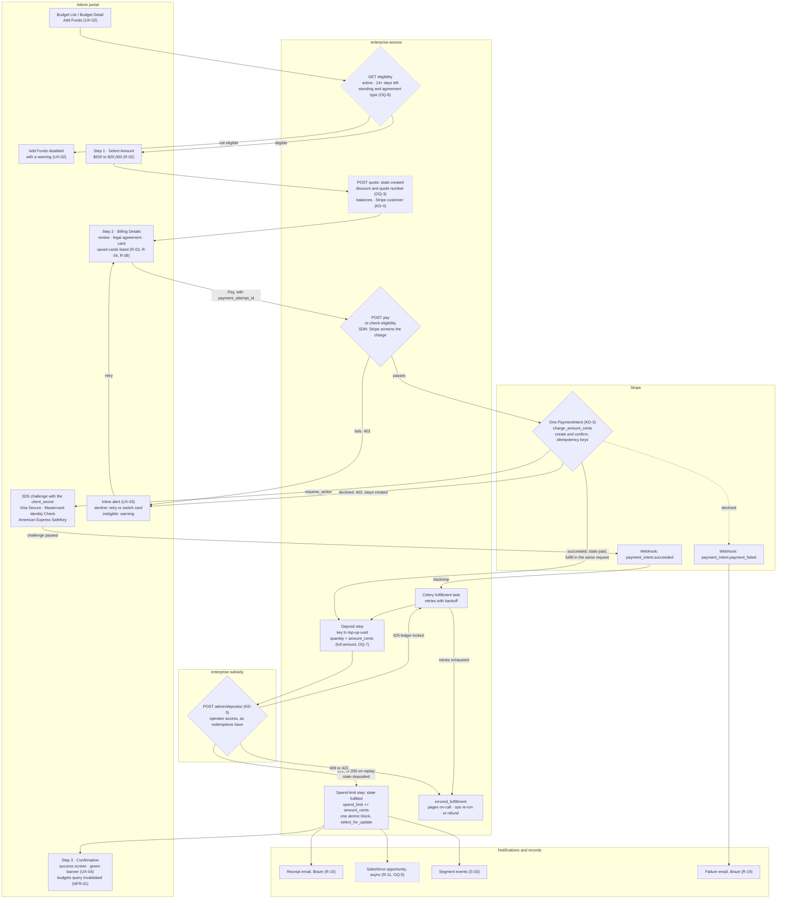
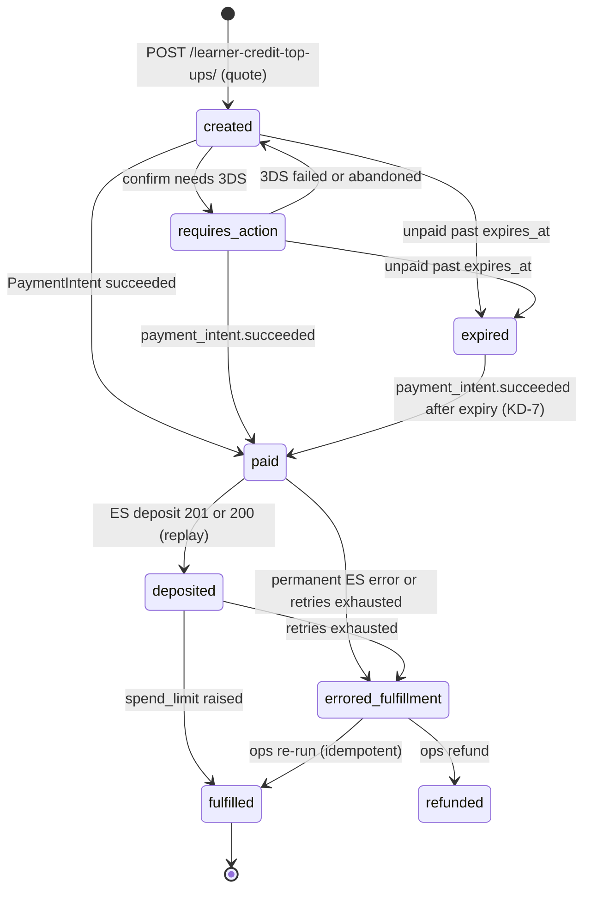
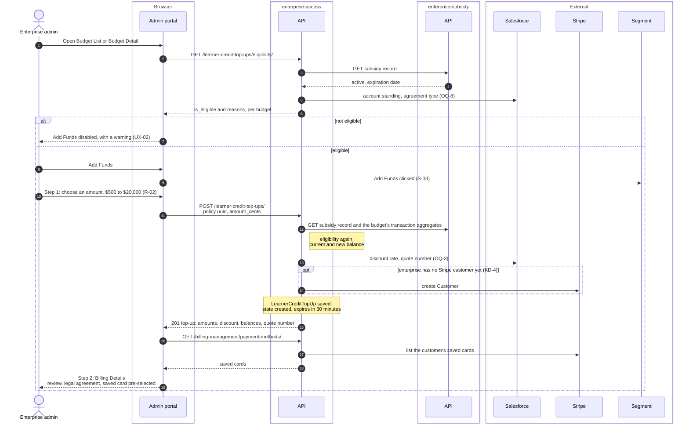
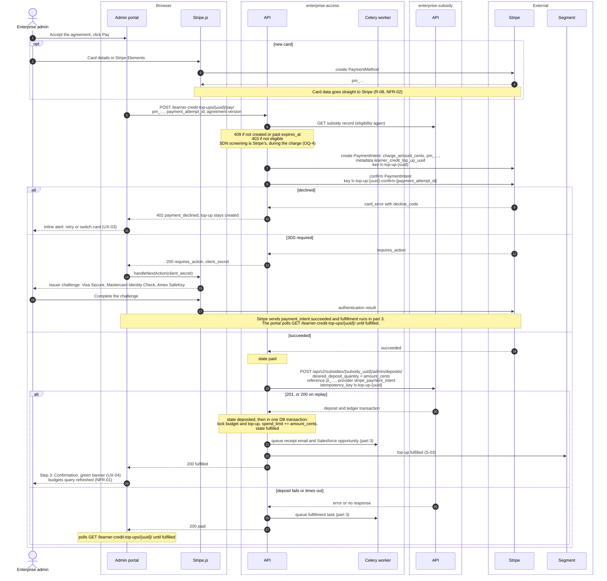
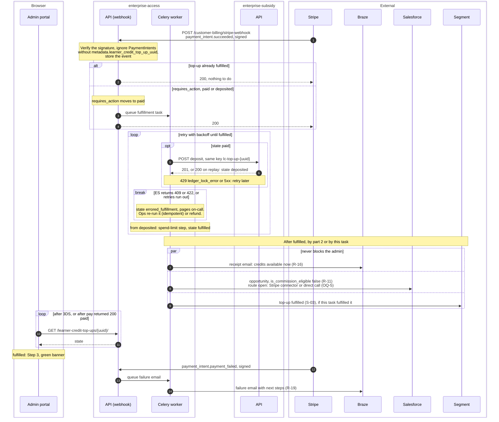

# Tech Spec: Learner Credit Self-Service Top Up

<!-- Ported from Confluence "Tech Spec Template - Agentic SDLC" and reconciled to Inner Loop v7. -->
 
> **Document Classification**
> **Type:** Plan Document (pre-build intent).
> This document captures how we intended to build BEFORE building. It becomes historical after release. Post-build truth lives in ADRs.

> **Conventions used in this spec**
> - **Ground every load-bearing claim about the existing system.** Tag each as **`[Specified]`** — verified against code or the PRD, with a `file:line` citation — or **`[Assumed]`** — not yet verified. An `[Assumed]` claim on a load-bearing path must be promoted to an Open Question (with an owner) before the Ready-to-Build gate; the gate's first criterion is that no load-bearing claim is still `[Assumed]`.
> - **Pre-build decisions live in Key Decisions**, not in ADRs. "Why this vs. that" reasoning belongs here while the design can still churn; ADRs are minted post-build at Knowledge Banking from the decisions that survived the build.

| Field | Value |
| --- | --- |
| Author | rthota-sonata@2u.com (co-authored with Claude) |
| Status | Draft |
| PRD Link | PRD (V2): Learner Credit Top Up — `https://2u-internal.atlassian.net/wiki/spaces/SOL/pages/4004348117/PRD+V2+Learner+Credit+Top+Up` |
| Engineering Lead | rthota-sonata@2u.com |
| Reviewers | Proposed, from the PRD's RACI (Eng Lead to confirm): Brian Beggs (Engineering; accountable and responsible for engineering implementation), Alberto Del Toro (PM), Justin Grabowski (RevOps; Salesforce) |
| Created | 2026-09-24 |
| Last Updated | 2026-10-21 |

## Background & Context

### Problem Summary

Enterprise admins can't add funds to an active Learner Credit budget themselves. Mid-term
top-ups go through Sales or CS, causing multi-day delays, repeat tickets, gaps where learners
can't enroll, and lost revenue. This spec designs a self-service top-up in the admin portal:
pay by card (funds available within 30 seconds) or ACH (3–4 business days), with the original
discount carried forward, eligibility and SDN gates, and an async Salesforce opportunity.
**Top-ups add funds, never time** — the budget's term and expiry don't change.

The PRD frames this as an integration on existing Subscription billing rails. Grounding shows
that is only partly true: signed Stripe webhooks, payment-method management, and email
plumbing exist, but one-time charges, ACH, SDN screening, Salesforce opportunity creation, and
a stored discount rate do not (see Current State). Delivery is therefore split into three
phases — see **Phased Delivery** below.

The two failure modes the design must rule out:

1. **Charged but not credited** — Stripe captures payment, but the deposit or spend-limit
   update fails, or a retry can't tell whether it already succeeded.
2. **Credited but not spendable** — the subsidy ledger grows but the budget's `spend_limit`
   doesn't, so the admin has paid for money they can't use.

### Phased Delivery

**Status:** Approved 2026-09-25 by the Eng Lead and the PM (Alberto Del Toro, in a meeting) —
KD-1, OQ-2.

The PRD's V1 ships in three phases. Card top-ups launch first, with the Salesforce opportunity
included because every deposit must be recorded and tracked auditably from the first sale. ACH
follows once the admin portal's card-only ADR is satisfied; billing history comes last.

| Phase | What ships | Requirements | Must be resolved first |
| --- | --- | --- | --- |
| **1 — Card top-ups + Salesforce** (launch) | "Add Funds" on Budget List and Budget Detail, with eligibility gating · amount selection · pre-charge review and legal agreement · discount carry-forward · card payment (Stripe Elements), saved to the Stripe customer · SDN screening · balance and spend limit raised within 30 s, safe to retry · async Salesforce opportunity · card receipt and payment-failure emails · green confirmation banner · feature flag | R-01 (card), R-02–R-06, R-08 (card), R-09, R-10, **R-11**, R-14, R-16, R-19 · UX-01–UX-03, UX-04 (card) · NFR-01–NFR-05 (NFR-04 without `PendingTopUp`) · S-01–S-04 | OQ-3 (discount and quote source) · OQ-5 (Salesforce route) · OQ-8 (standing and agreement-type data) |
| **2 — ACH** | Bank payment via Stripe Financial Connections, with the 3–4 business-day notice · "Pending Credits" on Budget List and Budget Detail · ACH-initiated and ACH-cleared emails · amber pending banner · pending state on the success screen · failure email extended to ACH returns | R-01 (ACH), R-06 (pending), R-07, R-08 (bank), R-12, R-17, R-18, R-19 (ACH) · UX-04 (ACH) · NFR-04 (`PendingTopUp`) | Phase 1 live · admin-portal ADR 0012 conditions met: security review and pentest, NACHA audit, Legal review of the authorization wording · a new ADR superseding ADR 0012 |
| **3 — Billing history** | Top-up transactions on the Billing screen (date, description, amount, "Paid") · Billing entry point hidden until the admin's first top-up | R-13 | Phase 1 live · the Billing page shown to customers without an active subscription (OQ-6, resolved 2026-10-19: both flags are on in production) |

**Until Phase 2 ships**, admins who want to pay by bank transfer keep going through Sales/CS.

**A Phase 1 decision sets Phase 3's cost.** The existing billing transaction list reads only
Stripe invoices, so charging top-ups through a Stripe Invoice would make them appear there
almost for free, while a direct PaymentIntent would not. KD-3 chose the PaymentIntent, so Phase 3
lists top-up records alongside the invoices.

### Current State — verified against code

*How does the system behave today? What is missing or broken? This section is grounded, not
recalled: every load-bearing claim cites `file:line` in the real repo and is tagged
`[Specified]`. If you cannot cite it, tag it `[Assumed]` and open an Open Question — do not
write it as fact. Grounding happens here, as part of drafting the spec; there is no separate
architecture pass or artifact.*

**Grounded against:**

| Repo | Branch | Commit (short SHA) | At head of main/master? |
| --- | --- | --- | --- |
| edx/enterprise-subsidy | `main` (no `release/ulmo` branch exists) | `78f9af7` | Yes |
| edx/enterprise-access | `main` | `67499592` (re-baselined 2026-09-28 from `994b8d99`; the only change to cited code was 5 lines inserted at line 170 of `customer_billing/models.py`, and the later citations are updated) | Yes — `release/ulmo` (`620ff2fb`) was considered and rejected: it is 282 commits behind `main` (branched 2025-10-30), and admin-portal `master` already calls `main`-only endpoints (`/api/v1/billing-management/*`) |
| edx/frontend-app-admin-portal | `master` (no `release/ulmo` branch exists) | `efb24ed5` (re-baselined 2026-09-28 from `825a8ec1`; browserslist update only, no cited file changed) | Yes |
| edx/frontend-app-enterprise-checkout | `main` (no `release/ulmo` branch exists) | `f3f0217` | Yes |
| openedx/course-discovery (precedent only) | `master` | `97c5ad7` | Yes |
| openedx/openedx-ledger (pip dependency) | tag `2.0.0` — the version pinned at `enterprise-subsidy:requirements/base.txt:231` | `a458d66` | No — `main` (`981831f`) differs only by a PII docstring annotation on `Transaction` |
| 2u-enterprise-subsidy-client (pip dependency of enterprise-access) | `2.2.1`, pinned at `EA:requirements/base.txt:7` | read from the installed package | n/a — pinned version |
| stripe-python (pip dependency of enterprise-access) | `15.6.1`, pinned at `EA:requirements/base.txt:382` | read from the published wheel (added 2026-10-16) | n/a — pinned version |
| edx-rest-api-client (pip dependency of enterprise-access) | `7.0.0`, pinned at `EA:requirements/base.txt:216` | read from the published wheel (added 2026-10-16) | n/a — pinned version |
| edx/edx-internal (deployment config) | `master` | `e342615e0` (fetched 2026-10-19; added for OQ-5) | Yes. The local checkout is on `rthota/ENT-10608` (`73af765ae`), so searches ran against `origin/master` and every remote branch. |
| edx/edx-platform (LMS; read only for its edx-enterprise pin) | `release-ulmo`, the fork's default branch (`edx/HEAD`) | `d249fc87d4` (added 2026-10-19, for OQ-12) | Unknown. `git fetch` failed on 2026-10-19 (no access to the SSH remote), so this is the last fetched ref, from 2026-09-04. `edx/master` is a stale 2025 branch. |
| edx-enterprise (pip dependency of the LMS) | `8.9.4`, pinned at `EP:requirements/edx/base.txt:476` | read from the published wheel (added 2026-10-19, for OQ-12) | n/a — pinned version |

*Citations are against read-only snapshots of the refs above, not local working checkouts
(local `enterprise-subsidy` and `frontend-app-admin-portal` are on feature branches).*

Paths below are prefixed by repo: `EA` = enterprise-access, `ES` = enterprise-subsidy,
`LED` = openedx-ledger, `AP` = frontend-app-admin-portal, `CHK` = frontend-app-enterprise-checkout,
`SCL` = 2u-enterprise-subsidy-client, `STR` = stripe-python, `ERC` = edx-rest-api-client, `INT` = edx-internal,
`EP` = edx-platform, `EE` = edx-enterprise.

**Budgets and balance**

- *[Specified]* A budget is a `SubsidyAccessPolicy`; many policies can share one subsidy
  (`subsidy_uuid` is not unique, `EA:enterprise_access/apps/subsidy_access_policy/models.py:218`;
  limits are summed per subsidy at `:359`).
- *[Specified]* Available balance is `min(spend_limit − spent, subsidy ledger balance)`
  (`EA:.../subsidy_access_policy/models.py:587-594`). **A ledger deposit alone does not raise
  it** for any budget that has a `spend_limit`.
- *[Specified]* `clean_spend_limit` rejects active limits summing above the subsidy's total
  deposits (`EA:.../subsidy_access_policy/models.py:434-444`), so the deposit must land
  **before** the spend-limit raise.
- *[Specified]* Ledger balance counts every transaction except `failed`
  (`LED:openedx_ledger/models.py:183-187`), and `create_deposit()` always writes `committed`
  (`LED:openedx_ledger/api.py:303`). A "pending" ACH deposit in the ledger would be spendable
  immediately.
- *[Specified]* No discount rate or quote number is stored anywhere. The subsidy's only
  Salesforce link is `reference_id` (an OpportunityLineItem ID,
  `ES:enterprise_subsidy/apps/subsidy/models.py:162-182`); `grep -i "discount|quote"` over
  enterprise-access models finds nothing relevant. The source of truth is Salesforce (Eng Lead,
  2026-09-25). See OQ-3.
- *[Specified]* The balance an admin sees is fetched fresh from enterprise-subsidy on every
  request. `subsidy_record()` caches only for the length of one request
  (`EA:.../subsidy_access_policy/models.py:510-531`), and `spend_available` reads it through that
  cache (`:558-594`). The one cross-request copy of the subsidy record (TieredCache, `:534-544`) is
  read only by a Braze task (`EA:enterprise_access/apps/content_assignments/tasks.py:226`). The portal
  caches budgets in react-query under `budgets(enterpriseId)`
  (`AP:src/components/EnterpriseSubsidiesContext/data/hooks.js:118-126`;
  `AP:src/components/learner-credit-management/data/constants.js:120`). So for NFR-01, "invalidate
  the balance cache" means invalidating that portal query after a top-up. No server cache needs
  clearing.

**Salesforce and warehouse access today**

- *[Specified]* No service in this design calls Salesforce. Salesforce calls enterprise-access
  (`EA:enterprise_access/apps/api/v1/views/provisioning.py:181`, "Called by Salesforce when the
  paid OLI is created…"). The only outbound Salesforce client in our repos is in
  course-discovery (`simple_salesforce`, `course-discovery:course_discovery/apps/course_metadata/salesforce.py:8`;
  `requirements/base.txt:553`) — a precedent, not reusable code.
- *[Specified]* enterprise-access already has a Snowflake helper using key-pair service
  credentials (`EA:enterprise_access/apps/core/snowflake.py:1, 41`), described as "for
  enterprise-access reporting commands". Its only callers are batch management commands
  (`EA:enterprise_access/apps/core/management/commands/monthly_impact_report.py:8`;
  `EA:enterprise_access/apps/track/management/commands/nudge_dormant_enrolled_enterprise_learners.py:10`);
  nothing in a request path uses it.

**Deposit paths today**

- *[Specified]* `SubsidyAccessPolicy.create_deposit()` — docstring: "referred to as a
  'Top-Up'" (`EA:.../subsidy_access_policy/models.py:1175`) — calls enterprise-subsidy, then
  `spend_limit += qty; save()` (`:1189-1194`). It passes no idempotency key and has no
  compensation if the save fails. Its only caller is the Django admin "Deposit Funds" tool
  (`EA:.../subsidy_access_policy/admin/__init__.py:118`).
- *[Specified]* enterprise-subsidy's only deposit API, `POST /api/v2/subsidies/<uuid>/admin/deposits/`
  (`ES:enterprise_subsidy/apps/api/v2/views/deposit.py:30-97`), requires operator access
  (`ES:enterprise_subsidy/apps/subsidy/rules.py:105`), rejects expired subsidies
  (`deposit.py:86-90`), and requires a sales-contract reference with an existing provider slug
  (`ES:enterprise_subsidy/apps/api/v2/serializers/deposits.py:50-54, 83-92`).
- *[Specified]* enterprise-access's service user already passes that operator check in production.
  enterprise-access uses the v2 subsidy client (`EA:enterprise_access/settings/base.py:579`; not
  overridden in `INT:argocd/applications/enterprise-access/prod-config.yaml`), so every Learner Credit
  redemption POSTs to `/api/v2/subsidies/<uuid>/admin/transactions/`
  (`EA:.../subsidy_access_policy/models.py:1082`; `SCL:edx_enterprise_subsidy_client/client.py:293, 335-369`).
  That endpoint requires `PERMISSION_CAN_CREATE_TRANSACTIONS`
  (`ES:enterprise_subsidy/apps/api/v2/views/transaction.py:177-178`), which maps to the same
  `has_operator_level_access` predicate as deposits (`ES:.../subsidy/rules.py:101, 105-106`), checked
  against the same context, the subsidy's enterprise (`ES:.../api/v2/views/deposit.py:69`). The grant
  itself is LMS data, not code: the LMS builds JWT `roles` from `SystemWideEnterpriseUserRoleAssignment`
  rows (`INT:argocd/applications/edxapp-lms/prod-config.yaml:2153`; `EE:enterprise/models.py:3771, 3828`),
  added in the LMS admin or with `assign_system_wide_enterprise_role`. Nothing grants it to service
  users automatically: the LMS's service-username list (`enterprise_access_worker` is on it,
  `INT:argocd/applications/edxapp-lms/prod-config.yaml:1125-1132`) is used only for API throttling
  (`EE:enterprise/api/throttles.py:37`). See OQ-9.
- *[Specified]* `create_deposit()` is not idempotent: a repeated key raises
  (`LED:openedx_ledger/api.py:286-287`) and surfaces as 422. Ledger-lock contention surfaces as
  the same 422 (`LED:openedx_ledger/api.py:317-320`; `deposit.py:96-97`), so callers can't tell
  a retryable failure from a permanent one.
- *[Specified]* The deposit view has a 200-on-replay path that is never used: "only here for when we
  eventually make deposit creation actually idempotent" (`ES:enterprise_subsidy/apps/api/v2/views/deposit.py:58-67, 92-94`).
  The serializer always reports a new deposit (`ES:.../api/v2/serializers/deposits.py:148`).
  enterprise-access's subsidy client already sends `idempotency_key` and documents 429 for lock
  contention (`SCL:edx_enterprise_subsidy_client/client.py:375-397, 406-407`), but
  `SubsidyAccessPolicy.create_deposit()` never passes a key (`EA:.../subsidy_access_policy/models.py:1180-1189`).
- *[Specified]* Deposit `metadata` is unpacked into `create_deposit(**metadata)`
  (`ES:.../api/v2/serializers/deposits.py:125-132`). A key that matches a ledger parameter name,
  such as `subsidy_access_policy_uuid` or `lms_user_id`, is written to that Transaction column
  rather than stored as metadata (`LED:openedx_ledger/api.py:52-65, 274-282`). If a deposit
  carried a policy UUID, it would be summed into that policy's aggregates
  (`ES:enterprise_subsidy/apps/api/paginators.py:30`; `EA:.../subsidy_access_policy/models.py:714-718`)
  and make the policy's spend look smaller than it is.
- *[Specified]* The only reference-provider slug is `salesforce_opportunity_line_item`
  (`ES:enterprise_subsidy/apps/subsidy/migrations/0022_backfill_initial_deposits.py:34-37`).
  Deleting a provider row deletes its deposits (`on_delete=CASCADE`, `LED:openedx_ledger/models.py:746-751`).
- *[Specified]* Only operators can write policies, including `spend_limit`
  (`EA:enterprise_access/apps/core/rules.py:537`). Enterprise admins get learner-level policy
  access (`EA:enterprise_access/settings/base.py:356-366`).

**Stripe and billing (enterprise-access)**

- *[Specified]* The only Stripe checkout is subscription mode, card only
  (`EA:enterprise_access/apps/customer_billing/stripe_api.py:37, 71-73`). No one-time payment
  exists: `grep "PaymentIntent\.create|'mode': 'payment'|Customer\.create\("` → 0 hits.
- *[Specified]* The Stripe customer is found by admin email (`stripe_api.py:83`) and resolved
  per enterprise only through a `CheckoutIntent`
  (`EA:enterprise_access/apps/api/v1/views/customer_billing.py:816-842`). Sales-provisioned
  Learner Credit customers have none, and no code creates one.
- *[Specified]* `CheckoutIntent` models a new-customer purchase — it reserves an enterprise's
  slug/name (`EA:.../customer_billing/models.py:194`) and a license quantity (`:319`) — and
  returns an already-paid intent unchanged (`:795-804`). It does not fit repeated top-ups.
- *[Specified]* The webhook verifies Stripe signatures
  (`EA:enterprise_access/apps/api/authentication.py:58-63`). It handles only `invoice.*` and
  `customer.subscription.*` events and ignores non-subscription invoices
  (`EA:.../customer_billing/stripe_event_handlers.py:379-382`). Processing is inline, and dedup
  is partial (`views/customer_billing.py:203-222`).
- *[Specified]* `payment_intent.succeeded` and `payment_intent.payment_failed` are declared event
  types (`EA:.../customer_billing/stripe_event_types.py:137, 140`) but nothing handles them.
  `persist_stripe_event` records only invoice and subscription events
  (`EA:.../customer_billing/stripe_event_handlers.py:112-123`). The `checkout_intent` foreign
  key is nullable on both event tables (`EA:.../customer_billing/models.py:1071-1073, 1131-1133`).
  No Stripe write call passes an idempotency key (grep `idempotency` over `customer_billing` and
  `provisioning` → 0 hits).
- *[Specified]* No service stores account standing or agreement type (grep
  `account_standing|good_standing|agreement_type` over EA and ES → 0 hits). See OQ-8.
- *[Specified]* The billing-management API (payment methods, address, invoice-based
  transactions) exists (`EA:enterprise_access/apps/api/v1/urls.py:44-45`), and admins have
  access (`EA:.../core/rules.py:635`), but it is off by default
  (`EA:enterprise_access/settings/base.py:678`). It is on in production and stage
  (`INT:argocd/applications/enterprise-access/prod-config.yaml:188`; `stage-config.yaml:249`;
  OQ-6, resolved 2026-10-19). Bank
  accounts can be listed and attached but not created or verified: no Financial Connections
  session, SetupIntent, or mandate code (grep). Transactions come only from `stripe.Invoice.list`
  (`views/customer_billing.py:1748`).
- *[Specified]* Salesforce integration is inbound only (Salesforce calls
  `EA:.../api/v1/views/provisioning.py:181`); Stripe→Salesforce is designed to run through
  Stripe's connector (`EA:docs/decisions/0026-stripe-event-consumption-delivery.rst:26-29`).
  `is_commission_eligible` appears nowhere (grep → 0). See OQ-5.
- *[Specified]* `is_commission_eligible` isn't configured in deployment either. In edx-internal,
  `git grep -i commission` finds nothing on `master` or on any remote branch. enterprise-access's
  deployed config has no Salesforce settings or credentials (`git grep -i salesforce` over
  `INT:argocd/applications/enterprise-access/` → 0 hits); the only Salesforce settings in
  edx-internal belong to course-discovery and edxapp (LMS/CMS). So `false` is not a deployed
  setting: whichever route OQ-5 picks has to send it.
- *[Specified]* SDN screening has no code; an ADR assumes Stripe handles it
  (`EA:docs/decisions/0030-self-service-purchasing-BFF.rst:488`). Only an embargoed-country
  list exists (`EA:enterprise_access/settings/base.py:706-709`). See OQ-4, resolved 2026-10-19:
  Stripe's screening is enough.
- *[Specified]* enterprise-access sends Segment events through `track_event`
  (`EA:enterprise_access/apps/track/segment.py:14`), which `customer_billing` already uses
  (`EA:.../customer_billing/stripe_event_handlers.py:346`). Portal events are named under
  `edx.ui.enterprise.admin_portal.learner_credit_management` (`AP:src/eventTracking.js:14, 19`); the
  PRD's `top_up_cta_clicked` doesn't follow that convention. Nothing in these repos shows how
  top-up data would reach Snowflake, which K-04 and K-05 are measured from. See OQ-10, resolved
  2026-10-21: through Segment events.
- *[Specified]* Emails are direct Braze sends from Celery tasks with retry
  (`EA:enterprise_access/tasks.py:14-39`). Campaigns are keyed to Teams/Essentials only
  (`EA:.../customer_billing/utils.py:76-80`); no top-up emails exist.
- *[Specified]* Feature flags: one unrelated global waffle flag (`EA:enterprise_access/toggles.py:18`);
  billing gates are Django settings. Self-service purchasing (SSP) is gated this way:
  `ENABLE_CUSTOMER_BILLING_API` and `ENABLE_BILLING_MANAGEMENT_API` (`EA:enterprise_access/settings/base.py:675-678`)
  decide whether `api/v1/urls.py` registers the billing routes at all (`EA:enterprise_access/apps/api/v1/urls.py:38-45, 51-52`),
  so with a setting off its endpoints return 404. Each environment sets them in edx-internal
  (`INT:argocd/applications/enterprise-access/prod-config.yaml:187-188`). On the checkout MFE, SSP is
  a config flag, `FEATURE_SELF_SERVICE_PURCHASING`, plus an unlock key a tester passes as
  `?feature=<key>` (`CHK:src/components/app/routes/loaders/rootLoader.ts:77-115`). The admin
  portal's top-up flag is already configured in edx-internal: `'true'` on stage and `''` (off) in
  production (`INT:frontends/frontend-app-admin-portal/stage_config.yml:46`; `prod_config.yml:46`).
  There is no per-enterprise flag mechanism in enterprise-access.
  django-waffle `5.0.0` and edx-toggles `6.0.0` are installed (`EA:requirements/base.txt:153, 220`;
  `EA:enterprise_access/settings/base.py:78, 118`), so a waffle flag can be turned on for everyone,
  a percentage, or named users and groups (django-waffle `waffle/models.py:144-187, 342-348`), but
  not for an enterprise. The LMS's `enterprise_features`, which the BFFs already read
  (`EA:enterprise_access/apps/bffs/context.py:335`), aren't per enterprise either: they are global
  edx-enterprise waffle flags (`EE:enterprise/toggles.py:202`). See KD-6 (OQ-12).
- *[Specified]* A `CheckoutIntent` owner can PATCH its state from `created` to `paid`
  (`EA:enterprise_access/apps/api/serializers/customer_billing.py:160-179`;
  `EA:.../customer_billing/constants.py:96-100`). Pre-existing and out of scope; raised
  separately with enterprise-access owners. Top-up state must not be client-writable.

**enterprise-subsidy infrastructure**

- *[Specified]* No Celery, no waffle usage, no Stripe code, no balance cache, and deposits
  emit no events (greps; event producers are transaction-only,
  `ES:enterprise_subsidy/apps/core/event_bus.py:46-91`). Balance is computed live
  (`ES:enterprise_subsidy/apps/subsidy/models.py:353-354`), so NFR-01's "invalidate the balance
  cache" has nothing to invalidate in this service.

**Admin portal**

- *[Specified]* A budget's URL id is a policy UUID or an ecommerce offer integer
  (`AP:src/components/learner-credit-management/data/hooks/useBudgetId.js:17-18`); the list
  fetches only active policies (`AP:src/data/services/EnterpriseAccessApiService.ts:278`).
  Offer-based budgets can't take top-ups.
- *[Specified]* Budget cards show available = `spendAvailableUsd` and "pending" =
  `amountAllocatedUsd` (`AP:src/components/EnterpriseSubsidiesContext/data/hooks.js:80-82`).
  "Pending Credits" needs its own field and label.
- *[Specified]* Budget-list items carry no `subsidyUuid` or `spendLimit`
  (`AP:src/components/EnterpriseSubsidiesContext/data/hooks.js:72-88`), and no portal code
  handles a PaymentIntent `client_secret` (grep). Billing calls pass `enterprise_customer_uuid` as
  a query parameter (`AP:src/data/services/EnterpriseAccessApiService.ts:703-826`).
- *[Specified]* "Expiring" status starts at 120 days
  (`AP:src/components/BudgetExpiryAlertAndModal/data/expiryThresholds.js:6`), with a "Contact
  support" CTA; Add Funds is blocked only inside 14 days (R-09).
- *[Specified]* Stripe JS is already a dependency (`AP:package.json:47-48`). A Billing page
  exists but shows only when `ENABLE_NATIVE_BILLING` is on and the customer has an active
  subscription (`AP:src/components/billing/data/utils.ts:17-18`), so Learner-Credit-only
  customers never see it. `ENABLE_NATIVE_BILLING` comes from `FEATURE_ENABLE_NATIVE_BILLING`
  (`AP:src/config/index.js:75`), which is `'true'` in production and stage
  (`INT:frontends/frontend-app-admin-portal/prod_config.yml:53`; `stage_config.yml:51`). So the
  active-subscription check is the only thing hiding the page from them.
- *[Specified]* Portal ADR 0012 (Accepted, March 2026) allows cards only; ACH requires
  Financial Connections, a security review and pentest, a NACHA audit, and Legal review
  (`AP:docs/decisions/0012-credit-card-only-payment-methods.rst:51, 81-87`).
- *[Specified]* The checkout MFE is subscription-only and not packaged for reuse, and it runs
  different Paragon/react-query major versions (`CHK:package.json:51, 55` vs
  `AP:package.json:46, 49`). Patterns can be reused; code can't.


### Relevant Architecture

| System | Role in This Feature | Owner |
| --- | --- | --- |
| frontend-app-admin-portal | Add Funds entry points, checkout UI, pending indicator, banners, billing history | `group:2u-enterprise` (`AP:catalog-info.yaml:29`) |
| enterprise-access | Owns budgets (`SubsidyAccessPolicy.spend_limit`), Stripe billing, webhooks, and Braze emails today | `group:2u-enterprise` (`EA:catalog-info.yaml:29`) |
| enterprise-subsidy | Ledger of record; deposit write | rthota-sonata@2u.com (Eng Lead); repo owner `group:2u-enterprise` (`ES:catalog-info.yaml:18`) |
| openedx-ledger (pip) | `Deposit` / `Transaction` models, balance, ledger lock | Open edX (shared library) |
| Stripe | Payments, customer, Financial Connections | External |
| Salesforce | Opportunity / revenue attribution | Justin Grabowski (RevOps) |
| Braze | Transactional emails | Integration code: `group:2u-enterprise` (enterprise-access). Campaign content: not named. The PRD's RACI has no email row; Marketing (Sam Creek) is the likely owner (Dependencies). |
| LMS / edx-enterprise | Enterprise customer record and admin JWT roles. Its `enterprise_features` are global waffle flags, not per-enterprise settings (Current State). | Not named. edx-enterprise isn't checked out in this workspace; its pinned wheel was read for OQ-12. This design makes no new calls to it (KD-6). |

## Requirements

*Carried from the PRD (source of truth for what to build), restated here with stable REQ-IDs
so each design decision and the Traceability section can reference them. Tag any requirement
the design assumes but the PRD does not yet state as `[Assumed]` and open an Open Question.*

**REQ-IDs are the PRD's own IDs** (R-, NFR-, UX-), so the spec and the PRD cite the same
numbers. Requirements the PRD states outside its numbered list, or that come from the Eng Lead,
are `S-01` onward. The **Phase** column replaces the template's P0/P1: the PRD doesn't rank
requirements, and delivery order comes from the approved phases (KD-1). A requirement that spans
two phases shows both. R-15 is not a requirement: the PRD uses that ID only for an out-of-scope
item, and it is dropped (Eng Lead, 2026-10-19; OQ-1).

| REQ-ID | Requirement | Type | Phase | Source |
| --- | --- | --- | --- | --- |
| R-01 | Add funds to an existing budget by card or by ACH. The balance updates within 30 s of a successful card charge, or within 30 s of ACH settlement. | Functional | 1 (card) · 2 (ACH) | PRD R-01 |
| R-02 | Choose a preset ($500, $1,000, $2,500, $5,000) or a custom amount from $500 to $20,000, validated on both client and server. The order summary updates live. | Functional | 1 | PRD R-02 |
| R-03 | Billing Details shows a pre-charge review: amount, discount, total, current and new balance, payment method, budget expiry. Pay stays disabled until the legal checkbox is checked. | Functional | 1 | PRD R-03 |
| R-04 | The admin accepts the Top-Up Legal Agreement, which shows the original Salesforce quote number and the budget expiry, and states that the original order terms apply. | Functional | 1 | PRD R-04 |
| R-05 | The original sale's discount carries forward automatically. The system uses the client's stored rate (which can be 0) and never derives a new one. Admins can't edit it; with no discount on record, the discount row is hidden. | Functional | 1 | PRD R-05 |
| R-06 | An order summary shows on every step. The success screen adds the transaction ID and payment method. A pending ACH top-up shows the credit as "Pending". | Functional | 1 · 2 (pending) | PRD R-06 |
| R-07 | Pay by bank through Stripe Financial Connections (search, sign in, select, link), with a 3–4 business-day settlement notice. | Functional | 2 | PRD R-07 |
| R-08 | Cards (Stripe Elements) and linked bank accounts are saved to the shared Stripe customer and pre-selected next time. Raw card data never touches edX servers. | Functional | 1 (card) · 2 (bank) | PRD R-08 |
| R-09 | Ineligible budgets can't be topped up. The portal disables Add Funds with a warning when fewer than 14 days remain; the backend separately checks account standing, agreement type, and active status, and returns 403 with structured error codes. | Functional | 1 | PRD R-09 (changed from 40 to 14 days by the PM, 2026-10-19) |
| R-10 | SDN screening runs on the backend for every transaction and every new or changed payment method, by Stripe. | Functional | 1 | PRD R-10 |
| R-11 | The balance updates within 30 s of a successful charge. An async Salesforce opportunity is created with `is_commission_eligible: false` and never blocks the success screen. | Functional | 1 | PRD R-11 |
| R-12 | In-flight ACH shows "Pending Credits" (amount and initiation date) on Budget Detail and Budget List. It is informational only and clears on settlement or failure. | Functional | 2 | PRD R-12 |
| R-13 | Top-ups appear on the Billing screen (date, description, amount, "Paid"). The Billing entry point stays hidden until the admin's first top-up. | Functional | 3 | PRD R-13 |
| R-14 | Checkout is scoped to the selected budget's `subsidy_uuid`; no cross-budget selection. | Functional | 1 | PRD R-14 |
| R-16 | A successful card charge sends a receipt email saying the credits are available now. | Functional | 1 | PRD R-16 |
| R-17 | An initiated ACH payment sends an email: payment in progress, credits pending, funds in 3–4 business days. | Functional | 2 | PRD R-17 |
| R-18 | A cleared ACH payment sends an email: credits applied and available. | Functional | 2 | PRD R-18 |
| R-19 | A failed or declined payment sends an email with corrective guidance. A declined card also shows an inline error. | Functional | 1 (card) · 2 (ACH return) | PRD R-19 |
| NFR-01 | Performance: the balance updates within 30 s of a card charge; the top-up endpoint responds in under 500 ms, excluding Stripe latency; writes invalidate the balance cache. | NFR | 1 | PRD NFR-01 |
| NFR-02 | Security: PCI-DSS (no raw card data on edX servers), SDN screening per transaction, RBAC via JWT (`SYSTEM_ENTERPRISE_ADMIN_ROLE`), idempotency keys against double charges, and a security review before release. | NFR | 1 | PRD NFR-02 |
| NFR-03 | Accessibility, WCAG 2.1 AA: full keyboard navigation, screen-reader tested, contrast of at least 4.5:1, status changes announced, color never the only signal. Paragon components only. | NFR | 1 | PRD NFR-03 |
| NFR-04 | Scalability: balance writes are atomic and race-free under concurrent load; a `PendingTopUp` model tracks in-flight ACH and soft-deletes after 30 days; Celery absorbs Salesforce-event backpressure. | NFR | 1 · 2 (`PendingTopUp`) | PRD NFR-04 |
| NFR-05 | Compatibility: Chrome, Firefox, Safari, Edge (latest 2 versions); responsive down to 375 px; behind `FEATURE_TOP_UP_LEARNER_CREDIT`, and with the flag off all entry points are hidden and requests return 404. | NFR | 1 | PRD NFR-05 (flag renamed; see below) |
| UX-01 | Checkout is an in-portal, full-content-area flow (not a modal) with a breadcrumb and a 3-step stepper: Select Amount → Billing Details → Confirmation. A live order-summary sidebar shows on the first two steps. | Functional (UX) | 1 | PRD UX-01 |
| UX-02 | Add Funds appears on Budget List and Budget Detail. For an ineligible budget it is disabled, with an inline warning explaining why. | Functional (UX) | 1 | PRD UX-02 |
| UX-03 | Failures show inline: a declined card gets an alert to retry or switch payment method; an ineligible budget gets a warning banner. | Functional (UX) | 1 | PRD UX-03 |
| UX-04 | After checkout, Budget Detail shows a banner: green ("funds added — now available") for a card, amber ("top-up pending") for ACH. | Functional (UX) | 1 (card) · 2 (ACH) | PRD UX-04 |
| S-01 | Every self-service deposit is recorded and auditable in the database: who started it, the amount, when, the payment method and reference, and the discount applied. | Functional | 1 | Eng Lead, 2026-09-25; the repo PRD's Outcome 2 (`ES:docs/prd/learner-credit-top-up-prd.md:76`). Not in the PRD V2 text. |
| S-02 | A top-up adds funds, never time. It never changes the budget's or the subsidy's term or expiration, and it is not a renewal. | Functional (constraint) | 1 | PRD Executive Summary ("Core constraint") and Out of Scope |
| S-03 | Emit the tracking events the success metrics are measured from: at least the K-01 funnel (Add Funds clicked → payment succeeded), plus the events K-04 and K-05 are counted from, sent to Segment (OQ-10). | Functional | 1 | PRD Success Metrics |
| S-04 | Make the guardrails measurable: the failed-payment rate (must stay below 5%) and the SDN failure rate (no upward anomaly). The third guardrail, CS/Sales ticket volume, is measured outside these systems. | NFR | 1 | PRD Success Metrics, Guardrails |

**Where the design reads the PRD differently** (each is settled or tracked elsewhere in this spec):

- NFR-01, "invalidate the balance cache": no server cache sits on the balance path. The portal's
  budgets query is what gets invalidated (Current State).
- NFR-01, "under 500 ms": `pay` funds the budget in the same request (KD-3), and that includes a
  call to enterprise-subsidy that takes the ledger lock. The lock doesn't wait: a busy lock fails at
  once and returns 429 (Integration Points). This is settled in the Performance Budget.
- NFR-04, `PendingTopUp`: replaced by `LearnerCreditTopUp` in `state=processing`. Rows are kept,
  not soft-deleted after 30 days, because of S-01 (Data Model). To be confirmed with the PM in Phase 2
  design.
- R-09 depends on data that doesn't exist yet (OQ-8). R-10 is met by Stripe's own screening, so
  enterprise-access adds no SDN check (OQ-4, resolved 2026-10-19).
- S-04, the SDN failure rate: out of scope for Phase 1 (OQ-13, Eng Lead 2026-10-21). Stripe screens
  payments, and enterprise-access doesn't count screening blocks. The failed-payment rate is still
  measured. The Data Model notes what a future change would need.
- NFR-05, flag name: the PRD calls the flag `FEATURE_LEARNER_CREDIT_TOP_UP`. This spec uses
  `FEATURE_TOP_UP_LEARNER_CREDIT`, the name the admin portal already ships
  (`AP:src/config/index.js:76` as of `ac9849ae`, #183), so the portal and the backend use one name
  (Eng Lead, 2026-10-13). enterprise-access reads it as a Django setting, the way it gates SSP (KD-6).
  **Note:** `FEATURE_LEARNER_CREDIT_TOP_UP` = `FEATURE_TOP_UP_LEARNER_CREDIT`. Both names refer to
  the same flag; wherever the PRD says `FEATURE_LEARNER_CREDIT_TOP_UP`, read `FEATURE_TOP_UP_LEARNER_CREDIT`.

## Key Decisions

*Pre-build decisions and the reasoning behind them ("why this vs. that") — the
architecture-justification / tradeoff record. These are decisions **of this spec**, provisional
until built. Each is grounded in the Current State above and cites the REQ(s) it serves. After
release, the decisions that survived the build are minted as ADRs at Knowledge Banking; the
`Rejected Alternative` column is the fuller Alternatives Considered table's short form.*

| # | Decision | Why (tradeoff / justification) | Rejected Alternative | REQs |
| --- | --- | --- | --- | --- |
| KD-1 | Deliver in three phases (see Phased Delivery): (1) card top-ups plus the Salesforce opportunity, (2) ACH and Pending Credits, (3) billing history. | ACH is blocked by admin-portal ADR 0012 until a security review, pentest, NACHA audit, and Legal review are done, and one-time charges are net-new; shipping card first delivers the value without waiting on ACH compliance. Salesforce is in Phase 1 because deposits must be recorded and tracked auditably in the database from the first sale (Eng Lead, 2026-09-25); it also protects revenue attribution (PRD RK-03, K-03), and Phase 1 already needs Salesforce data for the discount (OQ-3). Billing history waits on how Phase 1 charges (OQ-6, which it also waited on, was resolved 2026-10-19). | One V1 release with every PRD requirement (all value blocked on ACH compliance); Salesforce opportunity in a later phase (revenue from early top-ups unattributed). | All — per-phase mapping in Phased Delivery |
| KD-2 | Top-ups live in enterprise-access's `customer_billing` app. A new `LearnerCreditTopUp` model owns the state machine and the orchestration. enterprise-subsidy stays the ledger of record and only takes the deposit. | enterprise-access already has the Stripe client, the webhook registry (`EA:.../stripe_event_handlers.py:524-554`), billing-management access control, the Celery and Braze tasks, and write access to `spend_limit`. enterprise-subsidy has none of these (Current State). `customer_billing` rather than a new app because the top-up needs that app's webhook dispatch, Stripe helpers and permissions anyway; a new app would only be separate in name. | Record in enterprise-subsidy (it would need Stripe, Celery, a webhook, and a call back into enterprise-access to raise `spend_limit`); a separate `top_up` app in enterprise-access (it would import all of `customer_billing` anyway). | R-01, R-09, R-11, R-14, NFR-04; S-01 |
| KD-3 | Charge each top-up through one Stripe PaymentIntent, created and confirmed on the server with a saved card. Fulfill in the same request when the charge succeeds; the `payment_intent.succeeded` webhook and a Celery task are backstops. | Confirming on the server puts the eligibility and SDN checks at the moment of charge (R-09, R-10). Fulfilling in the same request meets the 30-second target (R-01, NFR-01) without waiting for webhook delivery. With one PaymentIntent per top-up, a double charge can't happen (NFR-02, RK-04). The live invoice handlers, which only handle subscriptions (`EA:.../stripe_event_handlers.py:353-383, 560`), are left alone. Cost: Phase 3 billing history must list top-up records alongside Stripe invoices, because today it reads only invoices (`EA:.../views/customer_billing.py:1748`). | Confirm in the browser and fulfill only from the webhook (no server check at the moment of charge, and funds wait for webhook delivery); one-off Stripe Invoice (Phase 3 nearly free, but it changes the live subscription invoice path and needs more Stripe calls per charge). | R-01, R-06, R-08, R-10, R-13 (cost), R-16, R-19, NFR-01, NFR-02 |
| KD-4 | Add a new `EnterpriseStripeCustomer` table that maps each enterprise to its Stripe customer, backfilled from `CheckoutIntent`. For an enterprise with no Stripe customer, enterprise-access creates one when the first quote is made. | Sales-provisioned Learner Credit customers have no `CheckoutIntent`, so today neither top-ups nor saved payment methods can find their Stripe customer (`EA:.../views/customer_billing.py:816-842`). One table fixes both. | Stripe customer search by metadata (the search index lags and is rate-limited, so duplicate customers are possible); a synthetic `CheckoutIntent` (it reserves a slug and name, and needs a product and a license quantity). | R-08, R-14 |
| KD-5 | Make enterprise-subsidy's existing deposit endpoint safe to retry when the caller sends an explicit `idempotency_key`: 200 for a replay, 409 for a conflict, 429 when the ledger is locked. Add a `stripe_payment_intent` reference provider for top-up deposits. | Today a retry and a lock timeout both return 422 (`ES:.../api/v2/views/deposit.py:96-97`), so enterprise-access can't tell "already done" from "try again" from "failed". The view already has the 200-on-replay path (`deposit.py:58-67, 92-94`) and the enterprise-access client already sends keys (`SCL:.../client.py:375-407`), so the change is small and needs no client release. Calls without a key still get 422, so an operator's accidental duplicate is still blocked. A top-up has no OpportunityLineItem when the deposit is made, so its reference is the PaymentIntent. | A new endpoint just for self-service deposits (duplicates the validation and needs a new client method); no enterprise-subsidy change, with enterprise-access checking for an existing deposit first (no deposit lookup exists, `ES:enterprise_subsidy/apps/api/filters.py:41-48`, and the check races). | R-01, NFR-02, NFR-04; S-01 |
| KD-6 | enterprise-access reads `FEATURE_TOP_UP_LEARNER_CREDIT` the way it gates self-service purchasing (SSP): as a Django setting, default `False`, that decides whether `api/v1/urls.py` registers the `learner-credit-top-ups` routes. With it off, every top-up endpoint returns 404 (NFR-05). Each environment sets it in edx-internal, next to `ENABLE_CUSTOMER_BILLING_API`. (Eng Lead, 2026-10-19; resolves OQ-12.) | This is how enterprise-access already gates its billing APIs (`EA:enterprise_access/settings/base.py:675-678`; `EA:enterprise_access/apps/api/v1/urls.py:38-45`; `INT:argocd/applications/enterprise-access/prod-config.yaml:187-188`), so it needs no new mechanism. The Stripe webhook stays under `customer-billing`, which `ENABLE_CUSTOMER_BILLING_API` gates, so a top-up that was already paid is still credited when this flag is off (Feature Flags). The PRD's NFR-05 asks only for the gate and the 404, not per-enterprise control. **Cost:** the flag applies to a whole environment, so production can't be piloted with a few enterprises. Turning it on or off takes an edx-internal change and a redeploy, not a runtime toggle, on both the backend and the portal. | A global waffle flag (a runtime toggle that can target users and groups, but a second flag style for this one feature); a waffle flag plus a per-enterprise allowlist (new code and a new pattern); the LMS's `enterprise_features` (also global waffle flags, so it adds an LMS call without per-enterprise control). | NFR-05, UX-02 |
| KD-7 | A charge that succeeds after its quote expired is credited. The state machine allows `expired → paid`, and the `payment_intent.succeeded` handler treats an `expired` top-up like `created` or `requires_action`: it moves it to `paid` and queues fulfillment. (Eng Lead, 2026-10-21; resolves OQ-11, option (a).) | Money that has been taken must always be credited (failure mode 1). A 3DS challenge can be finished after `expires_at`, and Stripe then captures the payment. Cancelling the PaymentIntent when the quote expires (option b) still races with a challenge being finished at that moment, and the loser of that race is a charge with nothing to credit it. The amounts were fixed in the quote the admin accepted, so crediting them later charges no price the admin didn't agree to. **Cost:** a late charge isn't re-checked for eligibility. If the subsidy expired in between, the deposit fails with 422, the top-up goes to `errored_fulfillment`, on-call is paged, and it is refunded. | Cancel the PaymentIntent when a quote in `requires_action` expires (races with a finished challenge, and leaves charges to find and refund by hand). | R-01, NFR-02; S-01 |

**Superseded Decisions:** none. This spec doesn't replace an earlier draft.

## Proposed Design

### High-Level Architecture

**Top-up flow (Phase 1, card).** This is the whole path, from the Add Funds button to spendable
funds. Endpoints are in API Contracts, states in the `LearnerCreditTopUp` state machine, and the
deposit and spend-limit steps in the Fulfillment rules (Data Model). Dashed boxes depend on an
open question that still blocks Phase 1.



- **Two amounts (OQ-7).** Stripe charges `charge_amount_cents`, the discounted total. The deposit
  and the `spend_limit` increase both use `amount_cents`, the full selected amount.
- **When fulfillment doesn't finish in the `pay` request**, the response says `paid` and the portal
  polls `GET /learner-credit-top-ups/<uuid>/` until the top-up is `fulfilled`. It does the same after
  a 3DS challenge, where the webhook queues fulfillment.
- **Every retry is safe.** The PaymentIntent can succeed only once, and the deposit key returns the
  same deposit on replay. The spend-limit step runs only from `deposited`, so it runs once.
- **Phase 2** adds ACH: `payment_intent.processing` moves the top-up to `processing` (Pending
  Credits), and fulfillment waits for the payment to settle.

### Data Model

*The shape follows KD-2 through KD-5. Column-level detail (indexes, the ERD) is finalized in the
impl-plan.*

**New Models / Tables**

| Model / Table | Fields | Relationships | Notes |
| --- | --- | --- | --- |
| `LearnerCreditTopUp` (EA `customer_billing`) | See the field table below | FK → `SubsidyAccessPolicy` (PROTECT); FK → `User` (SET_NULL) | One row per top-up, from quote to fulfillment. This is the audit record for every self-service deposit (S-01), and rows are never deleted. `TimeStampedModel` + `HistoricalRecords` with a UUID primary key, like `ForcedPolicyRedemption` (`EA:.../subsidy_access_policy/models.py:2152-2229`). State changes go through an allowed-transitions table, as `CheckoutIntent` does (`EA:.../customer_billing/constants.py:96-121`; `models.py:371-396`). |
| `EnterpriseStripeCustomer` (EA `customer_billing`) | `enterprise_customer_uuid` (UUID, unique) · `stripe_customer_id` (char 255, unique) · `source` (`checkout_intent_backfill` / `created_for_top_up`) | None; the enterprise is referenced by UUID, as elsewhere in EA | KD-4. `TimeStampedModel` + `HistoricalRecords`. `_get_stripe_customer_id_for_enterprise` reads this table first and falls back to `CheckoutIntent` (`EA:.../views/customer_billing.py:816-842`). |
| enterprise-subsidy: no new table | — | — | One new data row: a `SalesContractReferenceProvider` with slug `stripe_payment_intent` (KD-5; slugs are limited to 32 characters, `LED:openedx_ledger/models.py:683-685`). The slug is its own constant, not added to `SubsidyReferenceChoices`, because that list is also the set of allowed `Subsidy.reference_type` values (`ES:enterprise_subsidy/apps/subsidy/models.py:63-70, 176`) and a subsidy is never created by a PaymentIntent (Eng Lead, 2026-10-13). Each top-up is an ordinary ledger `Deposit` + `Transaction` (`LED:openedx_ledger/models.py:701-756`), so top-up funds are interchangeable with the original funds (PRD A-3). |

**`LearnerCreditTopUp` fields**

| Field | Type | Notes |
| --- | --- | --- |
| `uuid` | UUID, PK | Source of every idempotency key: `lc-top-up-<uuid>` for the Stripe PaymentIntent and for the ES deposit. Shown to the admin as the transaction ID (R-06). |
| `enterprise_customer_uuid` | UUID, indexed | Must match the policy's enterprise; checked on every request. |
| `subsidy_access_policy` | FK, PROTECT | The budget (R-14). PROTECT because a paid top-up must never lose its budget. Policies are soft-deleted with `active=False`, so they are never hard-deleted in normal use (`EA:.../subsidy_access_policy/models.py:1196-1206`). |
| `subsidy_uuid` | UUID, indexed | Copy of `policy.subsidy_uuid` taken when the top-up is created; this is where the deposit goes. |
| `initiated_by` / `initiated_by_lms_user_id` | FK `User` (SET_NULL) / integer | The integer ID is kept after the user is retired (`EA:enterprise_access/apps/core/models.py:20`). Needs a `.. pii:` annotation, as on `StripeEventData` (`EA:.../customer_billing/models.py:1050`). |
| `state` | char, indexed, choices | See the state machine below. Only the server writes it; clients can never set it (see the `CheckoutIntent` PATCH gap in Current State). |
| `amount_cents` | BigInteger | Credit added to the budget: the full selected amount, not the discounted amount (OQ-7). It is used three times: as the ES `desired_deposit_quantity`, as the `spend_limit` increase, and as the amount validated against the 50,000–2,000,000 range (R-02). |
| `discount_rate` | Decimal(5,4), null | Copied at quote time (R-05). `NULL` means no discount is on record, so the discount row is hidden. `0` is a real 0% rate and is never used as a default for `NULL` (RK-05). Source: OQ-3. |
| `discount_cents` / `charge_amount_cents` | BigInteger | The card is charged `amount_cents − discount_cents`. The admin pays the discounted price and receives the full selected amount as credit (OQ-7, resolved 2026-10-12). With no discount on record, the two amounts are equal. |
| `currency` | char(3) | `usd` only. |
| `sales_quote_number` | char, null | Copied at quote time for the legal agreement (R-04). Source: OQ-3. |
| `agreement_version` / `agreement_accepted_at` | char / datetime, null | Set when the admin pays (R-04). |
| `stripe_customer_id` | char, indexed | Taken from `EnterpriseStripeCustomer`. |
| `stripe_payment_intent_id` | char, unique, null | Each top-up has exactly one PaymentIntent (KD-3). |
| `payment_method_type` / `stripe_payment_method_id` | char / char, null | `card` in Phase 1; `us_bank_account` in Phase 2. Card brand and last 4 digits are fetched from Stripe, not stored. |
| `deposit_uuid` / `ledger_transaction_uuid` | UUID, null | Returned by ES (`ES:enterprise_subsidy/apps/api/v2/serializers/deposits.py:30-37`). |
| `spend_limit_before` / `spend_limit_after` | Integer, null | Written in the same DB transaction as the `spend_limit` increase. They are the audit trail and show the increase happened once. They stay `NULL` when the policy has no `spend_limit`, because in that case the ledger deposit alone raises the available balance (`EA:.../subsidy_access_policy/models.py:587-594`). |
| `expires_at` | datetime | Unpaid quotes expire (proposed: 30 minutes), so a stale discount or balance is never charged. |
| `paid_at` / `deposited_at` / `fulfilled_at` | datetime, null | Each is set once, on the change into that state, in the same save as the state. `fulfilled_at − paid_at` is the time-to-spendable-funds metric (Performance Budget), and `paid_at` / `deposited_at` start the stuck-top-up alert's clock (Fulfillment rule 4). |
| `last_error` | text, null | Same role as `CheckoutIntent.last_checkout_error` (`EA:.../customer_billing/models.py:326`). |
| `salesforce_opportunity_id` / `salesforce_synced_at` | char / datetime, null | For R-11. The shape may change once OQ-5 is answered. |

Constraints: `stripe_payment_intent_id` is unique, and `(subsidy_access_policy, state)` is indexed for the
Pending Credits and billing-history queries.

**Future, out of scope for Phase 1 (OQ-13).** The model stores no SDN screening result, and Phase 1
doesn't count screening blocks. A decline leaves the top-up in `created`; the only traces are the
`payment.failed` Segment event and the stored Stripe event. If the S-04 SDN guardrail is ever counted
in enterprise-access, record each payment attempt's Stripe outcome rather than inferring it from the
top-up's state: for example a `LearnerCreditTopUpPaymentAttempt` table keyed by `payment_attempt_id`,
with the decline code and Stripe's outcome type, or at least a `last_decline_code` column. That
also needs a way to tell a screening block from other declines (OQ-13).

**`LearnerCreditTopUp` states**



**3DS** (3-D Secure) is the card issuer's authentication challenge. The card networks brand it as
**Visa Secure**, **Mastercard Identity Check**, and **American Express SafeKey**, so an admin may see
any of these names on their bank's challenge screen. All of them reach this design the same way:
the PaymentIntent returns `requires_action`, and the portal completes the challenge with the
`client_secret` (Stripe reference: `https://docs.stripe.com/payments/3d-secure`).

A declined card leaves the top-up in `created`, because the PaymentIntent returns to
`requires_payment_method`, so the admin can retry or switch cards. Phase 2 adds two states:
`processing` for ACH in flight and `payment_failed` for an ACH return. Pending Credits is then just
`state=processing`, which replaces the separate `PendingTopUp` model named in PRD NFR-04. Pending
rows are kept, not soft-deleted after 30 days, because every deposit must stay auditable. Confirm
this during Phase 2 design.

**Fulfillment rules.** These rules either rule out the two failure modes in the Problem Summary or make them trigger an alert.

1. The deposit is made only after the PaymentIntent has succeeded (PRD Principle 2).
2. **Deposit step:** the ES call uses the key `lc-top-up-<uuid>`. A replay returns the same deposit (KD-5), so retries never deposit twice.
3. **Spend-limit step:** one `transaction.atomic()` block locks the policy and the top-up with
   `select_for_update()`, adds `amount_cents` to `spend_limit`, and moves the top-up to `fulfilled`.
   It runs only from `deposited`, so it runs once. It must read a fresh `total_deposits`, because
   `clean_spend_limit` reads the subsidy record from the request cache
   (`EA:.../subsidy_access_policy/models.py:434-444, 511-545`). `select_for_update` is not used
   anywhere in enterprise-access today (grep → 0 hits), so this is a new pattern for the repo.
4. A top-up that stays in `paid` or `deposited` past the alert threshold, or reaches
   `errored_fulfillment`, pages on-call. This is the "charged but not credited" alarm; the
   threshold is set in Monitoring & Alerting.
5. Deposit metadata uses only keys that don't clash with ledger parameter names. It never uses
   `subsidy_access_policy_uuid` or `lms_user_id` (see Current State). The metadata written is:
   `source: "learner_credit_top_up"`, `learner_credit_top_up_uuid`, `top_up_policy_uuid`,
   `initiated_by_lms_user_id`, `stripe_payment_intent_id`, `discount_rate`, `charge_amount_cents`.
   The deposit's provider is `stripe_payment_intent` and its reference ID is the `pi_…` ID. Together
   these let the ledger alone show who made the top-up, how much, when, which payment, and what
   discount applied (S-01).

**Migrations Required**

| Migration | Description | Risk (table size, locks) | Rollback Strategy |
| --- | --- | --- | --- |
| EA `customer_billing`: add `LearnerCreditTopUp` and its history table | New tables | None; creates tables only and locks no existing table | Reverse the migration only before the first real top-up. After launch, turn the flag off and keep the tables, which hold payment records. |
| EA `customer_billing`: add `EnterpriseStripeCustomer` and its history table | New tables | None | Same as above. |
| EA `customer_billing`: backfill `EnterpriseStripeCustomer` from `CheckoutIntent` | For each enterprise, take the latest intent that has a Stripe customer ID, using the same ordering as `EA:.../views/customer_billing.py:816-842` | Low. Reads `CheckoutIntent`, which has about one row per self-service purchase (`[Assumed]` small). `get_or_create` makes it safe to re-run. | The reverse step does nothing. The lookup falls back to `CheckoutIntent`, so the code can be rolled back on its own. |
| ES `subsidy`: data migration that adds the provider `stripe_payment_intent` | `get_or_create`, like `ES:.../subsidy/migrations/0022_backfill_initial_deposits.py:34-37` | None; adds one row | **The reverse step must do nothing.** Deleting the provider row would also delete every top-up `Deposit` (`LED:openedx_ledger/models.py:746-751`). |

Deploy order: the ES migration and deposit fix first, then the EA migrations, then the EA code behind the flag, then the portal.

**ERD:** in the impl-plan's Data Model (`docs/plans/impl-plan.md`), generated from this section. It shows the same tables plus the enterprise-subsidy `Deposit`, `Transaction` and provider rows.

### API Contracts

*All new endpoints are in enterprise-access under `/api/v1/learner-credit-top-ups/` (KD-2).
Conventions match billing-management:*

- *Auth is JWT.*
- *`enterprise_customer_uuid` is a required query parameter on every call and is the access-control
  context (`EA:.../views/customer_billing.py:958-961`).*
- *JSON is snake_case, and the portal converts it to camelCase (`AP:src/data/services/EnterpriseAccessApiService.ts:703-826`).*
- *Money is in integer USD cents.*

*Permission: a new `customer_billing.learner_credit_top_up` permission, granted to the same roles as
`BILLING_MANAGEMENT_ACCESS_PERMISSION`: customer-billing operators and admins. Enterprise admins
get the admin role through `SYSTEM_ENTERPRISE_ADMIN_ROLE` (`EA:.../core/rules.py:634-637`;
`settings/base.py:356-363`). A separate permission lets top-up access be narrowed later (PRD open
question 3) without changing billing-management access. Every endpoint returns 404 when the feature
flag is off (NFR-05), because the routes aren't registered (KD-6).*

**New Endpoints**

| Method | Path | Request Body | Response | Auth | Notes |
| --- | --- | --- | --- | --- | --- |
| GET | `/api/v1/learner-credit-top-ups/eligibility/?enterprise_customer_uuid=&policy_uuid=` | — | 200 `{"results": [{"policy_uuid", "is_eligible", "reasons": [{"error_code", "developer_message"}], "subsidy_expiration_datetime"}]}`. Covers every active policy of the enterprise, or only the one named by `policy_uuid`. | top-up permission | Drives the Add Funds button on Budget List and Budget Detail (UX-02, R-09). It runs the same checks as the write endpoints, so the portal and backend can't disagree (RK-07). It is not added to the shared `subsidy-access-policies` list (`EA:enterprise_access/apps/api/v1/views/subsidy_access_policy.py:264-337`), although that list already returns `subsidy_expiration_datetime` and `is_subsidy_active`: its read permission includes learners, because enterprise admins get the same learner-level policy role (`EA:.../core/rules.py:529-532`; `settings/base.py:356-366`); it can't fail closed, because its serializer swallows subsidy errors (`EA:enterprise_access/apps/api/serializers/subsidy_access_policy.py:120-155`); it can't return 404 when the flag is off without breaking its other callers; and it pages at 10 policies (`subsidy_access_policy.py:257-261`). The eligibility endpoint reuses its filter (`EA:enterprise_access/apps/api/filters/subsidy_access_policy.py:10-25`) and the policy's subsidy-record properties. |
| POST | `/api/v1/learner-credit-top-ups/?enterprise_customer_uuid=` | `{"subsidy_access_policy_uuid", "amount_cents"}` | 201 top-up (see below) with `state: created` | same | Creates the quote. It checks eligibility, records the discount, quote number and balances, and makes sure the enterprise has a Stripe customer (KD-4). The result feeds the Billing Details review (R-03) and the legal agreement (R-04). Nothing is charged. To change the amount, create a new quote; unpaid quotes expire. |
| POST | `/api/v1/learner-credit-top-ups/<uuid>/pay/?enterprise_customer_uuid=` | `{"payment_method_id": "pm_…", "payment_attempt_id": "<uuid>", "agreement_accepted": true, "agreement_version"}` | 200 top-up. `state` is `fulfilled`, or `paid` (fulfillment deferred; poll), or `requires_action` with a `client_secret` (3DS). 402 if the card is declined. | same | See KD-3. Details below the table. |
| GET | `/api/v1/learner-credit-top-ups/<uuid>/?enterprise_customer_uuid=` | — | 200 top-up | same | Used by the success screen, and for polling after 3DS or a deferred fulfillment (R-06). |
| GET | `/api/v1/learner-credit-top-ups/?enterprise_customer_uuid=&subsidy_access_policy_uuid=&state=` | — | 200 paginated list of top-ups | same | Ships in Phase 1 for ops and the success screen. Phase 2 reads `state=processing` for Pending Credits (R-12). Phase 3 reads `state=fulfilled` for billing history and for the "at least one top-up" check (R-13). |

**How `pay` works** (all steps on the server):

1. It re-checks eligibility. SDN screening is Stripe's own, during the charge (OQ-4), so
   enterprise-access runs no check of its own.
2. It creates the top-up's single PaymentIntent with idempotency key `lc-top-up-<uuid>`. Setting
   `setup_future_usage` saves the card to the Stripe customer (R-08).
3. It confirms the PaymentIntent with key `lc-top-up-<uuid>-confirm-<payment_attempt_id>`. The
   portal generates one `payment_attempt_id` per click of Pay, so a double-click replays the same
   request instead of charging again. A PaymentIntent can succeed only once, so no sequence of
   retries can charge twice (NFR-02, RK-04).
4. On success, it tries fulfillment in the same request. If that fails for any reason, a Celery task
   takes over.

**Top-up response body**

```json
{
  "uuid": "6f1c…",
  "state": "fulfilled",
  "subsidy_access_policy_uuid": "…",
  "amount_cents": 100000,
  "discount_rate": "0.1000",
  "discount_cents": 10000,
  "charge_amount_cents": 90000,
  "currency": "usd",
  "current_balance_cents": 25000,
  "new_balance_cents": 125000,
  "subsidy_expiration_datetime": "2027-06-30T00:00:00Z",
  "sales_quote_number": "Q-01234",
  "agreement_version": "2026-10-01",
  "payment_method": {"type": "card", "brand": "visa", "last4": "4242"},
  "client_secret": null,
  "expires_at": "…",
  "created": "…",
  "fulfilled_at": "…"
}
```

- `discount_rate` and `discount_cents` are `null` when there is no discount (R-05).
- `new_balance_cents` adds the full `amount_cents`, not `charge_amount_cents` (OQ-7).
- `client_secret` is set only in `requires_action`.
- The balances are computed from `spend_available` at quote time (`EA:.../subsidy_access_policy/models.py:573-594`).
- Stripe IDs other than the `client_secret` are not exposed.

**Modified Endpoints**

| Method | Path | Change | Breaking? | Migration Path |
| --- | --- | --- | --- | --- |
| POST | ES `/api/v2/subsidies/<uuid>/admin/deposits/` | KD-5; details below the table. | No, for known callers. The only caller is enterprise-access's Deposit Funds tool, and it sends no key and no metadata (`EA:.../subsidy_access_policy/admin/views.py:143-147`). | Ship before the enterprise-access changes. The client already sends `idempotency_key` and documents 429 (`SCL:.../client.py:375-407`), so no client release is needed. |
| GET, POST, DELETE | EA `/api/v1/billing-management/payment-methods/…` and the other actions that use the same lookup | `_get_stripe_customer_id_for_enterprise` reads `EnterpriseStripeCustomer` first and falls back to `CheckoutIntent` (KD-4). Learner-Credit-only customers now get their saved cards instead of a 404 "Stripe customer not found". | No; additive. Subscription customers resolve to the same Stripe customer because of the backfill. | Run the backfill migration before deploying the code. Listing saved cards so they can be pre-selected (R-08) needs `ENABLE_BILLING_MANAGEMENT_API` on in production. It is (OQ-6, resolved 2026-10-19). |
| POST | EA `/api/v1/customer-billing/stripe-webhook` | Handles two new event types; details below the table. | No; new event types only. | The Stripe webhook endpoint must be subscribed to `payment_intent.*` events (ops configuration). |

**Deposit endpoint changes** (ES):

- These apply only when the caller sends an explicit `idempotency_key`. If a deposit with that key
  already exists with the same quantity, reference ID and provider, the endpoint returns 200 with
  that deposit. This uses the unused path at `deposit.py:58-67, 92-94`.
- That replay check runs before the expired-subsidy check (`deposit.py:86-90`), so a replay still
  returns 200 after the subsidy expires. Returning an existing deposit adds no money; a 422 there
  would push a funded top-up into `errored_fulfillment` (Eng Lead, 2026-10-13).
- The same key with different values returns 409 `deposit_idempotency_conflict`.
- Lock contention returns 429 `ledger_lock_error`. The ledger library wraps the lock error in its
  own exception, so the view checks the wrapped cause (`LED:openedx_ledger/api.py:317-320`), as the
  v2 transaction view does (`ES:.../api/v2/views/transaction.py:192-196`).
- If two requests with the same key race, the one that loses re-reads the deposit and returns 200.
- `metadata` keys that match ledger parameter names return 400.
- Calls without a key are unchanged: a duplicate still gets 422.

**Webhook changes** (EA):

- New handlers registered with `@on_stripe_event` (`EA:.../stripe_event_handlers.py:524-554`):
  `payment_intent.succeeded` queues fulfillment, and `payment_intent.payment_failed` sends the
  failure email (R-19). Phase 2 adds `payment_intent.processing`.
- The handlers ignore any PaymentIntent without `metadata.learner_credit_top_up_uuid`, because
  subscription invoices also create PaymentIntents. This mirrors the existing invoice filter (`:353-383`).
- `persist_stripe_event` gets a new branch that stores these events with `checkout_intent=NULL`
  (both foreign keys are nullable). A redelivered event does no harm, because fulfillment checks the
  top-up's state before acting.
- `payment_intent.succeeded` moves a top-up in `created`, `requires_action` or `expired` to `paid`.
  An `expired` one is a 3DS challenge finished after its quote expired, and it is credited (KD-7).

**API Error Codes**

The error body is `{"error_code": "…", "developer_message": "…"}`. This is the structured format customer
billing already uses (`EA:.../api/serializers/customer_billing.py:87-98`; codes defined as in
`customer_billing/constants.py:6-60`). Access-control 403s and 404s keep DRF's `{"detail": …}` body. The portal
doesn't handle `error_code` anywhere yet. The closest existing pattern is the assignment flow, which
branches on a `reason` field
(`AP:src/components/learner-credit-management/assignment-modal/CreateAllocationErrorAlertModals.jsx:59-62`).

| Code | Condition | Client Action |
| --- | --- | --- |
| 400 `invalid_amount` | `amount_cents` is outside 50,000–2,000,000 | Show inline validation; the portal also checks this itself (R-02). |
| 400 `agreement_not_accepted` | `agreement_accepted` is not true, or `agreement_version` is not the current version | Keep Pay disabled (R-03) and reload the agreement. |
| 402 `payment_declined` (with `decline_code`) | Stripe declined the card. The top-up stays in `created`. `[Assumed]`, not load-bearing: a payment blocked by Stripe's SDN screening also arrives this way, so the admin sees the generic decline message and never learns why. | Show the inline decline alert and offer retry or switch card (UX-03). The webhook sends the failure email (R-19). |
| 403 (DRF `detail`) | The caller is not an admin of this enterprise | Show the generic no-access page. |
| 403 `budget_not_active` | The policy is inactive or retired, or the subsidy is not active | Disable Add Funds and show the warning (UX-02). |
| 403 `budget_expiring_soon` | Fewer than 14 days until `subsidy_expiration_datetime` | Disable Add Funds and show the "fewer than 14 days" warning. |
| 403 `account_not_eligible` | Account standing or agreement type fails (R-09). No data source exists today; see OQ-8. | Disable Add Funds and point to support. |
| 404 (DRF `detail`) | The flag is off (NFR-05), or the top-up or policy doesn't exist or belongs to another enterprise | Hide the entry points. |
| 409 `top_up_not_payable` | Pay was called on a top-up that is not in `created` | Fetch the top-up and show its current state. |
| 409 `top_up_expired` | The quote is past `expires_at` | Restart at Select Amount, which creates a new quote. |
| 422 `pricing_unavailable` | The discount or quote record is missing or misconfigured (RK-05) | Block checkout and point to support. |
| 503 `pricing_source_unavailable` | The pricing source (OQ-3) is unreachable | Retry later. |
| 503 `payment_provider_unavailable` | A Stripe error other than a decline | Retry later. Retrying the same top-up is safe. |
| 503 `subsidy_service_unavailable` | Proposed (Integration Points): enterprise-subsidy couldn't be read, so eligibility or balances are unknown | Retry later. Add Funds stays disabled until eligibility can be read. |
| ES: 200 (replay), 409 `deposit_idempotency_conflict`, 429 `ledger_lock_error`, 422 `deposit_on_expired_subsidy` | Internal calls from enterprise-access to enterprise-subsidy only | 200: continue. 429: the Celery task retries with backoff (`EA:enterprise_access/tasks.py:14-39`). 409 or 422: move to `errored_fulfillment`, which pages on-call and starts the refund runbook. |

### Sequence Diagrams

These diagrams show the Phase 1 card flow from the High-Level Architecture with one column per
system, in three parts: (1) eligibility and the quote, (2) paying, and (3) what runs after the
payment, outside the admin's request. Endpoints are in API Contracts and states in the
`LearnerCreditTopUp` state machine.

- A call labelled with an open question (OQ-3, OQ-5, OQ-8) depends on one that
  still blocks Phase 1.
- The **Salesforce** column is where the data lives. Whether enterprise-access calls Salesforce,
  reads Snowflake, or keeps a synced copy is OQ-3, and the opportunity's route is OQ-5.
- Not drawn: the LMS issues the admin's JWT before the flow starts, and openedx-ledger runs inside
  enterprise-subsidy as a library.

**1. Eligibility, quote, and Billing Details**



**2. Pay**

Stripe charges `charge_amount_cents`, the discounted total. The deposit and the `spend_limit`
increase use `amount_cents`, the full selected amount (OQ-7).



**3. After payment: webhooks, the fulfillment task, and side effects**

The fulfillment task repeats part 2's steps with the same keys, so it is safe to run after a
fulfillment that already finished.



### Integration Points

*Every call this design makes to another system, as enterprise-access makes it. "Proposed" marks a
setting the Eng Lead still has to confirm.*

| External System | Protocol (REST / gRPC / Event) | Contract | Failure Mode (Timeout / 5xx / Queue full) | Fallback |
| --- | --- | --- | --- | --- |
| enterprise-subsidy | REST, through the subsidy client (SCL `2.2.1`) as the backend service user, with OAuth2 client credentials (`SCL:edx_enterprise_subsidy_client/client.py:66-74`) | **Reads:** the subsidy record and the policy's transaction aggregates, for eligibility and balances (`EA:.../subsidy_access_policy/models.py:510-531, 700-720`). **Write:** `POST /api/v2/subsidies/<uuid>/admin/deposits/` with `idempotency_key`, the `stripe_payment_intent` provider and the metadata in Fulfillment rule 5 (KD-5). Needs operator access, which the service user already has: redemptions pass the same check (OQ-9). | **429:** the ledger is locked. The lock is a single memcached `add`, so a busy lock fails at once instead of waiting (`LED:openedx_ledger/models.py:214-247`). **409 or 422:** permanent. **403:** the operator grant is missing. **5xx.** **No timeout:** the client's `post` passes none (`SCL:.../client.py:408-411`), and `edx-rest-api-client` applies its default timeout only to token requests (`ERC:edx_rest_api_client/client.py:226-249`). **Reads fail quietly:** `subsidy_record()` returns `{}` on an HTTP error (`EA:.../subsidy_access_policy/models.py:524-529`). | **Deposit in `pay`:** a proposed 3-second timeout; on timeout, 429 or 5xx, `pay` returns `paid` and the fulfillment task takes over (KD-3). **Deposit in the task:** retry 429, 5xx and timeouts with backoff; 409 or 422 → `errored_fulfillment`. A retry with the same key is safe (KD-5). **Reads:** proposed: fail closed. An empty subsidy record returns 503 `subsidy_service_unavailable` and never counts as eligible. |
| Stripe API | REST, through stripe-python `15.6.1` with the platform key (`EA:.../customer_billing/stripe_api.py:17`) | Create a Customer (KD-4). List the customer's PaymentMethods (billing-management). Create and confirm one PaymentIntent per top-up, with the idempotency keys and `metadata.learner_credit_top_up_uuid` from API Contracts. | Card declines (`CardError`). Other API errors and timeouts. enterprise-access sets no Stripe timeout or retry count (grep `max_network_retries\|timeout` over `customer_billing` → 0 hits), so the library defaults apply: 2 automatic retries (`STR:stripe/__init__.py:39`) and an 80-second timeout (`STR:stripe/_http_client.py:512`). | Decline → 402, and the top-up stays `created`. Other errors → 503 `payment_provider_unavailable`; a retry is safe because the keys are the same. Proposed: top-up calls use their own Stripe client with a 10-second timeout, so `pay` can't hang for 80 seconds. The subscription code keeps the defaults. |
| Stripe webhooks | Event: signed HTTPS POST to `/api/v1/customer-billing/stripe-webhook`, verified with `STRIPE_WEBHOOK_ENDPOINT_SECRET` (`EA:enterprise_access/apps/api/authentication.py:58-63`) | `payment_intent.succeeded` and `payment_intent.payment_failed`, plus `payment_intent.processing` in Phase 2 (Event / Message Contracts) | Late, repeated or out-of-order delivery. The endpoint has no general dedup (`EA:.../views/customer_billing.py:203-208`). A handler that raises returns an error, so Stripe retries (`:219-222`). | The `pay` request fulfills without the webhook in the common case. Handlers check the top-up's state before acting, so a repeat does nothing. The reconciliation alert (Monitoring) catches an event that never arrives. |
| Salesforce | Open: Salesforce API, Snowflake, or a synced copy in enterprise-access (OQ-3). The opportunity's route is OQ-5. enterprise-access has no Salesforce settings or credentials in edx-internal today. | **Reads:** discount rate and quote number when a quote is made (R-04, R-05); account standing and agreement type for eligibility (OQ-8). **Write:** one opportunity per fulfilled top-up, `is_commission_eligible: false` (R-11). | Source unreachable; record missing or incomplete (RK-05) | **Quote:** 503 `pricing_source_unavailable` or 422 `pricing_unavailable`. Checkout is blocked; a guessed discount is never charged. **Eligibility:** proposed: fail closed and show "try again later". **Opportunity:** async in Celery with retries; never blocks the admin (R-11); the sync alert in Monitoring. |
| Braze | REST, through `BrazeApiClient` (`EA:enterprise_access/apps/api_client/braze_client.py:14`), from Celery tasks | Two new API-triggered campaigns: receipt (R-16) and payment failure (R-19). Campaign IDs are Django settings, like the existing billing receipt and billing error campaigns (`EA:enterprise_access/settings/base.py:530, 555`). Trigger properties: amount credited, amount charged, budget name, transaction ID (the top-up `uuid`), card brand and last 4 digits, date. Phase 2 adds the two ACH emails. | Timeouts and API errors | `LoggedTaskWithRetry` retries 5 times with exponential backoff capped at 10 minutes, about 25 minutes in all (`EA:enterprise_access/tasks.py:14-39`; `settings/base.py:457`). After that the email is lost and logged; the top-up and the success screen are unaffected. |
| Segment | Event: `track_event` on the server (`EA:enterprise_access/apps/track/segment.py:14`); the portal's tracking helpers in the browser (`AP:src/eventTracking.js:14-19`) | The events in Event / Message Contracts | `track_event` logs and swallows every error (`segment.py:29-30`) | None needed: a lost event costs a KPI data point, not a top-up. Counts can be rebuilt from `LearnerCreditTopUp` rows (OQ-10). |
| LMS / edx-enterprise | JWT issued by the LMS and checked locally by `JwtAuthentication` (`EA:enterprise_access/settings/base.py:172-175`) | No new calls. The admin role comes from the JWT (API Contracts), and the flag is a local Django setting (KD-6). | None: no call is made | None needed |

### Event / Message Contracts

*Three kinds of message: Stripe webhooks coming in, Segment tracking going out, and Celery tasks
inside enterprise-access. No openedx-events (Kafka) event is added. enterprise-subsidy deposits emit
none today (`ES:enterprise_subsidy/apps/core/event_bus.py:46-91`), and nothing downstream needs
one in Phase 1. Event names and properties are proposed (impl-plan chunks 15 and 27).*

| Event Name | Producer | Consumer(s) | Schema | Ordering Guarantee |
| --- | --- | --- | --- | --- |
| `payment_intent.succeeded` | Stripe | enterprise-access webhook → fulfillment task | Stripe's PaymentIntent object. The handler reads `id`, `status` and `metadata.learner_credit_top_up_uuid`, and ignores events without that key. | None. Stripe can deliver late, twice, or out of order. The handler acts on the top-up's current state, not on event order. |
| `payment_intent.payment_failed` | Stripe | enterprise-access webhook → failure-email task (R-19) | PaymentIntent, with `last_payment_error.decline_code` | None. The email is keyed to the Stripe event ID, so a redelivered event doesn't send a second email. |
| `payment_intent.processing` (Phase 2) | Stripe | enterprise-access webhook | PaymentIntent | None; moves the top-up to `processing` (Pending Credits) |
| Celery: fulfillment task | `pay` (fallback), the `payment_intent.succeeded` handler, the ops re-run | enterprise-access worker | `{"top_up_uuid": "<uuid>"}` only; the task re-reads the row | None needed. Each step runs only from its starting state (Fulfillment rules), so a duplicate or late task does nothing. |
| Celery: receipt email, failure email, Salesforce opportunity | enterprise-access | worker → Braze / Salesforce | `{"top_up_uuid": "<uuid>"}`; the failure email also takes the Stripe event ID | None needed. The receipt and the opportunity are queued only on the change into `fulfilled`, which happens once. |
| `edx.server.enterprise-access.learner-credit-top-up.lifecycle.event` | enterprise-access, on every state change (like `CheckoutIntent`'s lifecycle event, `EA:.../customer_billing/constants.py:86`; `signals.py:52-56`) | Segment; K-04 and K-05 are counted from it (OQ-10) | `top_up_uuid`, `enterprise_customer_uuid`, `subsidy_access_policy_uuid`, `state`, `previous_state`, `amount_cents`, `charge_amount_cents`, `discount_rate`, `payment_method_type` | Best effort; no ordering. Consumers order by the event timestamp. `state: paid` ends the K-01 funnel (the PRD's `top_up_payment_succeeded`). |
| `edx.server.enterprise-access.learner-credit-top-up.payment.failed` | enterprise-access, on a 402 decline and on `payment_intent.payment_failed` | Segment | `top_up_uuid`, `enterprise_customer_uuid`, `decline_code`, `source` (`pay` or `webhook`) | Best effort. Feeds the failed-payment guardrail (S-04). |
| `edx.ui.enterprise.admin_portal.learner_credit_management.top_up.*` | Admin portal | Segment | `add_funds_clicked` (the PRD's `top_up_cta_clicked`; starts K-01), `amount_selected`, `pay_clicked`, `confirmation_viewed`. Properties: `enterprise_customer_uuid`, `subsidy_access_policy_uuid`, and `top_up_uuid` once a quote exists. | Best effort |

Nothing about SDN screening is sent to Segment. Stripe does the screening (OQ-4), and Segment feeds
Braze (PRD summary), so a screening result must never reach a marketing tool. Counting the SDN
guardrail (S-04) is out of scope for Phase 1 (OQ-13).

## Non-Functional Design

### Performance Budget

*NFR-01 sets two targets: funds spendable within 30 seconds of a card charge, and the top-up
endpoint under 500 ms, not counting Stripe. All targets below are proposed (impl-plan Open Items 3).
None has a baseline: the endpoints are new, and these repos record no latency for the
enterprise-subsidy calls they make. Measurements come from APM, where `customer_billing` already
sends custom attributes (`EA:.../customer_billing/signals.py:8, 33-35`).*

| Metric | Target | Measurement | Current Baseline |
| --- | --- | --- | --- |
| Response time p50: `pay` | ≤ 500 ms, not counting Stripe calls (NFR-01). This includes the enterprise-subsidy deposit and the spend-limit step. | APM transaction time minus Stripe external-call time | None (new endpoint) |
| Response time p99: `pay` | ≤ 3.5 s, not counting Stripe. The 3-second deposit timeout (Integration Points) caps it: past that, `pay` returns `paid` and the task finishes. | Same | None |
| Response time p50 / p99: eligibility and quote | ≤ 300 ms / ≤ 1 s, not counting the pricing and standing source (OQ-3, OQ-8), which gets its own budget once chosen | APM | None |
| Time to spendable funds | p95 ≤ 30 s from `paid` to `fulfilled` (R-01, NFR-01); the PRD's K-02 allows under 2 minutes | `fulfilled_at − paid_at` (Monitoring) | None |
| Throughput | No forecast in the PRD. `[Assumed]` well under one top-up per second: it is an admin action, not a learner action. Not load-bearing (Scalability). | Top-ups created per hour | None |
| DB query time | Spend-limit step ≤ 50 ms: one `transaction.atomic()` block that locks one policy and one top-up and makes no network calls | APM database time for the step | None (`select_for_update` is new to the repo, Fulfillment rule 3) |

**Meeting the 30 seconds when `pay` can't finish.** `LoggedTaskWithRetry` waits 60 seconds before
its first retry (`EA:enterprise_access/tasks.py:37`), so any retry would miss the target. Proposed:
the fulfillment task runs its first attempt as soon as it is queued and backs off from 5 seconds.
The email and Salesforce tasks keep the shared base task.

### Scalability Considerations

At 10 times the load, these give way first, in this order:

1. **The ledger lock, per subsidy.** Each ledger allows one write at a time, and a second write
   fails at once with 429 (Integration Points). Top-up deposits share that lock with learner
   redemptions on the same subsidy. More load shows up as more 429s and task retries, not lost
   money. Mitigation: backoff with jitter. The spend-limit step runs outside the ledger lock.
2. **The Celery queue.** enterprise-access has one default queue and no task routes
   (`EA:enterprise_access/settings/base.py:423`). A backlog of Braze tasks would delay fulfillment.
   Proposed: route the fulfillment task to its own queue.
3. **Eligibility for enterprises with many budgets.** The eligibility endpoint covers every active
   policy. Each distinct subsidy costs one enterprise-subsidy read (cached for the request,
   `EA:.../subsidy_access_policy/models.py:510-531`), plus one standing lookup (OQ-8). Proposed: one
   standing lookup per enterprise per request, cached briefly if OQ-8's source is slow.
4. **The shared webhook.** Events are processed inline (`EA:.../views/customer_billing.py:222`).
   Top-up handlers only queue a task, so they add little time to the subscription events that
   share the endpoint.

Row locks on a policy serialize concurrent top-ups to the same budget. NFR-04 requires that, and
the lock is held for one short transaction. Stripe's account rate limits
(`https://docs.stripe.com/rate-limits`) are far above any expected top-up volume.

### Security Design

*NFR-02 requires a security review before release. These rows are what that review checks.*

| Concern | Approach | Validation |
| --- | --- | --- |
| Authentication | **Admin endpoints:** JWT through `JwtAuthentication` (`EA:enterprise_access/settings/base.py:172-175`). **Webhook:** the Stripe signature, checked against `STRIPE_WEBHOOK_ENDPOINT_SECRET` (`EA:enterprise_access/apps/api/authentication.py:58-63`; `settings/base.py:669`). **enterprise-access to enterprise-subsidy:** the backend service user's OAuth2 client credentials (Integration Points). | Tests: no JWT → 401; a bad or missing signature is rejected. Security review. |
| Authorization | The new `customer_billing.learner_credit_top_up` permission (API Contracts). `enterprise_customer_uuid` is the access context, and the policy and top-up must belong to that enterprise or the call returns 404, so one enterprise can't read or pay another's top-up. `state` is written only by the server (the `CheckoutIntent` PATCH gap, Current State). Deposits need operator access in enterprise-subsidy, which the service user already has (OQ-9). | Tests: an admin of enterprise A gets 404 for enterprise B's policy and top-up; a learner gets 403; no endpoint accepts `state`. |
| Payment data (PCI-DSS) | Card numbers go from Stripe Elements straight to Stripe (`AP:src/components/billing/AddPaymentMethodModal.tsx:125`). enterprise-access sees only `pm_…` and `pi_…` IDs. The `client_secret` is returned only in `requires_action`, and it is never stored or logged. | Security review. A test asserts the `client_secret` is absent from the model and from log output. |
| Data at rest | The new tables hold Stripe IDs, amounts, the discount, the quote number, the agreement version, and the initiating user's LMS ID. They hold no card data and no secrets. They sit in the same database as `CheckoutIntent` and `StripeEventData`. History tables keep every change (S-01). | `make pii_check` passes (`EA:Makefile:93-95`). |
| Data in transit | HTTPS to Stripe, enterprise-subsidy, Braze and Segment, through the existing clients; the webhook arrives over HTTPS | No change from the existing integrations |
| Input validation | Serializers check: `amount_cents` is an integer from 50,000 to 2,000,000 (R-02); `agreement_version` is the current version. The charge is computed on the server from the quote, never taken from the request, and a quote's amounts never change. Before confirming, `pay` checks that the PaymentMethod belongs to the enterprise's Stripe customer, as the billing-management API already does (`EA:.../views/customer_billing.py:1474-1483`). Deposit metadata uses a fixed key set, and enterprise-subsidy rejects keys that clash with ledger columns (impl-plan chunk 2). | Tests for each 400 in API Contracts, a PaymentMethod from another customer, and a request that tries to set the amount or state. |
| Abuse and replay | One PaymentIntent per top-up and idempotency keys on every write (KD-3, KD-5). Quotes expire after 30 minutes. Proposed: a scoped DRF throttle on `pay`, like the existing scoped rates (`EA:enterprise_access/settings/base.py:184-189`), to slow card testing. | Tests: a double-clicked Pay charges once; the throttle returns 429. |
| SDN screening (R-10) | Stripe's own screening covers every charge and every new payment method (OQ-4, resolved 2026-10-19). enterprise-access adds no check. A blocked payment is shown to the admin as a generic decline (`[Assumed]`, not load-bearing). Counting blocks is out of scope (OQ-13). | The pre-release security review confirms the design relies on Stripe's screening. |
| PII handling | `initiated_by_lms_user_id` gets a `.. pii:` annotation with retirement handling, like `StripeEventData` (`EA:.../customer_billing/models.py:1050`). The user foreign key is `SET_NULL`. Segment events carry the user only as the Segment `user_id`, as `track_event` does today. Screening results are never sent to Segment (Event / Message Contracts). Billing name, email and address stay in Stripe. | `make pii_check`; review of the event properties |

### Accessibility Impact

All new UI is in frontend-app-admin-portal, built with Paragon `22.20.3` (`AP:package.json:46`),
against NFR-03 (WCAG 2.1 AA) and NFR-05 (down to 375 px wide).

- **Stepper (UX-01).** Paragon `Stepper`, as bulk enrollment already uses it
  (`AP:src/components/BulkEnrollmentPage/stepper/BulkEnrollmentStepper.jsx:5, 50`). Each step
  change moves focus to the new step's heading and updates the page title.
- **Amount (R-02).** The presets are a labelled radio group; the custom amount is a labelled input
  whose error is tied to it with `aria-describedby`. The order summary announces its new total
  through a polite live region once typing pauses, not on every keystroke.
- **Card field (R-08).** Stripe's `CardElement`, wrapped in Paragon theming
  (`AP:src/components/billing/StripeProvider.tsx:10`; `AddPaymentMethodModal.tsx:348`). It is an
  iframe Stripe owns. We label it and show its errors in our own text. `[Assumed]` Stripe Elements
  meets WCAG 2.1 AA; the screen-reader pass checks it. The 3DS challenge is the card issuer's page,
  outside our control.
- **Legal agreement (R-03, R-04).** A Paragon checkbox with a visible label. While Pay is
  disabled, the text next to it says why.
- **Alerts and banners (UX-03, UX-04).** Declines and ineligibility use Paragon `Alert`, which
  screen readers announce. The green and amber banners carry an icon and words, so color is never
  the only signal.
- **Disabled Add Funds (UX-02).** The reason is visible inline text, not only a tooltip, because a
  disabled button can't take focus.
- **Waiting for fulfillment.** While the portal polls, a status message is announced politely.
- **Quote expiry.** A 30-minute quote is a time limit under WCAG 2.2.1. Proposed: on
  `top_up_expired`, the portal makes a new quote for the same amount and shows the new totals before
  Pay, instead of sending the admin back to Select Amount.

**Validation:** `jest-axe` is already a dev dependency (`AP:package.json:116`), so component tests
run axe. Before release, a manual keyboard pass and a screen-reader pass (VoiceOver with Safari, NVDA
with Chrome), and contrast checked against Paragon's tokens. Each portal chunk in the impl-plan
carries its own accessibility criteria.

## Alternatives Considered

| # | Alternative | Pros | Cons | Why Not Chosen |
| --- | --- | --- | --- | --- |
| 1 | Ship every PRD requirement in one V1 release (KD-1) | One launch. Admins who want to pay by bank are served from day one. | Card top-ups wait on ADR 0012's conditions for ACH: security review, pentest, NACHA audit, Legal review | It holds back the card value for compliance work only ACH needs |
| 2 | Create the Salesforce opportunity in a later phase (KD-1) | A smaller Phase 1, and OQ-5 no longer blocks it | Early top-ups go unattributed (RK-03, K-03), and deposits aren't tracked the way S-01 requires from the first sale | Eng Lead decision, 2026-09-25 |
| 3 | Record and run top-ups in enterprise-subsidy (KD-2) | Sits next to the ledger; one service owns money coming in | enterprise-subsidy has no Stripe, Celery, webhook or Braze code (Current State). It would also have to call back into enterprise-access to raise `spend_limit`, a cross-service write inside the money path. | More new infrastructure and a second failure point between charge and credit |
| 4 | A new `top_up` Django app in enterprise-access (KD-2) | A visible boundary | It would import `customer_billing`'s webhook registry, Stripe helpers and permissions anyway | Separate in name only |
| 5 | Confirm the PaymentIntent in the browser and fulfill only from the webhook (KD-3) | Stripe's standard client flow; 3DS handled in place; less server code | No server-side eligibility or SDN check at the moment of charge (R-09, R-10). Funds wait for webhook delivery (NFR-01). The webhook becomes the only path to credit. | Fails R-10 and puts NFR-01 at risk |
| 6 | One Stripe Invoice per top-up (KD-3) | Phase 3 billing history comes almost free, because it reads invoices | Changes the live subscription invoice handlers in Phase 1, and needs more Stripe calls per charge | Puts subscription billing at risk in Phase 1 to save work in Phase 3 |
| 7 | Stripe Checkout in `payment` mode, a hosted page. Not a KD; listed because enterprise-access already uses Checkout for subscriptions (`EA:.../customer_billing/stripe_api.py:37, 71-73`). | Stripe hosts the form and 3DS; reuses existing session code | Leaves the portal, but UX-01 requires an in-portal flow. No server check at the moment of charge, and credit comes only from the webhook (as in 5). | Fails UX-01 and R-10 |
| 8 | Find the Stripe customer by searching metadata (KD-4) | No new table | Stripe's search index lags and is rate-limited, so duplicate customers are possible | Not reliable enough to charge against |
| 9 | Create a synthetic `CheckoutIntent` for Learner Credit customers (KD-4) | The existing lookup works unchanged | Reserves a slug and name, and needs a product and a license quantity; mixes fake rows into self-service purchase data | The model doesn't fit |
| 10 | A new enterprise-subsidy endpoint just for self-service deposits (KD-5) | Leaves the existing endpoint's behavior alone | Duplicates validation, and needs a new client method and a client release | The existing endpoint already has a replay path to finish |
| 11 | No enterprise-subsidy change: enterprise-access checks for an existing deposit first (KD-5) | Nothing to deploy in enterprise-subsidy | No lookup by key exists (`ES:enterprise_subsidy/apps/api/filters.py:41-48`), and check-then-write races | Can't be made safe |
| 12 | A separate `PendingTopUp` model for ACH in flight (PRD NFR-04; Data Model) | Matches the PRD's wording | A second record for the same top-up. Its soft delete after 30 days conflicts with S-01. | `LearnerCreditTopUp` with `state=processing` covers it; to confirm in Phase 2 design |
| 13 | Deposit ACH funds when the payment starts, as a "pending" deposit (Phase 2) | One deposit path for card and ACH | `create_deposit()` always commits, and the ledger counts every transaction that isn't failed, so a pending deposit is spendable at once (`LED:openedx_ledger/api.py:303`; `LED:openedx_ledger/models.py:183-187`) | It would credit money that can still be returned |

*This is the fuller companion to Key Decisions above (each KD's rejected alternative expands
here). After release, the chosen approach and its alternatives are minted as an ADR.*

## Risks & Open Questions

### Technical Risks

*Likelihood and impact are proposed. PRD risk IDs (RK-) are given where a risk restates one.*

| # | Risk | Likelihood | Impact | Mitigation |
| --- | --- | --- | --- | --- |
| TR-1 | **Charged but not credited.** The deposit or the spend-limit step fails after the charge (failure mode 1). | Medium: two network steps follow the charge | High | Steps that are safe to repeat, the Celery retry task, P1 alerts, and an ops re-run (Fulfillment rules; Monitoring & Alerting) |
| TR-2 | **Credited but not spendable** (failure mode 2). In `pay`, eligibility reads the subsidy record before the deposit, and the request cache keeps that copy (`EA:.../subsidy_access_policy/models.py:510-531`). `clean_spend_limit` would then see the old `total_deposits` and reject the raise. | High if missed: it happens on every in-request fulfillment | High | Fulfillment rule 3: a fresh read in the spend-limit step, plus a test that runs eligibility, deposit and raise in one request |
| TR-3 | **A charge succeeds after its quote expired.** A 3DS challenge finished after `expires_at` charges the card. | Low to medium | Medium: the top-up is credited late, and if the subsidy expired in between the deposit fails and the charge must be refunded | KD-7: `expired → paid` is allowed, so the webhook credits it like any other payment. A deposit that fails goes to `errored_fulfillment`, which pages on-call. |
| TR-4 | **Top-up handlers break the shared subscription webhook.** | Low | High: subscription billing | Handlers filter on `metadata.learner_credit_top_up_uuid` and only queue a task. Tests replay existing invoice and subscription events. The impl-plan rates chunk 12 as one of the riskiest. |
| TR-5 | **Row locks deadlock or are held too long.** `select_for_update` is new to the repo. | Low | Medium | One lock order (policy, then top-up), no network calls inside the block, and a test with two top-ups on one budget |
| TR-6 | **Fulfillment by the task misses 30 seconds.** The shared base task waits 60 seconds before retrying, and all tasks share one queue. | Medium | Low: funds arrive later, and NFR-01 and K-02 are missed | Its own backoff starting at 5 seconds, and its own queue (Performance Budget; Scalability) |
| TR-7 | **A hung call holds `pay`.** The deposit call has no timeout, and Stripe's default is 80 seconds. | Low | Medium: web workers tied up while the admin waits | Explicit timeouts (Integration Points) |
| TR-8 | **An empty subsidy record is treated as eligible.** `subsidy_record()` returns `{}` on HTTP errors (`EA:.../subsidy_access_policy/models.py:524-529`). | Medium: any enterprise-subsidy outage | Medium: a wrong eligibility answer, or a crash on missing keys | Fail closed with 503 `subsidy_service_unavailable` |
| TR-9 | **The wrong Stripe customer after the backfill.** An enterprise with several `CheckoutIntent`s maps to one customer. | Low | Medium: saved cards missing, or a card from another customer offered | The backfill uses the same ordering as the existing lookup; unique constraints; `pay` checks that the PaymentMethod belongs to the customer (Security Design) |
| TR-10 | **The operator grant is lost**, so every deposit gets 403 | Low: the grant exists today, because every Learner Credit redemption passes the same check (OQ-9) | High: no top-up can be credited | A P1 alert on any deposit 403; the first deposit on stage confirms the grant there |
| TR-11 | **Double charge on retry** (RK-04) | Low | High | One PaymentIntent per top-up, with idempotency keys (KD-3) |
| TR-12 | **Wrong or missing discount** (RK-05) | Medium | Medium | `NULL` and `0` handled separately; 422 `pricing_unavailable`; the discount is copied when the quote is made. Source: OQ-3. |
| TR-13 | **The portal and the backend disagree on eligibility** (RK-07) | Medium | Low | The eligibility endpoint drives the button and runs the same checks as the write endpoints |
| TR-14 | **The Salesforce opportunity goes missing without anyone noticing** (RK-03) | Medium | Medium | Async with retries, `salesforce_synced_at`, and the sync alert (Monitoring) |
| TR-15 | **SDN false positives** (RK-02) | Low | High | Stripe's screening decides (OQ-4). The admin sees the generic decline message and can contact support; CS raises false positives with Stripe. Counting screening blocks is out of scope (OQ-13). |
| TR-16 | **Deposit metadata miscounts policy spend.** A key that matches a ledger column is written to that column (Current State). | Low with the fix | High: wrong balances | A fixed metadata key set (Fulfillment rule 5); enterprise-subsidy rejects clashing keys (impl-plan chunk 2) |

### Open Questions

*Each open question gets a stable ID (OQ-1, OQ-2, …) so decisions, requirements, and build
chunks can cite the gate they wait on. Any load-bearing `[Assumed]` claim in this spec must have
a corresponding OQ here. The **Gates** column names the specific decision, section, or build
chunk that cannot proceed until this resolves — this is what the Ready-to-Build checklist checks.*

| OQ-ID | Question | Impact on Design | Gates (decision / section / chunk) | Owner | Target Date |
| --- | --- | --- | --- | --- | --- |
| OQ-1 | **Resolved 2026-10-19.** PRD's Out of Scope cites "R-15" (separate tracking of top-up vs. original funds), but R-15 is never defined. Confirm it is only that exclusion. Yes: R-15 is dropped, and separate tracking stays out of scope (Eng Lead). | Low — Requirements table completeness | Requirements | Alberto Del Toro | Closed |
| OQ-2 | **Resolved 2026-09-25.** Can V1 ship in phases rather than all PRD requirements at once? Yes — approved by the Eng Lead and by Alberto Del Toro in a meeting. See Phased Delivery and KD-1. | High — sets V1 scope and REQ priorities | Requirements priorities; Build Phases | Alberto Del Toro | Closed |
| OQ-3 | **Partly answered 2026-09-25:** the discount rate (R-05) and quote number (R-04) come from Salesforce (Eng Lead). Still open: how we get them — Salesforce API, Snowflake, or stored on our side and kept in sync (options under discussion). Integration needs work with the Salesforce team; action item and ticket exist (ticket ID not recorded here yet). | High — no data source for pricing or the legal agreement until the integration exists | Pricing design; legal agreement content; **blocks Phase 1** | rthota-sonata@2u.com with the Salesforce team; Justin Grabowski | Before impl-plan chunk 17 starts; blocks the Phase 1 release |
| OQ-4 | **Resolved 2026-10-19.** Does Stripe's own screening satisfy R-10 (SDN per transaction and per payment-method change), or is a separate check required? Stripe's screening is enough (Eng Lead). The PRD's R-10 already names Stripe. enterprise-access adds no SDN check, and the 403 `payment_screening_failed` code is removed. impl-plan chunk 18 and chunk 11's SDN interface can be dropped. Counting the SDN guardrail moves to OQ-13. | High — compliance gate before any charge | SDN design; security review; no longer blocks Phase 1 | Legal / Compliance | Closed |
| OQ-5 | **Partly answered 2026-10-19:** the opportunity is created with `is_commission_eligible: false` (Eng Lead confirmed). edx-internal has no setting for it, and no Salesforce config for enterprise-access (Current State), so the chosen route has to set it. A new outbound integration would also need Salesforce credentials added to enterprise-access's config; none exist. Still open: the route. Is it created by Stripe's connector per EA ADR 0026, or by a new outbound integration? | High — R-11 is now Phase 1 (KD-1) | Salesforce integration design; **blocks Phase 1** | Justin Grabowski | Before impl-plan chunk 20 starts; blocks the Phase 1 release |
| OQ-6 | **Resolved 2026-10-19.** Are `ENABLE_BILLING_MANAGEMENT_API` (enterprise-access) and `ENABLE_NATIVE_BILLING` (admin portal) on in production? Yes, both, in production and stage, per edx-internal `master@e342615e0`: `ENABLE_BILLING_MANAGEMENT_API: true` (`INT:argocd/applications/enterprise-access/prod-config.yaml:188`; `stage-config.yaml:249`), and `FEATURE_ENABLE_NATIVE_BILLING: 'true'` (`INT:frontends/frontend-app-admin-portal/prod_config.yml:53`; `stage_config.yml:51`), which the portal reads as `ENABLE_NATIVE_BILLING` (`AP:src/config/index.js:75`). Saved cards can be listed for pre-selection in Phase 1. For Phase 3, the Billing page and API exist in production, but the page is still hidden from customers without an active subscription (`AP:src/components/billing/data/utils.ts:17-18`). R-13's gate (shown after the first top-up) has to replace or extend that check. | High — Phase 1 lists saved cards through `billing-management/payment-methods` (API Contracts). It also decides whether billing history (R-13) can reuse the existing page and API. | Saved-card pre-selection (R-08); billing history decision (Phase 3). No longer blocks either. | rthota-sonata@2u.com | Closed |
| OQ-7 | **Resolved 2026-10-12.** Does a top-up add the full selected amount as credit while charging the card the discounted total (for example, $1,000 of credit for $900)? Yes. The total (full selected) amount is credited, not the discounted amount. `amount_cents` is the ES deposit quantity and the `spend_limit` increase; the card is charged `charge_amount_cents` = `amount_cents − discount_cents` (Data Model). | High — sets both the deposit and the charge, and the two failure modes are defined against these numbers | Data Model; pricing design; no longer blocks Phase 1 | Alberto Del Toro, with Finance | Closed |
| OQ-8 | Where do "account standing" and "agreement type" (R-09) come from? No service stores either (Current State). Salesforce is likely, alongside OQ-3. | High — the `account_not_eligible` check can't be computed | Eligibility endpoint; **blocks Phase 1** | rthota-sonata@2u.com with Justin Grabowski | Before impl-plan chunk 19 starts; blocks the Phase 1 release |
| OQ-9 | **Resolved 2026-10-21, from code and config.** Does enterprise-access's backend-service OAuth user hold `enterprise_openedx_operator` in enterprise-subsidy in production? In effect, yes. The deposit endpoint requires operator access (`ES:enterprise_subsidy/apps/subsidy/rules.py:105`), and every Learner Credit redemption already passes the same check: redemptions POST to enterprise-subsidy's v2 admin transactions endpoint, whose permission maps to the same `has_operator_level_access` predicate on the same context, the subsidy's enterprise (Current State). So any subsidy enterprise-access can redeem against, it can deposit into. The grant row itself lives in the LMS (`/admin/enterprise/systemwideenterpriseuserroleassignment/`), not in any repo, and nothing grants it automatically. Looking up the service user's row there, or the first deposit on stage, confirms it directly. The P1 alert on a deposit 403 stays. | High — without it, every fulfillment deposit gets a 403 | Deposit step; no longer blocks Phase 1 | rthota-sonata@2u.com | Closed |
| OQ-10 | **Resolved 2026-10-21.** How does top-up data reach Snowflake for K-04 (repeat top-ups per admin) and K-05 (enterprises with at least one top-up)? Through Segment events (Eng Lead); the `LearnerCreditTopUp` table isn't replicated. A ticket is being written to build and fire them. `tickets.md` already drafts that work as Ticket 15 (server events, chunk 15), with the portal funnel events in Ticket 26 (chunk 27). The lifecycle event carries `enterprise_customer_uuid` and the admin as the Segment `user_id`, which is what K-04 and K-05 count. Landing Segment data in Snowflake stays with the data team (Dependencies). | Medium — without it, two KPIs can't be measured. It doesn't block the build. | S-03 event design (Event / Message Contracts) | Alberto Del Toro, with the data team | Closed |
| OQ-11 | **Resolved 2026-10-21: option (a).** A charge can succeed after its quote expired: a 3DS challenge finished after `expires_at` charges the card, but the state machine had no `expired → paid` path (found while writing Monitoring & Alerting; impl-plan Open Items 12). Options were: (a) allow `expired → paid`, so money taken is always credited; (b) cancel the PaymentIntent when a quote in `requires_action` expires, which still races with a challenge being finished. The Eng Lead chose (a), recorded as KD-7; the state diagram and Webhook changes now include it. | High — failure mode 1 (TR-3) | State machine (impl-plan chunk 5); webhook handler (chunk 12) | rthota-sonata@2u.com (Eng Lead) | Closed |
| OQ-12 | **Resolved 2026-10-19:** a Django setting that gates route registration, the way SSP is gated (Eng Lead; KD-6). The recommendation below, (a), was not taken. How does enterprise-access read `FEATURE_TOP_UP_LEARNER_CREDIT`? It has one global waffle flag and no per-enterprise mechanism (`EA:enterprise_access/toggles.py:18`). Options, grounded 2026-10-19 (Current State): **(a)** a global edx-toggles waffle flag, like the existing one. It can be turned on for everyone, a percentage, or named users and groups, so a pilot works by putting the pilot enterprises' admins in a waffle group. No new code beyond the flag. **(b)** (a) plus a per-enterprise allowlist, so rollout goes one enterprise at a time without listing admins. New code, and a new pattern for the repo. **(c)** The LMS's `enterprise_features`. Grounding shows these are global waffle flags too, so this adds an LMS call and an edx-enterprise release without giving per-enterprise control. For (a) or (b) to limit who sees Add Funds, the portal must hide it when eligibility returns 404, because the portal's flag is build-time and global (#183; impl-plan chunk 21). **Recommendation: (a).** (impl-plan Open Items 1.) | Medium — decides whether rollout can go one enterprise at a time. With KD-6 it can't: rollout is per environment. | Feature Flags; eligibility endpoint and the 404s (impl-plan chunk 6); no longer blocks chunk 6 | rthota-sonata@2u.com (Eng Lead) | Closed |
| OQ-13 | **Closed 2026-10-21: out of scope** (Eng Lead). How is the SDN failure rate (S-04 guardrail) counted now that Stripe screens (OQ-4)? Phase 1 doesn't count it in enterprise-access. enterprise-access sees only the failed payment and, `[Assumed]` (not load-bearing), can't tell a screening block from other declines. A note under the `LearnerCreditTopUp` constraints (Data Model) records what a future change would need. The failed-payment guardrail is unaffected. | Medium — one S-04 guardrail isn't measured in Phase 1 | S-04; Monitoring & Alerting (SDN row) | rthota-sonata@2u.com, with Alberto Del Toro | Closed |

## Dependencies

| Dependency | Type (Internal / External) | Owner | What We Need | By When | Status |
| --- | --- | --- | --- | --- | --- |
| Salesforce | External | Justin Grabowski (RevOps), with rthota-sonata@2u.com | (1) Each enterprise's discount rate and quote number, read when a quote is made (R-04, R-05); Salesforce is the source, and the access route is open (OQ-3). (2) An opportunity for every top-up, created asynchronously with `is_commission_eligible: false` (R-11), either through Stripe's Salesforce connector (EA ADR 0026) or a new outbound integration (OQ-5). (3) Probably account standing and agreement type for the eligibility check (R-09, OQ-8). | Phase 1 launch: OQ-3, OQ-5 and OQ-8 all block Phase 1 | Partly answered: Salesforce is the pricing source (OQ-3, 2026-09-25). `is_commission_eligible: false` confirmed (OQ-5, 2026-10-19); no deployed setting for it exists in edx-internal, so the integration must send it. The access route, the opportunity route and the standing data are still open. An action item and a ticket with the Salesforce team exist (ticket ID not recorded here yet). |
| Stripe | External | Not named: whoever administers the Stripe account and its webhook configuration | (1) One-time card charges: one PaymentIntent per top-up, created and confirmed on the server with idempotency keys (KD-3). Today only subscription checkout exists. (2) The webhook endpoint subscribed to `payment_intent.*` events (API Contracts, Modified Endpoints). (3) A Stripe customer for every enterprise, created when missing (KD-4). (4) SDN screening on every charge and new payment method (R-10): Stripe's own screening is enough (OQ-4, resolved 2026-10-19). (5) Phase 2: Financial Connections and ACH bank payments (R-07). | (1)–(4) Phase 1 launch; (5) Phase 2 | Already integrated for subscriptions: signed webhooks and saved payment methods (Current State). One-time charges, `payment_intent` handling and Financial Connections are net-new. OQ-4 resolved: Stripe's screening is enough. |
| enterprise-subsidy | Internal | rthota-sonata@2u.com (Eng Lead, enterprise-subsidy owner) | (1) The deposit endpoint changes in KD-5: replay, 409, 429. (2) Rejecting metadata keys that clash with ledger columns. (3) The `stripe_payment_intent` provider row. (4) Operator access for enterprise-access's service user: already in place, because redemptions pass the same check (OQ-9, resolved 2026-10-21). | Deployed before the enterprise-access fulfillment code (deploy order, Data Model) | (1)–(3) are impl-plan chunks 1–3, drafted and not started. (4) is in place (OQ-9). |
| openedx-ledger | Internal (pip) | Open edX shared library | No change. Phase 1 uses the existing deposit API and ledger lock at `2.0.0`. | — | No change needed |
| frontend-app-admin-portal | Internal | `group:2u-enterprise`; impl-plan chunk owners | Add Funds driven by eligibility, the checkout route and its three steps, saved and new cards (reusing `AddPaymentMethodModal` and `StripeProvider`), the decline, 3DS and polling states, the confirmation banner, the funnel events | Phase 1 launch | Flag and a disabled Add Funds button merged (#183, `ac9849ae`). The rest (impl-plan chunks 21–27) is not started. |
| Braze campaigns | External | Not named. The PRD's RACI has no email row; Marketing (Sam Creek) is the likely owner. | Two API-triggered campaigns with approved copy: receipt (R-16) and payment failure (R-19), with the trigger properties in Integration Points. Their IDs go into enterprise-access settings. Phase 2 adds the ACH-started and ACH-cleared emails (R-17, R-18). | Phase 1 launch (Phase 2 emails with Phase 2) | Not started. No top-up campaigns exist (Current State). |
| Legal | Internal | Legal (responsible for legal review in the PRD's RACI; Alberto Del Toro accountable) | (1) The Top-Up Legal Agreement text and its version string, stored as `agreement_version` (R-04). (2) Phase 2: the ACH authorization wording (ADR 0012). | (1) Phase 1 launch; (2) Phase 2 | No agreement text exists in these repos. The SDN question is closed (OQ-4, 2026-10-19). |
| Security review | Internal | Not named. The PRD's RACI makes Legal responsible for the compliance and security review. | The pre-release security review that NFR-02 requires, against Security Design. Phase 2 adds the pentest and NACHA audit (ADR 0012). | Before the Phase 1 release | Not scheduled |
| Data team (Snowflake) | Internal | Alberto Del Toro, with the data team | K-04 and K-05 counted in Snowflake from the top-up Segment events (OQ-10: the route is Segment events), and agreement on the event names in Event / Message Contracts | Before GA metrics reporting | OQ-10 resolved 2026-10-21; a ticket to build and fire the events is being written (drafted as `tickets.md` Tickets 15 and 26) |

## Operational Design

### Monitoring & Alerting

*Signals come from `LearnerCreditTopUp` state changes, recorded the way `CheckoutIntent` already
sends its lifecycle state to monitoring as custom attributes
(`EA:enterprise_access/apps/customer_billing/signals.py:22-35`; keys at `constants.py:154-155`),
and from the error codes in API Contracts. Severities are proposed: **P1** pages on-call, **P2**
alerts the team in business hours, **P3** is dashboard only. Thresholds marked "proposed" are
the Eng Lead's to confirm.*

**Payment**

| Metric / Alert | Condition | Severity (P1 / P2 / P3) | Response |
| --- | --- | --- | --- |
| Charged but not credited | A top-up stays in `paid` or `deposited` past the threshold (Fulfillment rule 4). Proposed threshold: 15 minutes. That is well past the 30-second target and covers the fulfillment task's first retries (Performance Budget). | P1 | Page on-call. Check `last_error` and whether ES already holds a deposit for `lc-top-up-<uuid>`, then run the ops re-run, which is idempotent. Refund only if fulfillment can't complete. |
| Fulfillment failed | Any top-up reaches `errored_fulfillment` | P1 | Page on-call. Re-run fulfillment or refund, per the state machine. |
| Payment taken, top-up not moved | A periodic reconciliation finds a succeeded PaymentIntent carrying `learner_credit_top_up_uuid` whose top-up is not `paid`, `deposited` or `fulfilled`: both the `pay` request and the webhook missed it. Since KD-7, a charge that succeeds after its quote expired moves `expired → paid` through the webhook, so it only shows up here if the webhook missed it too. | P1 | Page on-call. Fulfill the top-up by hand, then find out why the webhook missed it (Stripe webhook delivery, below). |
| Failed-payment rate (guardrail) | Declined or failed payments (402 `payment_declined` and `payment_intent.payment_failed`) are more than 5% of payment attempts (S-04, PRD guardrail) | P2 | Break the failures down by `decline_code` to tell issuer declines from an integration fault, and check Stripe's status. Tell the PM: this is a launch guardrail. |
| SDN screening failures (guardrail) | Out of scope for Phase 1 (OQ-13): enterprise-access doesn't count screening blocks. Kept for a future change (Data Model note). | — | None in Phase 1. Compliance can review Stripe's blocked payments in Stripe. |
| 3DS completion | The share of top-ups that reach `requires_action` and then `expired` instead of `paid` | P3 | Dashboard only. A rise points to a problem in the portal's challenge step or with an issuer. |
| Time to spendable funds (NFR-01) | p95 time from `paid` to `fulfilled` | P3 | Dashboard only. The target for a card is 30 seconds. |

**Dependencies**

| Metric / Alert | Condition | Severity (P1 / P2 / P3) | Response |
| --- | --- | --- | --- |
| Stripe API errors | Sustained 503 `payment_provider_unavailable` from the quote or `pay` endpoints. Proposed threshold: 5 or more in 10 minutes. | P2 | Check Stripe's status page. Admins can retry: every Stripe write uses an idempotency key, so a retry never charges twice. |
| Stripe webhook delivery | `payment_intent.*` events fail the signature check or return errors, or Stripe reports failed deliveries to the endpoint | P2 | Check the endpoint's `payment_intent.*` subscription and its signing secret. Most fulfillment runs in the `pay` request, but the 3DS path and the failure email depend on the webhook. |
| enterprise-subsidy deposit access | Any deposit call returns 403 | P1 | No deposit can succeed: the service user has lost operator access in enterprise-subsidy (OQ-9). Restore the grant, then re-run the affected top-ups. |
| enterprise-subsidy deposit errors | Sustained 5xx, or 429 `ledger_lock_error` beyond what the Celery retries absorb | P2 | Retries back off on their own. Persistent failures end in `errored_fulfillment`, which pages (Payment, above). |
| Pricing source | 503 `pricing_source_unavailable` or 422 `pricing_unavailable` when a quote is created | P2 | Admins can't start a top-up. Check the pricing source (OQ-3) and the enterprise's Salesforce record. |
| Salesforce opportunity sync | A `fulfilled` top-up still has no `salesforce_synced_at` after the threshold. Proposed threshold: 24 hours. The check itself depends on OQ-5. | P3 | It never blocks the admin (R-11). Re-queue the sync. If it persists, tell RevOps (Justin Grabowski): revenue attribution (K-03) depends on it. |

### Feature Flags

| Flag Name | Default | Controls | Rollback Behavior |
| --- | --- | --- | --- |
| `FEATURE_TOP_UP_LEARNER_CREDIT` (the same flag as the PRD's `FEATURE_LEARNER_CREDIT_TOP_UP`; see NFR-05) | OFF | **Admin portal:** every top-up entry point, meaning Add Funds on Budget List and Budget Detail and the checkout route. The portal reads it as a build-time setting or through `hasFeatureFlagEnabled('TOP_UP_LEARNER_CREDIT')` (`AP:src/config/index.js:76` as of `ac9849ae`, #183). edx-internal already sets it: `'true'` on stage, off in production (`INT:frontends/frontend-app-admin-portal/stage_config.yml:46`; `prod_config.yml:46`). **enterprise-access:** a Django setting of the same name, default `False`, set per environment in edx-internal. When it is off, `api/v1/urls.py` doesn't register the `/api/v1/learner-credit-top-ups/` routes, so every top-up endpoint returns 404 (NFR-05; KD-6, the SSP pattern). It applies to a whole environment, not to one enterprise. | Turning it off takes an edx-internal change and a redeploy of each side; it is not a runtime toggle. Turning it off hides the entry points and makes the endpoints return 404; nothing is migrated or deleted. The Stripe webhook route is gated by `ENABLE_CUSTOMER_BILLING_API`, not by this flag (KD-6). Proposed: the `payment_intent.*` webhook handlers and the fulfillment task don't check the flag either, so a top-up that was already paid is still credited, and turning the flag off can't cause "charged but not credited". |

### Rollback Plan

1. **Turn `FEATURE_TOP_UP_LEARNER_CREDIT` off.** It is a deployed setting on both sides (KD-6), so
   this is an edx-internal change and a redeploy of enterprise-access and the admin portal. Turn off
   the backend first: the top-up endpoints then return 404, so the portal's checkout can't start a
   new top-up even before its own redeploy finishes. Nothing is migrated or deleted. The webhook handlers and fulfillment ignore
   the flag (Feature Flags, proposed), so a top-up that was already paid is still credited.
2. **Settle the top-ups in flight.** Run every top-up in `paid`, `deposited` or
   `errored_fulfillment` through to `fulfilled` with the ops re-run, or refund it. Quotes in
   `created` expire on their own. A quote in `requires_action` can still be charged if the admin
   finishes the challenge, and the webhook credits it.
3. **Roll back enterprise-access code only if the flag isn't enough.** The code can roll back on
   its own: the Stripe-customer lookup falls back to `CheckoutIntent`. Before removing the webhook
   handlers, wait until no top-up is in `requires_action` or `paid`. Otherwise a late
   `payment_intent.succeeded` has no handler, and only the reconciliation alert would catch it. Keep
   the new tables once a real top-up exists: they hold payment records.
4. **Leave the enterprise-subsidy changes in place.** The deposit endpoint changes don't affect
   calls without a key. Never reverse the provider migration: its reverse does nothing on purpose,
   because deleting the provider row would delete every top-up deposit.

## Build Phases (High-Level)

*Scope per phase is defined in **Phased Delivery** near the top of this spec. This table adds
sequencing only; build order within each phase is set after Proposed Design.*

| Phase | What's Built | Depends On | Enables |
| --- | --- | --- | --- |
| Phase 1 | Card top-ups + Salesforce opportunity | OQ-3, OQ-5, OQ-8 | Phase 2, Phase 3 |
| Phase 2 | ACH + Pending Credits | Phase 1; admin-portal ADR 0012 conditions | — |
| Phase 3 | Billing history | Phase 1; the Billing page's active-subscription check (OQ-6 resolved) | — |

*This section provides sequencing direction. Detailed chunking lives in impl-plan.md.*

## Traceability

*The audit line closing the loop back to the PRD (Mike's checkpoint concern). List every REQ-ID
from the Requirements table and confirm the design addresses it — the target state is **"REQs
unaddressed: none."** Any REQ left unaddressed must name the Open Question or decision that
explains why, so nothing falls through silently.*

| REQ-ID | Where the design addresses it | Status |
| --- | --- | --- |
| R-01 | KD-3; Fulfillment rules; Performance Budget; Phase 2 note under High-Level Architecture | Card: designed. ACH: Phase 2 (KD-1). |
| R-02 | POST quote; `amount_cents`; 400 `invalid_amount`; Security Design (input validation) | Designed |
| R-03 | Quote response (amounts, balances, expiry); 400 `agreement_not_accepted`; Accessibility Impact | Designed |
| R-04 | `sales_quote_number`, `agreement_version`, `agreement_accepted_at` | Designed. Data waits on OQ-3; agreement text on Legal (Dependencies). |
| R-05 | `discount_rate` (`NULL` vs `0`); 422 `pricing_unavailable` | Designed. Source waits on OQ-3. |
| R-06 | Response body: `uuid` as transaction ID, `payment_method`; GET top-up | Card: designed. Pending: Phase 2. |
| R-07 | Phased Delivery | Phase 2 (KD-1) |
| R-08 | KD-4; `setup_future_usage`; payment-methods endpoint; Sequence Diagrams part 2 | Card: designed. Bank: Phase 2. |
| R-09 | Eligibility endpoint; 403 codes; TR-13 | Designed. Standing and agreement type wait on OQ-8. |
| R-10 | Stripe's own screening on every charge and payment method (OQ-4, resolved 2026-10-19); Security Design | Designed: enterprise-access adds no screening code |
| R-11 | `salesforce_*` fields; Integration Points; Sequence Diagrams part 3 | Designed. Route waits on OQ-5. |
| R-12 | `state=processing` (Data Model) | Phase 2 (KD-1) |
| R-13 | List endpoint with `state=fulfilled`; KD-3's stated cost | Phase 3 (KD-1) |
| R-14 | `subsidy_uuid` copied from the policy; one policy per top-up | Designed |
| R-16 | Receipt email (Integration Points: Braze; Event / Message Contracts) | Designed |
| R-17 | Phased Delivery | Phase 2 (KD-1) |
| R-18 | Phased Delivery | Phase 2 (KD-1) |
| R-19 | 402 `payment_declined`; `payment_intent.payment_failed` email | Card: designed. ACH returns: Phase 2. |
| NFR-01 | KD-3; Performance Budget; Fulfillment rules | Designed; targets proposed |
| NFR-02 | Security Design; KD-3; KD-5 | Designed. SDN screening is Stripe's (OQ-4). |
| NFR-03 | Accessibility Impact | Designed |
| NFR-04 | Fulfillment rule 3; Scalability Considerations; `state=processing` in place of `PendingTopUp` | Designed. ACH part: Phase 2. |
| NFR-05 | KD-6; Feature Flags; 404 when off | Designed |
| UX-01 | Sequence Diagrams parts 1–2; Accessibility Impact (Stepper) | Designed |
| UX-02 | Eligibility endpoint; Accessibility Impact | Designed |
| UX-03 | 402 and 403 error codes; Sequence Diagrams part 2 | Designed |
| UX-04 | Sequence Diagrams part 2 (green banner) | Card: designed. Amber banner: Phase 2. |
| S-01 | `LearnerCreditTopUp` and its history; Fulfillment rule 5 | Designed |
| S-02 | Only `spend_limit` and the ledger change; nothing in the design writes a term or expiry date | Designed |
| S-03 | Event / Message Contracts | Designed. K-04 and K-05 are counted from the Segment events (OQ-10, resolved). |
| S-04 | Monitoring & Alerting (failed-payment guardrail); Event / Message Contracts | Failed-payment rate: designed. SDN rate: out of scope for Phase 1 (OQ-13). |

**REQs covered:** all 31: R-01–R-14, R-16–R-19, NFR-01–NFR-05, UX-01–UX-04, S-01–S-04. (R-15 is
not a requirement: it is dropped and out of scope, OQ-1.)
**REQs unaddressed:** none. Deferred by phase (KD-1): R-07, R-12, R-13, R-17, R-18, and the ACH
parts of R-01, R-06, R-08, R-19, UX-04 and NFR-04. Designed but waiting on an open question: R-04
and R-05 (OQ-3), R-09 (OQ-8), and R-11's route (OQ-5). Out of scope by decision: S-04's SDN failure
rate (OQ-13).

## AI Prompts for This Document

*This spec is meant to be **co-authored with the AI, not generated then reviewed** — the
understanding comes from working through the questions together. Drive the interaction: have the
AI ask before it drafts, ground its claims against the real repos as it writes, and surface
tradeoffs for you to decide. Use these prompts across the step.*

*Prefer to write it by hand? That's a legitimate path — the understanding is already in your
head. Use the `tech-spec` skill's **reshape** mode (`Put my handcrafted spec into this template
and ground it`) to map and verify your draft, then **review** mode (`Review my tech spec like a
tech lead`) for a findings brief. Both still ground your claims against the real repos; the
gate's grounding bar is the same whether you co-authored or handcrafted.*

**Co-author (drafting):**
- `Before drafting, ask me the questions you need answered to write the Current State and Key Decisions sections — one at a time.`
- `Ground the Current State against the real repos: for each claim about today's system, cite file:line or tag it [Assumed] and open an OQ. Show me what you couldn't verify.`
- `Walk me through the design tradeoffs for [decision]. Give me the options with pros/cons and a recommendation, then let me pick before you write the Key Decision.`

**Review (validating what you co-authored):**
- `Does this tech-spec align with patterns in CLAUDE.md and architecture docs?`
- `Identify missing error handling, edge cases, or failure modes in this design.`
- `Review API contracts for consistency, missing fields, and breaking change risks.`
- `Cross-reference tech-spec with PRD requirements — are any REQ-IDs unaddressed? Fill the Traceability line.`

## Changelog

| Date | Change | Why |
| --- | --- | --- |
| 2026-09-24 | Scaffolded; Problem Summary, Current State, Relevant Architecture, and OQ-1–OQ-6 drafted | Co-authoring sessions 1–2. |
| 2026-09-25 | Added Phased Delivery (after Problem Summary) and KD-1; OQ-2 resolved pending PM confirmation; OQ-3–OQ-5 marked as Phase 1 blockers; Build Phases filled | Eng Lead approved phasing, moved the Salesforce opportunity (R-11) into Phase 1, and kept billing history (R-13) in the last phase. |
| 2026-09-25 | Phasing marked PM-approved; OQ-2 closed; KD-1 reason updated to auditable deposit tracking; OQ-3 partly answered (source is Salesforce); added auditable-deposit requirement; grounded Salesforce and Snowflake access (course-discovery added to baseline) | Eng Lead answers: Alberto approved phasing in a meeting; discounts come from Salesforce. |
| 2026-09-28 | Data Model and API Contracts drafted. KD-2 to KD-5 recorded. Current State extended: deposit replay path, reserved metadata keys, provider cascade, unhandled `payment_intent` events, admin-portal payload. `SCL` added to the grounding baseline. OQ-6 now also blocks Phase 1. OQ-7 to OQ-9 opened. Phase 1 blockers updated. | Session 3: the Eng Lead chose where top-ups live (KD-2), the charge flow (KD-3), the Stripe-customer mapping (KD-4), and deposit idempotency (KD-5). |
| 2026-09-28 | Re-baselined enterprise-access to `main@67499592`. Eight `customer_billing/models.py` citations moved down 5 lines; the cited code itself is unchanged. The admin-portal `master` gained only a browserslist update, which touches no cited file. | Session 4: `main` moved after grounding (#298, academy course count). |
| 2026-09-28 | Requirements table written. REQ-IDs are the PRD's own IDs; S-01 to S-04 added (auditable deposit, never adds time, KPI events, guardrails); a Phase column replaces Priority. Phased Delivery Phase 1 now lists S-01 to S-04. The old "auditable-deposit requirement" references now point to S-01, which also cites the repo PRD's Outcome 2. Current State: the balance path has no server cache (the portal's react-query cache is what NFR-01 invalidates), and the Segment and portal event infrastructure is documented. OQ-10 opened. | Session 4: the Eng Lead chose the PRD IDs as they are, the four S-requirements, and phase-based priority. |
| 2026-10-12 | OQ-7 resolved: the full selected amount is credited, not the discounted amount; the card is charged the discounted total. The `[Assumed]` tag on `discount_cents` / `charge_amount_cents` is removed, `amount_cents` and the response body say which amount is credited, and OQ-7 no longer blocks Phase 1 (Phased Delivery, Build Phases). Added a 3DS note under the state diagram naming the card-network programs: Visa Secure, Mastercard Identity Check, American Express SafeKey. | Eng Lead answer to OQ-7; 3DS note added at the Eng Lead's request, for reference. |
| 2026-10-13 | High-Level Architecture: replaced the template placeholder with the Phase 1 card top-up flow, from Add Funds to fulfillment. It shows the portal, enterprise-access, Stripe and enterprise-subsidy steps, the 3DS, decline, retry and error paths, and the side effects; boxes gated by a Phase 1 open question (OQ-3, OQ-4, OQ-5, OQ-6, OQ-8, OQ-9) are dashed. Notes cover the two amounts (OQ-7), polling, retry safety, and what Phase 2 adds. | Eng Lead asked for the flow diagram in the spec. |
| 2026-10-13 | NFR-05: the feature flag is now `FEATURE_TOP_UP_LEARNER_CREDIT`, not the PRD's `FEATURE_LEARNER_CREDIT_TOP_UP`; the rename is listed under "Where the design reads the PRD differently", with a note that both names refer to the same flag. | Eng Lead decision: use the name the admin portal already ships (#183). |
| 2026-10-13 | Dependencies: added Salesforce (pricing data, the top-up opportunity, likely the standing data) and Stripe (one-time charges, `payment_intent` webhooks, a customer per enterprise, SDN question, Phase 2 Financial Connections), each tied to its open questions. | Eng Lead request. |
| 2026-10-13 | Monitoring & Alerting filled: a Payment table (charged but not credited, failed fulfillment, a Stripe-to-top-up reconciliation, the S-04 failed-payment and SDN guardrails, 3DS completion, time to spendable funds) and a Dependencies table (Stripe API and webhooks, enterprise-subsidy deposits, the pricing source, the Salesforce sync). Severities are proposed; the stuck-top-up threshold is still not set. Writing the reconciliation row exposed a gap: a charge can succeed after its quote expired, and the state machine has no `expired → paid` path. | Eng Lead request. |
| 2026-10-13 | Feature Flags: added `FEATURE_TOP_UP_LEARNER_CREDIT` (default OFF), what it controls in the portal and in enterprise-access, and its rollback behavior. Proposed that the webhook handlers and fulfillment ignore the flag, so paid top-ups are still credited after it is turned off. How enterprise-access reads the flag is still open. | Eng Lead request. |
| 2026-10-13 | Deposit endpoint changes: the replay check runs before the expired-subsidy check, so a replay still returns 200 after the subsidy expires. | Eng Lead decision (impl-plan Open Items item 6). |
| 2026-10-13 | Data Model: the `stripe_payment_intent` slug is its own constant, kept out of `SubsidyReferenceChoices`. | Eng Lead decision (impl-plan Open Items item 8). |
| 2026-10-16 | Sequence Diagrams: replaced the template placeholder with three Phase 1 card diagrams, one column per system (admin portal and Stripe.js, enterprise-access API and Celery worker, enterprise-subsidy, Salesforce, Stripe, Braze, Segment): (1) eligibility, quote and Billing Details, (2) pay, with the decline, 3DS, same-request fulfillment and deferred paths, (3) the `payment_intent.*` webhooks, the fulfillment task with retries and `errored_fulfillment`, the side effects, and portal polling. Calls gated by a Phase 1 open question carry its ID. | Eng Lead: the flow diagram doesn't show which systems are involved. |
| 2026-10-16 | Filled every section still holding template placeholders. **New content:** Integration Points; Event / Message Contracts (event names proposed); Performance Budget; Scalability Considerations; Security Design; Accessibility Impact; Alternatives Considered (13, from KD-1 to KD-5 plus three more); Technical Risks (TR-1 to TR-16); Rollback Plan; the Traceability table and audit line (31 REQs covered, none unaddressed). Dependencies gained enterprise-subsidy, openedx-ledger, the admin portal, Braze campaigns, Legal, the security review and the data team. **Open questions:** OQ-11 (charge after quote expiry) and OQ-12 (how enterprise-access reads the flag), both carried over from the impl-plan's Open Items. Target dates are now impl-plan milestones. **Proposed, for the Eng Lead to confirm:** reviewers and owners (from the PRD's RACI and `catalog-info.yaml`), alert thresholds (15 minutes stuck, 5 Stripe errors in 10 minutes, 24 hours for the Salesforce sync), timeouts (3 seconds for the deposit in `pay`, 10 seconds for Stripe), the fulfillment task's 5-second backoff and its own queue, failing closed on an unreadable subsidy record (new 503 `subsidy_service_unavailable`), a throttle on `pay`, re-quoting on expiry. **Grounding:** added stripe-python `15.6.1` and edx-rest-api-client `7.0.0` to the baseline. New findings: the deposit call and Stripe calls have no explicit timeout; `subsidy_record()` returns `{}` on errors; Celery has one queue and a 60-second first retry; the ledger lock fails at once instead of waiting, which corrects the NFR-01 note under Requirements. **Superseded Decisions:** none (stated). **ERD:** points to the impl-plan's. | Eng Lead: all sections of the spec must be filled in. |
| 2026-10-19 | **OQ-1 closed:** R-15 is dropped, and separate tracking of top-up vs. original funds stays out of scope (Requirements, Traceability). **OQ-4 closed:** Stripe's own SDN screening satisfies R-10. enterprise-access adds no SDN check. `pay` step 1, the flowchart's pay box (no longer dashed), sequence part 2, Security Design, TR-15, Dependencies (Stripe, Legal) and Traceability updated. The 403 `payment_screening_failed` code is removed; a blocked payment is assumed to arrive as a 402 decline. OQ-4 no longer blocks Phase 1 (Phased Delivery, Build Phases). The R-10 row now says "by Stripe", as the PRD does. **OQ-13 opened:** how the SDN guardrail (S-04) is counted now that Stripe screens. **OQ-5 partly answered:** `is_commission_eligible: false` confirmed; the route (Stripe connector or a new outbound integration) is still open and still blocks Phase 1. | Eng Lead answers to OQ-1, OQ-4 and OQ-5. |
| 2026-10-19 | Checked `is_commission_eligible` in edx-internal: it appears nowhere on `master` (`e342615e0`) or any remote branch, and enterprise-access's deployed config has no Salesforce settings or credentials. Added edx-internal to the grounding baseline (`INT`), a Current State bullet, and the finding to OQ-5, Integration Points and Dependencies. OQ-5's route stays open. | Eng Lead asked to verify the flag in edx-internal. |
| 2026-10-19 | **OQ-6 closed:** both flags are on in production and stage, per edx-internal `master@e342615e0`: `ENABLE_BILLING_MANAGEMENT_API: true` for enterprise-access, and `FEATURE_ENABLE_NATIVE_BILLING: 'true'` for the admin portal. OQ-6 no longer blocks Phase 1 or Phase 3 (Phased Delivery, Build Phases). The flowchart's Billing Details box is no longer dashed; sequence part 1, Modified Endpoints, Current State, KD-1 and Traceability are updated. Phase 3 still has to show the Billing page to customers without an active subscription. | Eng Lead asked to close OQ-6 from the edx-internal evidence. |
| 2026-10-19 | Expiry threshold for Add Funds changed from 40 to 14 days: Current State, R-09, the flowchart's eligibility box, and the `budget_expiring_soon` error code. The R-09 row notes the change. | PM decision. |
| 2026-10-19 | Completeness pass. **Filled:** the empty notes cell for `paid_at` / `deposited_at` / `fulfilled_at` (Data Model). **Corrected:** the eligibility endpoint's reason for not extending the `subsidy-access-policies` list. That list already reads the subsidy record for every policy. The real reasons are that its permission includes learners, it can't fail closed, it can't return 404 behind the flag, and it pages at 10. **14 days:** the PRD now says 14 in R-09 and UX-02 (local copy `prd_review.txt`), so the "reads the PRD differently" bullet is removed; the PRD's risk text still says "40-day". **OQ-12 grounded, then closed as KD-6:** the LMS's `enterprise_features` turned out to be global waffle flags, not per enterprise (edx-enterprise `8.9.4`, pinned by edx-platform `release-ulmo`, added to the baseline). The Eng Lead chose the SSP pattern: a Django setting that gates route registration, set per environment in edx-internal. Current State (SSP gating; the portal flag already set in edx-internal), Relevant Architecture, API Contracts, Integration Points, Feature Flags, Rollback Plan step 1, Build Phases and Traceability updated. **Still open:** OQ-11 (KD-7), awaiting the Eng Lead; the values marked "Proposed" stay proposed (Eng Lead, 2026-10-19). | Eng Lead: every section of the spec must be filled in; answer to OQ-12. |
| 2026-10-21 | **OQ-11 closed, option (a), recorded as KD-7:** a charge that succeeds after its quote expired is credited. The state diagram gains `expired → paid`, Webhook changes say so, and TR-3, the reconciliation alert row and the Superseded Decisions note are updated. **OQ-9 closed from code and config:** every Learner Credit redemption already passes the operator check that deposits use: same predicate, same context. The grant itself is an LMS role-assignment row that no repo records, and nothing grants it automatically. New Current State bullet with the evidence; edx-enterprise is cited at `8.9.4` and edx-internal at `e342615e0`. OQ-9 no longer blocks Phase 1: Phased Delivery, Build Phases, the flowchart's deposit box (no longer dashed), sequence parts 2 and 3, Integration Points, Security Design, TR-10 and Dependencies are updated. **OQ-10 closed:** K-04 and K-05 are counted from Segment events, and a ticket to build and fire them is being written (drafted as `tickets.md` Tickets 15 and 26). Current State, S-03, Event / Message Contracts, Dependencies and Traceability are updated. **OQ-13 closed as out of scope:** Phase 1 doesn't count the SDN failure rate. A future-change note is added under the Data Model constraints, and the PRD-differences list, the 402 and SDN rows (their assumption is marked not load-bearing), Event / Message Contracts, TR-15, the SDN monitoring row and Traceability are updated. Phase 1 is now blocked only by OQ-3, OQ-5 and OQ-8. | Eng Lead answers to OQ-9, OQ-10, OQ-11 and OQ-13. |
