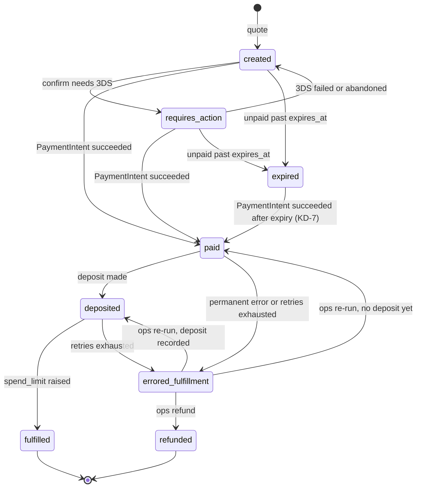

# Learner Credit Top-Ups

## Overview
Enterprise admins will be able to add funds ("top up") to an existing Learner Credit budget from the admin portal.
Introduced for **ENT-12356**. Today the **eligibility check** and the **`LearnerCreditTopUp` model** (ENT-12355, see
[below](#model-learnercredittopup)) exist. The eligibility check tells the portal which budgets may be topped up
and, when one can't, why. The quote (chunk 7) and pay (chunk 11) endpoints will be added to the same viewset and
must apply the same rules.

The rules live in one place, `enterprise_access/apps/customer_billing/api.py`:

- `evaluate_top_up_eligibility_for_policies(policies)` fetches each budget's subsidy record and evaluates it. Quote
  and pay must call this function rather than reimplementing the checks, so the portal and the backend always agree.
- `evaluate_top_up_eligibility(policy, subsidy)` applies the rules to one budget whose subsidy is already fetched.
- `is_top_up_enabled()` reads the feature flag.

Reason codes and error codes are in `customer_billing/constants.py` (`TOP_UP_INELIGIBILITY_REASONS`,
`TOP_UP_ERRORS`).

## Endpoint

`GET /api/v1/learner-credit-top-ups/eligibility/`

| Param | Required | Validation | Meaning |
|---|---|---|---|
| `enterprise_customer_uuid` | yes | UUID; also the edx-rbac context | The enterprise whose budgets are evaluated. |
| `policy_uuid` | no | UUID; must belong to the enterprise | Evaluate only this budget. |

- **Without `policy_uuid`:** returns every policy of the enterprise with `active=True`, oldest first. A retired
  policy that is still `active=True` is listed and reports `budget_not_active`, with
  `subsidy_expiration_datetime: null` (its subsidy isn't fetched).
- **With `policy_uuid`:** that budget is evaluated only if it is `active=True`; an inactive one returns 404
  `budget_not_found`, the same as a policy of another enterprise.

Ineligibility is a normal answer, not an error: it returns **200** with reasons.

```json
{
  "results": [
    {
      "policy_uuid": "7983a1ed-7a59-4bcd-9f75-c6896b628395",
      "is_eligible": false,
      "reasons": [
        {"error_code": "budget_expiring_soon", "message": "The budget expires in fewer than 14 days."}
      ],
      "subsidy_expiration_datetime": "2026-11-03T11:38:00Z"
    }
  ]
}
```

### Permissions
`customer_billing.learner_credit_top_up` is granted to the same roles as billing management:

- `CUSTOMER_BILLING_ADMIN_ROLE`: enterprise admins, for their own enterprise.
- `CUSTOMER_BILLING_OPERATOR_ROLE`: enterprise operators and provisioning admins, for every enterprise.

## Reason codes

A budget is eligible only when `reasons` is empty. Every failing rule is reported, in this order:

| `error_code` | When |
|---|---|
| `budget_not_active` | The policy is retired, the subsidy is not active (not started yet, or expired), or the subsidy answered 403/404 (see below). |
| `budget_expiring_soon` | Fewer than `TOP_UP_MIN_DAYS_BEFORE_EXPIRY` (14) days remain before the subsidy expires. Exactly 14 days still passes. An expired subsidy reports this as well as `budget_not_active`. |
| `account_not_eligible` | The account standing / agreement type check fails. Always passes today (see OQ-8). |

## Responses

| Status | Body | When |
|---|---|---|
| 200 | `{"results": [...]}` | Eligible or not, see the reason codes. |
| 400 | `{"<param>": ["Must be a valid UUID."]}` | `policy_uuid` is not a UUID, or `enterprise_customer_uuid` isn't one and the caller is an operator. |
| 401 | | Not authenticated. Checked before the feature flag. |
| 403 | `{"detail": "You do not have permission to perform this action."}` | No permission for `enterprise_customer_uuid`, including when it is missing, or malformed for an enterprise admin. |
| 404 | `{"detail": "Not found."}` | The feature flag is off, for every role. |
| 404 | `{"error_code": "budget_not_found", "detail": "Budget <policy_uuid> was not found for enterprise <uuid>."}` | `policy_uuid` doesn't exist or belongs to another enterprise. |
| 404 | `{"error_code": "no_budgets_found", "detail": "No active budgets were found for enterprise with UUID <uuid>."}` | The enterprise has no active budgets. Operators can query any enterprise, so this is also what a mistyped `enterprise_customer_uuid` returns for them. |
| 503 | `{"detail": "Could not verify subsidies with the Subsidy API. Please try again later."}` | enterprise-subsidy is failing (see below). Generic `SubsidyAPIUnavailableException` body; upstream details never reach the client. |

## One unreachable subsidy vs. an outage

Each budget's subsidy is read with `policy.subsidy_record(raise_on_error=True)`, following
`docs/architecture-patterns.md` §18 and the same shape as `get_policies_accepting_requests()`:

| enterprise-subsidy answers | Result |
|---|---|
| 403 or 404 on one attempt | That subsidy is fetched again, up to `TOP_UP_MAX_SUBSIDY_FETCH_ATTEMPTS` (3) attempts in all. The rows below apply once every attempt has failed; a success on a retry is used normally. Other failures are not retried. |
| 403 or 404 for **some** subsidies | Only those budgets report `budget_not_active`; the rest are evaluated normally (200). A soft-deleted subsidy answers 403, not 404. |
| 403 or 404 for **every** fetched subsidy | 503. That looks the same as our own credentials losing their role, so it is treated as an outage rather than reported as "nothing active". Inactive or retired budgets are already `budget_not_active`, so their subsidy isn't fetched and doesn't count: an enterprise whose budgets are all retired gets 200, not 503. |
| 403 or 404 for an explicitly requested `policy_uuid` | 200 with `budget_not_active`, since a deleted subsidy would otherwise return a 503 forever. |
| 5xx, connection error or timeout | 503, even if other budgets are healthy. |

Never report a failed lookup as an inactive budget in any other case: during an outage every budget would look
inactive. `subsidy_record()` without `raise_on_error` swallows HTTP errors into `{}`, which is why it isn't used.

## Feature flag

`FEATURE_TOP_UP_LEARNER_CREDIT`, a Django setting read on every request by `is_top_up_enabled()`. The URL is always
registered; when the setting is off every role gets a 404.

| Where | Value |
|---|---|
| `settings/base.py` | `False` (the default for every environment) |
| `settings/devstack.py` | `True` |
| Stage / prod | Set in edx-internal. Must stay `False` until chunk 19 (see below). |

Changing it needs a config change and a deploy, so turning it off again is not instant. Tests use
`@override_settings(FEATURE_TOP_UP_LEARNER_CREDIT=True)`.

## Open decisions

- **KD-6: global vs. per-enterprise flag.** Today the flag is a single global setting fixed at deploy time.
  `is_top_up_enabled()` is the only place it is read, so a per-enterprise version would change only that function
  and its callers.
- **OQ-8: account standing source.** There is no account-standing data source yet, so `account_not_eligible` is
  never reported (`is_account_in_good_standing()` always returns True). Chunk 19 replaces it.
- **Until both are settled, the flag is the only production safeguard:** it must stay off in stage and prod until
  chunk 19.
- **Pay permission (before chunk 11):** `customer_billing.learner_credit_top_up` will also cover pay, and it is
  granted to provisioning admins through `CUSTOMER_BILLING_OPERATOR_ROLE`. Whether pay needs a narrower permission
  is undecided.

## Model: `LearnerCreditTopUp`

Introduced for **ENT-12355** (impl-plan chunk 5), in `customer_billing/models.py`. One row per top-up, from quote to
fulfillment: the audit record of every self-service deposit (who started it, how much, when, which payment, what
discount). Rows must never be deleted (S-01): nothing enforces that beyond `PROTECT` on the policy, so don't add code
that deletes them. `history` (simple-history) keeps every change. Nothing creates or moves a top-up yet: the quote,
pay, webhook, deposit, spend-limit and ops chunks do that.

- **`uuid`** is the primary key and the source of both idempotency keys (`lc-top-up-<uuid>`, for the PaymentIntent
  and the deposit) and of the transaction ID shown to the admin.
- **`subsidy_access_policy`** is `PROTECT`: a budget with a top-up can't be hard-deleted. `SubsidyAccessPolicy.delete()`
  is a soft delete and is unaffected, but a queryset `.delete()`, or any fixture or script that hard-deletes
  policies, raises `ProtectedError` once a top-up exists.
- **`enterprise_customer_uuid` and `subsidy_uuid`** are copied from the policy when not given; when given they must
  match it. Like every quote field (below), they are checked only when the top-up is created: they are copies taken
  at that moment, and a policy changed later must not stop a paid top-up from being fulfilled.
- **`initiated_by`** is `SET_NULL`. `initiated_by_lms_user_id` is copied from it and kept after the user is retired,
  so the model and its history table are annotated `.. pii_retirement: retained` (the history table's annotation is
  in `.annotation_safe_list.yml`).
- **`stripe_payment_intent_id`** is unique and nullable: one PaymentIntent per top-up, and any number of unpaid
  quotes with none.
- **`expires_at`** defaults to now + `LEARNER_CREDIT_TOP_UP_QUOTE_MINUTES` (30).
- **Indexes:** `enterprise_customer_uuid`, `subsidy_uuid`, `state`, `stripe_customer_id`, and
  `(subsidy_access_policy, state)` for the Pending Credits and billing-history queries.

### Quote fields and amounts

`LearnerCreditTopUp.QUOTE_FIELDS` are fixed when the quote is created: the policy, enterprise and subsidy, the
initiating admin, the amounts and discount, the currency, `sales_quote_number` and `stripe_customer_id`. They are what
the admin accepted, and the charge and the deposit are made from them.

All amounts are integer USD cents. `clean()` checks them when the top-up is created and raises `ValidationError`
without writing anything when one fails:

| Rule | Why |
|---|---|
| `amount_cents`, `discount_cents` and `charge_amount_cents` are `int`s. A `Decimal` or `float` is rejected, not rounded, even with no fractional part (`Decimal('100')`, `100.0`). | Django truncates a fractional value only when it saves it, after the checks below had passed on the untruncated one. A quote of 50,001 with a discount of 6,170.1234 and a charge of 43,830.8766 would be stored as 50,001 − 6,170 ≠ 43,830. |
| `LEARNER_CREDIT_TOP_UP_MIN_AMOUNT_CENTS` (50,000) ≤ `amount_cents` ≤ `LEARNER_CREDIT_TOP_UP_MAX_AMOUNT_CENTS` (2,000,000) | The allowed top-up range (R-02). |
| `charge_amount_cents == amount_cents − discount_cents`, counting `NULL` as 0 | The card is charged the discounted price; the budget is credited the full `amount_cents` (OQ-7). |
| `discount_cents` is `NULL` exactly when `discount_rate` is `NULL` | `NULL` means no discount is on record; `0` is a real 0% rate and never stands in for `NULL` (RK-05). |
| 0 ≤ `discount_rate` < 1 and 0 ≤ `discount_cents` < `amount_cents` | The card is charged something, and never more than the credit. |

They aren't re-checked on later saves, since the fields can't change. Re-checking them would leave a paid top-up unable
to move if, for example, the allowed range were narrowed after it was paid. Not checked: that `discount_cents` equals
`amount_cents × discount_rate`, which needs a rounding rule (impl-plan Open Items 17).

### Saving

- **A new top-up** is checked by `clean()`.
- **An existing top-up** must be saved with `update_fields`, which may not name `state`, a state timestamp or a quote
  field; `save()` raises `ValueError` otherwise and adds `modified` itself. A full `save()` of a copy loaded before
  another request moved the top-up would write its old state back.
- **Saving an existing top-up reloads it** with `select_for_update()` inside `transaction.atomic()`, then applies only
  the `update_fields` values. simple-history records the whole instance, so without the reload a stale copy, or one
  with unsaved edits to other fields, would add a history record that doesn't match the row. Unsaved changes to
  fields not in `update_fields` are discarded.
- `save()` calls `clean()`, not `full_clean()`. `full_clean()` would report a reused `stripe_payment_intent_id` as a
  `ValidationError` instead of letting the unique index raise `IntegrityError`, and it would reject the nullable
  columns that aren't `blank=True`. As a result, field choices (`currency`, `payment_method_type`) aren't validated.
- Queryset `.update()` and `.delete()` bypass all of this. Don't use them on this table.

## States

`LearnerCreditTopUpState` and `ALLOWED_LEARNER_CREDIT_TOP_UP_STATE_TRANSITIONS` are in `customer_billing/constants.py`.
These are the Phase 1 (card) states; Phase 2 adds `processing` and `payment_failed`.



- **`expired → paid`:** a 3DS challenge finished after the quote expired still charges the card, and money taken
  must always be credited (spec KD-7).
- **`fulfilled` is reachable only from `deposited`,** so the spend limit is raised at most once. The ops re-run goes
  back to `paid` or `deposited` and takes the normal path, rather than jumping from `errored_fulfillment` straight to
  `fulfilled` as the spec's diagram shows (impl-plan Open Items 16).
- `fulfilled` and `refunded` are final.

### `transition_to(new_state, **fields)`

The only way `state` changes (see Saving).

- **Checks the stored state.** Inside `transaction.atomic()`, it reloads the top-up with `select_for_update()`, then
  checks the change against the stored state rather than the copy it was called on. A copy loaded before another
  request or task moved the top-up can't undo or repeat that change, and concurrent calls for one top-up run one at a
  time. Reloading discards unsaved changes to the instance: pass them as `fields`.
- **Returns `True` if this call changed the state.** Moving to the current state returns `False` and does nothing:
  no write, no history record, and `fields` are **not** saved (a warning is logged if they differ from the stored
  values). Code that must act once per change (queue the fulfillment, send an event) should act only on `True`.
  Called inside the caller's own `transaction.atomic()`, the lock is held until that block commits, so the spend-limit
  step can lock the policy, call `transition_to(FULFILLED, ...)` and raise `spend_limit` only if it returned `True`.
- Raises `InvalidLearnerCreditTopUpTransition` for a change the table doesn't allow. It isn't a `ValueError`, so a
  generic `except ValueError` won't swallow it. An unknown state, or `fields` naming `state`, a state timestamp or a
  quote field, raises `ValueError`.
- Saves the state, `fields` and the state's timestamp in one write, so one history record is added per change, and
  that record holds the stored values plus the change.
- Sets `paid_at`, `deposited_at` or `fulfilled_at` on the change into `paid`, `deposited` or `fulfilled`, unless it is
  already set: an ops re-run keeps the first timestamp, which `fulfilled_at − paid_at` and the stuck-top-up alert read.
- Whenever it raises, including when the save itself fails (a unique-index violation, a `post_save` receiver),
  nothing is written and the instance holds the stored values.
- **Not checked here:** the data each state needs, for example a `deposit_uuid` before `deposited`, or none before an
  ops re-run goes back to `paid`. The deposit (chunk 8) and ops re-run (chunk 10) steps must check it.
- On SQLite, used by the tests, `select_for_update()` does nothing. The tests prove the stored-state checks, not the
  lock.
