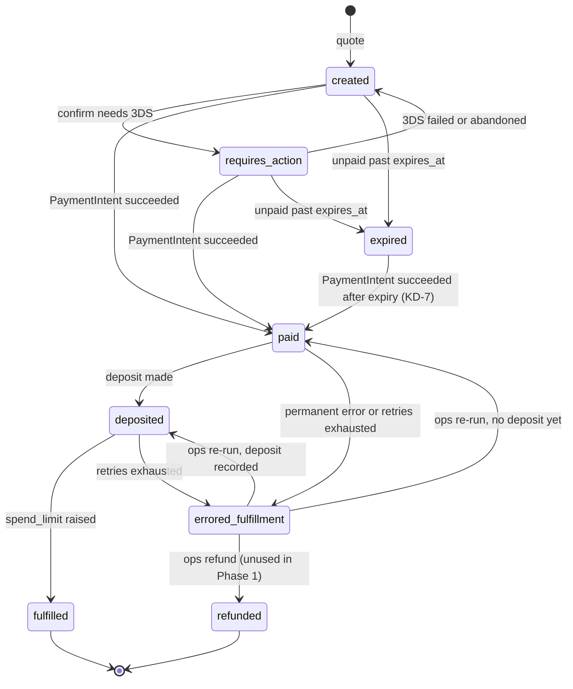

# Learner Credit Top-Ups

## Overview
Enterprise admins will be able to add funds ("top up") to an existing Learner Credit budget from the admin portal.
Introduced for **ENT-12356**. Today the **eligibility check** and the **`LearnerCreditTopUp` model** (ENT-12355, see
[below](#model-learnercredittopup)) exist. The eligibility check tells the portal which budgets may be topped up
and, when one can't, why. The quote (chunk 7) and pay (chunk 11) endpoints will be added to the same viewset and
must apply the same rules.

The rules live in one place, `enterprise_access/apps/customer_billing/api.py`:

- `evaluate_top_up_eligibility_for_policies(policies)` fetches each budget's subsidy record and evaluates it. Quote
  and pay must call this function rather than reimplementing the checks, so the portal and the backend always agree.
- `evaluate_top_up_eligibility(policy, subsidy)` applies the rules to one budget whose subsidy is already fetched.
- `is_top_up_enabled()` reads the feature flag.

Reason codes and error codes are in `customer_billing/constants.py` (`TOP_UP_INELIGIBILITY_REASONS`,
`TOP_UP_ERRORS`).

## Endpoint

`GET /api/v1/learner-credit-top-ups/eligibility/`

| Param | Required | Validation | Meaning |
|---|---|---|---|
| `enterprise_customer_uuid` | yes | UUID; also the edx-rbac context | The enterprise whose budgets are evaluated. |
| `policy_uuid` | no | UUID; must belong to the enterprise | Evaluate only this budget. |

- **Without `policy_uuid`:** returns every policy of the enterprise with `active=True`, oldest first. A retired
  policy that is still `active=True` is listed and reports `budget_not_active`, with
  `subsidy_expiration_datetime: null` (its subsidy isn't fetched).
- **With `policy_uuid`:** that budget is evaluated only if it is `active=True`; an inactive one returns 404
  `budget_not_found`, the same as a policy of another enterprise.

Ineligibility is a normal answer, not an error: it returns **200** with reasons.

```json
{
  "results": [
    {
      "policy_uuid": "7983a1ed-7a59-4bcd-9f75-c6896b628395",
      "is_eligible": false,
      "reasons": [
        {"error_code": "budget_expiring_soon", "message": "The budget expires in fewer than 14 days."}
      ],
      "subsidy_expiration_datetime": "2026-11-03T11:38:00Z"
    }
  ]
}
```

### Permissions
`customer_billing.learner_credit_top_up` is granted to the same roles as billing management:

- `CUSTOMER_BILLING_ADMIN_ROLE`: enterprise admins, for their own enterprise.
- `CUSTOMER_BILLING_OPERATOR_ROLE`: enterprise operators and provisioning admins, for every enterprise.

## Reason codes

A budget is eligible only when `reasons` is empty. Every failing rule is reported, in this order:

| `error_code` | When |
|---|---|
| `budget_not_active` | The policy is retired, the subsidy is not active (not started yet, or expired), or the subsidy answered 403/404 (see below). |
| `budget_expiring_soon` | Fewer than `TOP_UP_MIN_DAYS_BEFORE_EXPIRY` (14) days remain before the subsidy expires. Exactly 14 days still passes. An expired subsidy reports this as well as `budget_not_active`. |
| `account_not_eligible` | The account standing / agreement type check fails. Always passes today (see OQ-8). |

## Responses

| Status | Body | When |
|---|---|---|
| 200 | `{"results": [...]}` | Eligible or not, see the reason codes. |
| 400 | `{"<param>": ["Must be a valid UUID."]}` | `policy_uuid` is not a UUID, or `enterprise_customer_uuid` isn't one and the caller is an operator. |
| 401 | | Not authenticated. Checked before the feature flag. |
| 403 | `{"detail": "You do not have permission to perform this action."}` | No permission for `enterprise_customer_uuid`, including when it is missing, or malformed for an enterprise admin. |
| 404 | `{"detail": "Not found."}` | The feature flag is off, for every role. |
| 404 | `{"error_code": "budget_not_found", "detail": "Budget <policy_uuid> was not found for enterprise <uuid>."}` | `policy_uuid` doesn't exist or belongs to another enterprise. |
| 404 | `{"error_code": "no_budgets_found", "detail": "No active budgets were found for enterprise with UUID <uuid>."}` | The enterprise has no active budgets. Operators can query any enterprise, so this is also what a mistyped `enterprise_customer_uuid` returns for them. |
| 503 | `{"detail": "Could not verify subsidies with the Subsidy API. Please try again later."}` | enterprise-subsidy is failing (see below). Generic `SubsidyAPIUnavailableException` body; upstream details never reach the client. |

## One unreachable subsidy vs. an outage

Each budget's subsidy is read with `policy.subsidy_record(raise_on_error=True)`, following
`docs/architecture-patterns.md` §18 and the same shape as `get_policies_accepting_requests()`:

| enterprise-subsidy answers | Result |
|---|---|
| 403 or 404 on one attempt | That subsidy is fetched again, up to `TOP_UP_MAX_SUBSIDY_FETCH_ATTEMPTS` (3) attempts in all. The rows below apply once every attempt has failed; a success on a retry is used normally. Other failures are not retried. |
| 403 or 404 for **some** subsidies | Only those budgets report `budget_not_active`; the rest are evaluated normally (200). A soft-deleted subsidy answers 403, not 404. |
| 403 or 404 for **every** fetched subsidy | 503. That looks the same as our own credentials losing their role, so it is treated as an outage rather than reported as "nothing active". Inactive or retired budgets are already `budget_not_active`, so their subsidy isn't fetched and doesn't count: an enterprise whose budgets are all retired gets 200, not 503. |
| 403 or 404 for an explicitly requested `policy_uuid` | 200 with `budget_not_active`, since a deleted subsidy would otherwise return a 503 forever. |
| 5xx, connection error or timeout | 503, even if other budgets are healthy. |

Never report a failed lookup as an inactive budget in any other case: during an outage every budget would look
inactive. `subsidy_record()` without `raise_on_error` swallows HTTP errors into `{}`, which is why it isn't used.

## Feature flag

`FEATURE_TOP_UP_LEARNER_CREDIT`, a Django setting read on every request by `is_top_up_enabled()`. The URL is always
registered; when the setting is off every role gets a 404.

| Where | Value |
|---|---|
| `settings/base.py` | `False` (the default for every environment) |
| `settings/devstack.py` | `True` |
| Stage / prod | Set in edx-internal. Must stay `False` until chunk 19 (see below). |

Changing it needs a config change and a deploy, so turning it off again is not instant. Tests use
`@override_settings(FEATURE_TOP_UP_LEARNER_CREDIT=True)`.

## Open decisions

- **KD-6: global vs. per-enterprise flag.** Today the flag is a single global setting fixed at deploy time.
  `is_top_up_enabled()` is the only place it is read, so a per-enterprise version would change only that function
  and its callers.
- **OQ-8: account standing source.** There is no account-standing data source yet, so `account_not_eligible` is
  never reported (`is_account_in_good_standing()` always returns True). Chunk 19 replaces it.
- **Until both are settled, the flag is the only production safeguard:** it must stay off in stage and prod until
  chunk 19.
- **Pay permission (before chunk 11):** `customer_billing.learner_credit_top_up` will also cover pay, and it is
  granted to provisioning admins through `CUSTOMER_BILLING_OPERATOR_ROLE`. Whether pay needs a narrower permission
  is undecided.

## Model: `LearnerCreditTopUp`

Introduced for **ENT-12355** (impl-plan chunk 5), in `customer_billing/models.py`. One row per top-up, from quote to
fulfillment: the audit record of every self-service deposit (who started it, how much, when, which payment, what
discount). Rows must never be deleted (S-01): nothing enforces that beyond `PROTECT` on the policy, so don't add code
that deletes them. `history` (simple-history) keeps every change. So far only fulfillment moves a top-up: the
deposit and spend-limit steps, the fulfillment task that runs them, and the re-run command (see
[Fulfillment](#fulfillment-task-and-re-runs)). Nothing queues the task in production yet: the quote, pay and webhook
chunks create top-ups and hand them over to it.

- **`uuid`** is the primary key and the source of both idempotency keys (`lc-top-up-<uuid>`, for the PaymentIntent
  and the deposit) and of the transaction ID shown to the admin.
- **`subsidy_access_policy`** is `PROTECT`: a budget with a top-up can't be hard-deleted. `SubsidyAccessPolicy.delete()`
  is a soft delete and is unaffected, but a queryset `.delete()`, or any fixture or script that hard-deletes
  policies, raises `ProtectedError` once a top-up exists.
- **`enterprise_customer_uuid` and `subsidy_uuid`** are copied from the policy when not given; when given they must
  match it. Like every quote field (below), they are checked only when the top-up is created: they are copies taken
  at that moment, and a policy changed later must not stop a paid top-up from being fulfilled.
- **`initiated_by`** is `SET_NULL`. `initiated_by_lms_user_id` is copied from it and kept after the user is retired,
  so the model and its history table are annotated `.. pii_retirement: retained` (the history table's annotation is
  in `.annotation_safe_list.yml`).
- **`stripe_payment_intent_id`** is unique and nullable: one PaymentIntent per top-up, and any number of unpaid
  quotes with none.
- **`expires_at`** defaults to now + `LEARNER_CREDIT_TOP_UP_QUOTE_MINUTES` (30).
- **Indexes:** `enterprise_customer_uuid`, `subsidy_uuid`, `state`, `stripe_customer_id`, and
  `(subsidy_access_policy, state)` for the Pending Credits and billing-history queries.

### Quote fields and amounts

`LearnerCreditTopUp.QUOTE_FIELDS` are fixed when the quote is created: the policy, enterprise and subsidy, the
initiating admin, the amounts and discount, the currency, `sales_quote_number` and `stripe_customer_id`. They are what
the admin accepted, and the charge and the deposit are made from them.

All amounts are integer USD cents. `clean()` checks them when the top-up is created and raises `ValidationError`
without writing anything when one fails:

| Rule | Why |
|---|---|
| `amount_cents`, `discount_cents` and `charge_amount_cents` are `int`s. A `Decimal` or `float` is rejected, not rounded, even with no fractional part (`Decimal('100')`, `100.0`). | Django truncates a fractional value only when it saves it, after the checks below had passed on the untruncated one. A quote of 50,001 with a discount of 6,170.1234 and a charge of 43,830.8766 would be stored as 50,001 − 6,170 ≠ 43,830. |
| `LEARNER_CREDIT_TOP_UP_MIN_AMOUNT_CENTS` (50,000) ≤ `amount_cents` ≤ `LEARNER_CREDIT_TOP_UP_MAX_AMOUNT_CENTS` (2,000,000) | The allowed top-up range (R-02). |
| `charge_amount_cents == amount_cents − discount_cents`, counting `NULL` as 0 | The card is charged the discounted price; the budget is credited the full `amount_cents` (OQ-7). |
| `discount_cents` is `NULL` exactly when `discount_rate` is `NULL` | `NULL` means no discount is on record; `0` is a real 0% rate and never stands in for `NULL` (RK-05). |
| 0 ≤ `discount_rate` < 1 and 0 ≤ `discount_cents` < `amount_cents` | The card is charged something, and never more than the credit. |

They aren't re-checked on later saves, since the fields can't change. Re-checking them would leave a paid top-up unable
to move if, for example, the allowed range were narrowed after it was paid. Not checked: that `discount_cents` equals
`amount_cents × discount_rate`, which needs a rounding rule (impl-plan Open Items 17).

### Saving

- **A new top-up** is checked by `clean()`. It must start in `created`, with `paid_at`, `deposited_at` and
  `fulfilled_at` empty: every later state is reached through `transition_to()`, so a row can't be inserted already
  `deposited` or `fulfilled`, skipping the payment and deposit. In tests, `LearnerCreditTopUpFactory(state=...)`
  creates the quote and then moves it to that state directly in the database, writing no history record.
- **An existing top-up** must be saved with `update_fields`, which may not name `state`, a state timestamp or a quote
  field; `save()` raises `ValueError` otherwise and adds `modified` itself. A full `save()` of a copy loaded before
  another request moved the top-up would write its old state back.
- **Saving an existing top-up reloads it** with `select_for_update()` inside `transaction.atomic()`, then applies only
  the `update_fields` values. simple-history records the whole instance, so without the reload a stale copy, or one
  with unsaved edits to other fields, would add a history record that doesn't match the row. Unsaved changes to
  fields not in `update_fields` are discarded.
- `save()` calls `clean()`, not `full_clean()`. `full_clean()` would report a reused `stripe_payment_intent_id` as a
  `ValidationError` instead of letting the unique index raise `IntegrityError`, and it would reject the nullable
  columns that aren't `blank=True`. As a result, field choices (`currency`, `payment_method_type`) aren't validated.
- Queryset `.update()` and `.delete()` bypass all of this. Don't use them on this table.

## States

`LearnerCreditTopUpState` and `ALLOWED_LEARNER_CREDIT_TOP_UP_STATE_TRANSITIONS` are in `customer_billing/constants.py`.
These are the Phase 1 (card) states; Phase 2 adds `processing` and `payment_failed`.



- **`expired → paid`:** a 3DS challenge finished after the quote expired still charges the card, and money taken
  must always be credited (spec KD-7).
- **`fulfilled` is reachable only from `deposited`,** so the spend limit is raised at most once. The ops re-run goes
  back to `paid` or `deposited` and takes the normal path, rather than jumping from `errored_fulfillment` straight to
  `fulfilled` as the spec's diagram shows (impl-plan Open Items 16).
- `fulfilled` and `refunded` are final. `refunded` is unused in Phase 1: there are no refunds in v1, so a top-up that
  can't be credited stays in `errored_fulfillment` until ops fix the cause and re-run it (Eng Lead, 2026-11-02).

### `transition_to(new_state, **fields)`

The only way `state` changes (see Saving).

- **Checks the stored state.** Inside `transaction.atomic()`, it reloads the top-up with `select_for_update()`, then
  checks the change against the stored state rather than the copy it was called on. A copy loaded before another
  request or task moved the top-up can't undo or repeat that change, and concurrent calls for one top-up run one at a
  time. Reloading discards unsaved changes to the instance: pass them as `fields`.
- **Returns `True` if this call changed the state.** Moving to the current state returns `False` and does nothing:
  no write, no history record, and `fields` are **not** saved (a warning is logged if they differ from the stored
  values). Code that must act once per change (queue the fulfillment, send an event) should act only on `True`.
  Called inside the caller's own `transaction.atomic()`, the lock is held until that block commits, so the spend-limit
  step can lock the policy, call `transition_to(FULFILLED, ...)` and raise `spend_limit` only if it returned `True`.
- Raises `InvalidLearnerCreditTopUpTransition` for a change the table doesn't allow. It isn't a `ValueError`, so a
  generic `except ValueError` won't swallow it. An unknown state, or `fields` naming `state`, a state timestamp or a
  quote field, raises `ValueError`.
- Saves the state, `fields` and the state's timestamp in one write, so one history record is added per change, and
  that record holds the stored values plus the change.
- Sets `paid_at`, `deposited_at` or `fulfilled_at` on the change into `paid`, `deposited` or `fulfilled`, unless it is
  already set: an ops re-run keeps the first timestamp, which `fulfilled_at − paid_at` and the stuck-top-up alert read.
- Whenever it raises, including when the save itself fails (a unique-index violation, a `post_save` receiver),
  nothing is written and the instance holds the stored values.
- **Not checked here:** the data each state needs, for example a `deposit_uuid` before `deposited`, or none before an
  ops re-run goes back to `paid`. The deposit step records `deposit_uuid` on the move to `deposited`, and the re-run
  command picks `deposited` or `paid` from it.
- On SQLite, used by the tests, `select_for_update()` does nothing. The tests prove the stored-state checks, not the
  lock.

## Spend-limit step (`deposited → fulfilled`)

Introduced for **ENT-12512** (impl-plan chunk 9) as `fulfill_spend_limit_step(top_up)` in
`customer_billing/top_up_fulfillment.py`. It makes deposited funds spendable: it raises the budget's `spend_limit` by
`amount_cents`, once, and moves the top-up to `fulfilled`. The fulfillment task calls it, after the deposit step. It
follows the spec's Fulfillment rule 3 and TR-5.

| Outcome | Returns / raises | Top-up and budget afterwards |
|---|---|---|
| Fulfilled | `True` | `fulfilled`, `fulfilled_at` set. `spend_limit` raised by `amount_cents`, and `spend_limit_before` / `spend_limit_after` recorded. A budget with no spend limit is left without one, and both fields stay `NULL`. |
| Not `deposited` (already fulfilled, not deposited yet, errored, ...) | `False` | Unchanged. The subsidy isn't read. |
| The subsidy read fails: any HTTP error, a connection error or a timeout | `RetryableFulfillmentError` | Unchanged (`deposited`). |
| The raised `spend_limit` fails the policy's validation, and the subsidy's `total_deposits` is unchanged when read again | `NonRetryableFulfillmentError` | Unchanged (`deposited`). A retry would fail the same way. |
| The raised `spend_limit` fails the policy's validation, but `total_deposits` has grown when read again (another top-up of the subsidy was deposited and fulfilled during this run), or that read fails | `RetryableFulfillmentError` | Unchanged (`deposited`). A later run reads the new deposits and may succeed. |

Both errors subclass `LearnerCreditTopUpFulfillmentError` and chain the original exception as `__cause__`. Moving a
failed top-up to `errored_fulfillment`, and recording whether the error is retryable, is the caller's job (the
fulfillment task, below).
Database errors, such as a lock wait timeout, are not wrapped.

How it works:

1. **State check, before any network call.** The top-up is reloaded (unsaved changes to the instance are discarded),
   and the step returns `False` unless it is `deposited`.
2. **Fresh subsidy read, outside any transaction.** `policy.clear_cached_subsidy_record()`, then
   `policy.subsidy_record(raise_on_error=True)`. Clearing is required: `subsidy_record()` returns a request-cached
   record even with `raise_on_error=True`, and a record cached by the eligibility check earlier in the request, or by
   an earlier task in the same worker, predates the deposit. With it, the raise would exceed `total_deposits` and fail
   validation (TR-2). The request cache is keyed by enterprise and subsidy, so clearing it for one policy clears it for
   every policy of that subsidy.
3. **One `transaction.atomic()` block, no network calls.** It locks the policy row, **then** the top-up row
   (`select_for_update()`, always in this order, TR-5), and checks the state again under the lock. A run overtaken by
   another run during its read returns `False` here. It then raises and saves `spend_limit`, and calls
   `transition_to(FULFILLED, spend_limit_before=..., spend_limit_after=...)`. `policy.save()` runs `full_clean()`, and
   so `clean_spend_limit()`, which reads the record cached in step 2. The policy's history record has the change reason
   `Learner credit top-up <uuid>`.
4. **On a validation failure, read the subsidy again, after the block.** `clean_spend_limit()` compares the spend
   limits of the subsidy's policies, read under the lock, with the `total_deposits` read in step 2. If another top-up
   of the same subsidy was deposited and fulfilled in between, the spend limits include its raise but the deposits
   read don't include its deposit, so validation fails although a run with a fresh read would pass. The block has
   rolled back by then, so the second read holds no lock. If `total_deposits` grew, or the read fails, the error is
   retryable; otherwise it isn't.

Call the step outside any transaction. Inside one, its block is a savepoint, and InnoDB keeps the row locks after a
savepoint rolls back until the outer transaction ends, so the read in step 4 would run under them.

Testing notes:

- Scenario 4 (no network call inside the block) is a `TransactionTestCase`, because under `TestCase`
  `connection.in_atomic_block` is always `True`. It also checks that `subsidy_record()` *is* read inside the block,
  from the cache.
- SQLite ignores `select_for_update()`, so the lock order is tested by recording the models `select_for_update()` is
  called on. Races are tested with copies loaded before either writes, and with a run that another run overtakes from
  inside the mocked subsidy read.
- The step-4 race is simulated from inside the first mocked subsidy read: it raises the stored spend limit (the other
  top-up's raise) and makes the next read return the other deposit too. The `TransactionTestCase` also checks that
  the second read happens outside the block.

## Deposit step (`paid → deposited`)

`fulfill_deposit_step(top_up)` in `customer_billing/top_up_fulfillment.py`. Added for **ENT-12513** so the fulfillment
task works end to end; impl-plan chunk 8 owns it and still has to add the 30-second `SUBSIDY_CLIENT_TIMEOUT` on the
call (spec G-14) and decide whether the admin's LMS user ID goes in the metadata (G-25).

- Runs only from `paid` (stored state), so a `deposited` top-up sends no deposit.
- Calls enterprise-subsidy's deposit endpoint with `desired_deposit_quantity = amount_cents`, the PaymentIntent as
  the reference (provider `stripe_payment_intent`), the metadata of the spec's Fulfillment rule 5 except the LMS user
  ID, and **idempotency key `lc-top-up-<uuid>`**: a repeated key gets the deposit already made (spec KD-5), so a retry
  after a lost answer never deposits twice.
- Records `deposit_uuid` and `ledger_transaction_uuid` on `transition_to(DEPOSITED, ...)`. If another run fulfilled
  the top-up meanwhile, it records nothing and returns `False`.
- 400, 403, 404, 409 or 422 → `NonRetryableFulfillmentError`; any other HTTP error (429, 5xx), a connection error or
  a timeout → `RetryableFulfillmentError`. The message holds the status and the start of the response body.

## Fulfillment task and re-runs

Introduced for **ENT-12513** (impl-plan chunk 10; spec Fulfillment rules 3 and 6, Recovery jobs).

### `fulfill_learner_credit_top_up_task(top_up_uuid)`

In `customer_billing/tasks.py`. Takes only the top-up's UUID and re-reads the row, so a duplicate or late task does
nothing.

1. Clears the request cache (`RequestCache.clear_all_namespaces()`): nothing clears it between tasks in a worker,
   so a subsidy record cached by an earlier task would predate this deposit.
2. From `paid`: the deposit step, then the spend-limit step. From `deposited`: the spend-limit step only. Any other
   state (or an unknown UUID): logs and returns.
3. Ignores `FEATURE_TOP_UP_LEARNER_CREDIT`: money already taken must be credited.

| Failure | What happens |
|---|---|
| `NonRetryableFulfillmentError` (deposit 400/403/404/409/422, or a spend-limit validation failure with a fresh record) | Caught by the task: `errored_fulfillment`, `last_error_retryable=False`, `last_error` set. Not retried. |
| `RetryableFulfillmentError`, `requests` HTTP/connection/timeout errors, DB `OperationalError`, `SoftTimeLimitExceeded` | Retried with `LoggedTaskWithRetry`'s settings: 5 retries, backoff from 60 s, doubling, capped at 10 min, full jitter (about 25 min in all). The first attempt runs as soon as it is queued. |
| Retries run out on one of those | `on_failure`: `errored_fulfillment`, `last_error_retryable=True`. The re-run job resumes it. |
| Anything else (a bug) | Not retried. `on_failure`: `errored_fulfillment`, `last_error_retryable=False`. |
| The top-up moved on meanwhile (a duplicate task fulfilled it) | `on_failure` leaves it as it is. |
| Recording the failure fails too | Logged; the top-up stays in `paid` / `deposited`, and the re-run job queues it again after 45 minutes. |

`LoggedTaskWithRetry` has no failure hook of its own, so the task's base class, `LearnerCreditTopUpFulfillmentTask`,
adds `on_failure` (spec G-14). The task runs on the default queue: a dedicated queue is still Proposed.

### Fields

| Field | Meaning |
|---|---|
| `last_error_retryable` | Whether the error that moved the top-up to `errored_fulfillment` may pass on a later run. `NULL` until fulfillment first fails. `last_error` is free text, so the job can't tell the kinds apart from it. |
| `automatic_rerun_count` | How many times the scheduled job has resumed the top-up. Manual runs don't count. |

Neither is reset when a top-up is resumed or fulfilled: they describe its last error.

### `rerun_learner_credit_top_ups`

In `customer_billing/management/commands/`. Scheduled every 30 minutes by an edx-internal CronJob next to
`mark_stalled_checkout_intents` (not added yet). Ignores the feature flag.

| Selected | Action |
|---|---|
| `errored_fulfillment`, `last_error_retryable=True`, `automatic_rerun_count < 3` | Resume at `deposited` if `deposit_uuid` is set, otherwise `paid`; `automatic_rerun_count + 1`; queue the task once the change commits. |
| `paid` or `deposited`, `modified` 45 minutes ago or more (e.g. a lost Celery message) | Queue the task again. No state change. |
| `errored_fulfillment` and not retryable (`False` or `NULL`), or 3 automatic re-runs | Never, automatically: ops fix the cause and re-run by hand. |

- **Two runs at once resume a top-up once.** Each resume locks the row and re-checks the selection under the lock,
  then changes state through `transition_to()` and queues only when it returns `True`. A top-up that another run
  resumed, or that its task has since moved on, is skipped, so `transition_to()` never sees a disallowed change and
  `InvalidLearnerCreditTopUpTransition` can't escape (spec G-40). The 45-minute re-queue changes no state, so two runs
  at once can queue that task twice; the second does nothing.
- Resumes run before the stalled query, which reads `modified`, so a top-up just resumed isn't queued twice.
- 45 minutes is longer than the task's own retries, so a task still retrying isn't doubled. The thresholds are
  `LEARNER_CREDIT_TOP_UP_MAX_AUTOMATIC_RERUNS` and `LEARNER_CREDIT_TOP_UP_STALLED_MINUTES` in `constants.py`.
- A broker error after a resume commits leaves the top-up in `paid` / `deposited` with no task; the next run queues
  it once 45 minutes have passed.

### Runbook: manual re-run

```bash
./manage.py rerun_learner_credit_top_ups --top-up-uuid <uuid> --dry-run   # what it would do
./manage.py rerun_learner_credit_top_ups --top-up-uuid <uuid> [--top-up-uuid <uuid> ...]
```

- An `errored_fulfillment` top-up resumes at `deposited` or `paid` even when it isn't retryable or has reached the
  cap; its count doesn't change. A `paid` or `deposited` one is queued again. Any other state is left as it is
  (logged). An unknown UUID fails the command after the others have run.
- Read `last_error` first and fix the cause, or it fails the same way: for a 403, restore the operator grant or the
  subsidy; for a 404, restore the subsidy. For a 422 on an expired subsidy, extending the subsidy breaks S-02 (a
  top-up never adds time); how to handle it is open (spec G-36).
- `--dry-run` locks and reads only: it changes nothing, queues nothing, and logs and prints what it would do.

### Testing notes

- Tests run Celery eagerly, and `.apply()` runs every retry synchronously, without countdowns, then calls
  `on_failure`. A call that keeps failing is therefore made `1 + TASK_MAX_RETRIES` times.
- The backoff test patches `celery.app.autoretry.get_exponential_backoff_interval` and checks its arguments.
- The command tests run with `captureOnCommitCallbacks(execute=True)`, because a resume queues on commit
  (`docs/architecture-patterns.md` §19). The "two runs at once" test runs a second command from inside the first's
  `_resume()`, after the first has selected the top-up.
- The test mixin's mocked deposit call answers a repeated idempotency key with the deposit it already made, as
  enterprise-subsidy does, so the "never deposits twice" tests count deposits by key.
